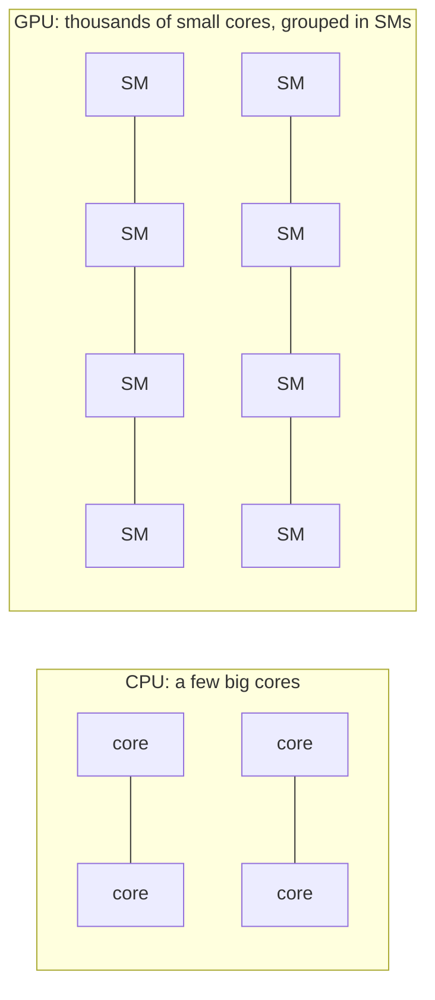
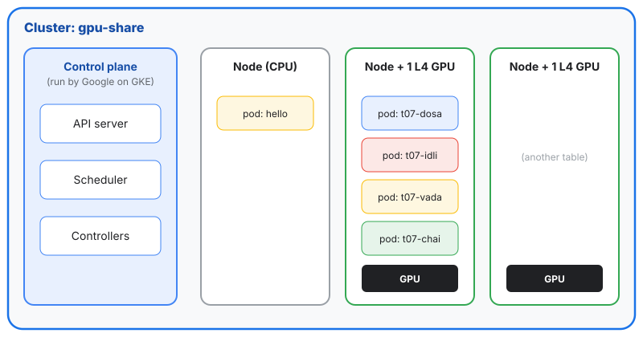

---
hide:
  - navigation
  - toc
title: "GPU sharing foundations: the main points in 10 minutes"
---

<!-- GENERATED by tools/build_codelabs.py from tools/codelabs.yml. Edit the sources, not this file. -->

# GPU sharing foundations: the main points in 10 minutes

GPU sharing foundations: the main points in 10 minutes

### About this codelab

:material-text-box-outline: Last updated Nov 21, 2026

:material-account-circle: Written by DevFest Bengaluru

:material-timer-outline: 10 min

## 1. Introduction { data-mins="1" }

Four short lessons with **only the main points** you need for the workshop. About **10 minutes**.
Already know Kubernetes and GPUs? Skip straight to the workshop.

| Lesson | The one idea |
|---|---|
| **Accelerated compute** | GPUs do thousands of maths operations at once, and they're expensive. |
| **Kubernetes basics** | Pods run on nodes; a pod asks for a GPU with `nvidia.com/gpu: 1`. |
| **Clusters and GPUs in the cloud** | GPU machines come in families; sharing is set per group of nodes. |
| **Sharing a GPU** | Time-sharing takes turns, MPS gives seats, MIG cuts the GPU into pieces. |

!!! tip "Before the day: a 2-minute check"
    Open **[shell.cloud.google.com](https://shell.cloud.google.com)**, sign in with the Google account you registered with,
    and accept the terms. A terminal with a blinking cursor means you're ready.

## 2. Accelerated compute { data-mins="2" }

AI is mostly **huge amounts of simple maths**: multiplying big grids of numbers, billions of times.

- **CPU**: a few powerful cores, one task after another. Great for everything else.
- **GPU**: thousands of small cores doing the same maths **at once**. Great for AI.
- **GPU memory** is a fixed size (24 GB on today's L4). Fill it and programs crash with **"CUDA out of memory"**.
- GPUs are **expensive**. One that sits 90% idle is a lot of wasted money, and that's what today is about.

| Word you'll see | Means |
|---|---|
| **SM** | a block of GPU cores (the L4 has 58) |
| **TFLOPS** | trillions of maths operations per second: our speedometer |

#### Quick check

  

    

Thousands of small cores doing maths at the same time.

    

<b>GPU</b>

  

  

    

What happens when GPU memory is full?

    

The next program to ask for memory crashes: <b>CUDA out of memory</b>.

  

## 3. Kubernetes basics { data-mins="3" }

**Kubernetes runs your programs on a group of machines and decides which machine each one goes on.**

  

    
    <button class="hs" style="left:4%;top:9%" data-title="Cluster" data-text="All the machines, managed together. Everyone at the workshop shares one.">1</button>
    <button class="hs" style="left:15.6%;top:52%" data-title="Scheduler" data-text="Picks <b>which node</b> each pod runs on, looking for free CPU, memory and GPU slots.">2</button>
    <button class="hs" style="left:41%;top:21%" data-title="Node" data-text="One machine. Some nodes have a GPU attached.">3</button>
    <button class="hs" style="left:63.7%;top:34.8%" data-title="Pod" data-text="One running copy of your program. Each of you works in your own <b>namespace</b> (e.g. t07-dosa).">4</button>
    <button class="hs" style="left:63.7%;top:83.8%" data-title="GPU" data-text="One physical GPU. Today, four pods share it.">5</button>
  

  

- **Node** = a machine · **Pod** = your running program · **Namespace** = your private area · **YAML** = how you describe what you want
- A pod asks for a GPU with **`nvidia.com/gpu: 1`**, and picks *which* nodes with a **`nodeSelector`** (labels on the node).

The four commands you'll use all day:

| Command | Does |
|---|---|
| `kubectl apply -f -` | create what the YAML you paste describes |
| `kubectl get pods` | list your pods and their status |
| `kubectl logs <pod>` | show what it printed (add `-f` to follow; ++ctrl+c++ to stop) |
| `kubectl delete pod <pod>` | remove it |

!!! tip "Stuck pod?"
    `kubectl describe pod <name>` and read the **Events** at the bottom. It tells you why.

#### Quick check

  
Which line in a pod's YAML asks for a GPU?

  <button data-opt="a"><code>nvidia.com/gpu: 1</code></button>
  <button data-opt="b"><code>kind: Pod</code></button>
  <button data-opt="c"><code>image: vllm/vllm-openai</code></button>
  
GPUs are requested as a whole number under <code>resources.limits</code>.

## 4. Clusters and GPUs in the cloud { data-mins="2" }

- You don't buy a GPU card; you rent a **machine that comes with GPUs**.
  - Today: **NVIDIA L4** (24 GB, good for inference) for most steps, and a big **H200 / A100** for the MIG demo.
- A **cluster** is a group of those machines running Kubernetes. A **node pool** (or group of nodes) is a set of identical machines.
- **GPU sharing is set per node pool / node, not per pod.** Your pod just picks the right node with a label.
- **Cloud Shell** ([shell.cloud.google.com](https://shell.cloud.google.com)) is a free terminal in your browser with `kubectl` ready. That's all you need today.

| | Managed (GKE) | Built by us (today, on Jarvislabs) |
|---|---|---|
| Control plane | Google runs it | k3s on a small VM |
| GPU driver + device plugin | Google installs them | the NVIDIA GPU Operator |
| Sharing setting | node pool flag | a label on each node |

!!! info "Doing it in your own cloud account later?"
    Three things to sort out first: **billing / credits**, **GPU quota** (often 0 on new accounts), and **deleting machines when you're done**.
    The take-home codelabs walk you through it.

#### Quick check

  
Where is GPU sharing switched on?

  <button data-opt="a">In each pod's YAML</button>
  <button data-opt="b">On the node (pool), and pods choose it with a label</button>
  <button data-opt="c">In Cloud Shell settings</button>
  
The sharing strategy belongs to the node. Pods pick a node with a <code>nodeSelector</code>.

## 5. Sharing a GPU { data-mins="2" }

Kubernetes hands out GPUs **whole**, even if your program uses 5%. Sharing fixes the waste. The question is **what each team gives up**.

Select each tab. Think of one Bengaluru auto-rickshaw.

=== ":material-clock-fast: Time-sharing"

    **Four passengers taking turns.** Everyone gets a ride; nobody knows when.

    :material-check: simple, works on any NVIDIA GPU · :material-close: speed depends on neighbours, **no memory limits**

=== ":material-call-split: MPS"

    **A shared cab with assigned seats.** Everyone rides together, each in their own seat.

    :material-check: steady speed, memory caps · :material-close: the caps are settings a pod can change

=== ":material-view-grid: MIG"

    **One big vehicle cut into separate autos.** Fully separate, but smaller.

    :material-check: real hardware walls · :material-close: only big, expensive GPUs; fixed slice sizes

You'll cause the two classic problems on purpose: a **noisy neighbour** slowing you down, and a **memory grab** crashing you.

#### Quick check

  
Your chatbot must always answer fast, next to a huge batch job. Which strategy protects it best?

  <button data-opt="a">Time-sharing</button>
  <button data-opt="b">It doesn't matter</button>
  <button data-opt="c">MIG (or MPS if there's no MIG)</button>
  
MIG gives the chatbot its own hardware slice. With time-sharing, the batch job slows it down. You'll measure this today.

## 6. Done { data-mins="0" }

That's all the theory you need.

- **GPUs** are fast at parallel maths, expensive, and have fixed memory.
- **Kubernetes** runs pods on nodes; pods ask for `nvidia.com/gpu: 1` and pick nodes with labels.
- **Sharing** is set on the node: **time-sharing** takes turns, **MPS** gives seats, **MIG** cuts the GPU.

**Next:** **[One GPU, Four Teams (the workshop)](gpu-sharing-jarvislabs.md)**. Keep the **[Glossary](../reference/glossary.md)** open in a tab if you like.
