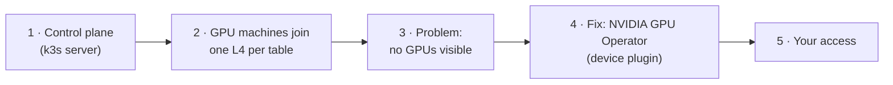

---
hide:
  - navigation
  - toc
title: "One GPU, Four Teams: from bare machines to shared GPUs"
---

<!-- GENERATED by tools/build_codelabs.py from tools/codelabs.yml. Edit the sources, not this file. -->

<div class="codelab-marker" data-catalog="../index.html"></div>

# One GPU, Four Teams: from bare machines to shared GPUs

<p class="codelab-bigtitle">One GPU, Four Teams: from bare machines to shared GPUs</p>

<div class="codelab-about" markdown>

### About this codelab

:material-text-box-outline: Last updated Nov 21, 2026

:material-account-circle: Written by DevFest Bengaluru

:material-timer-outline: 90 min

</div>

## 1. Introduction { data-mins="3" }

GPUs are the most expensive machines in a cluster. Today we start from **bare GPU machines**, build a Kubernetes cluster
**live**, and then hit one real problem after another, fixing each one as we go. Your table of four shares **one NVIDIA L4**.

<div class="journey">
<span>build the cluster</span> →
<span class="p">K8s can't see the GPU</span> → <span class="s">device plugin</span> →
<span class="p">1 pod hogs the whole GPU</span> → <span class="s">time-slicing</span> →
<span class="p">noisy neighbour + memory crash</span> → <span class="s">MPS / MIG</span> → <span class="s">HAMi limits</span> →
<span>a real model on a shared GPU</span>
</div>

#### The four teams at your table

| Team | Runs | Cares about |
|---|---|---|
| :material-food: **Dosa** | a Gemma chat assistant | fast answers |
| :material-rice: **Idli** | a batch job | throughput, takes everything it can get |
| :material-cookie: **Vada** | a notebook | idle, then suddenly busy |
| :material-tea: **Chai** | evaluations | steady load |

#### What you'll need

- A laptop with a browser and a Google account (for **Cloud Shell**, a free terminal in your browser)
- **No** Kubernetes or GPU experience. Every command is given. Want a 10-minute head start? [Foundations](foundations.md).

!!! info "How it works"
    **On the big screen** boxes are the instructor's commands: watch, no typing needed. Everything else is a **task** for you:
    copy, run, check **You should see**, click **Mark as done**.

**Time:** 90 minutes (3:00–4:30 PM).

## 2. Build the cluster, step by step { data-mins="17" }

!!! abstract "What you'll see"
    The instructor turns plain GPU machines into a Kubernetes cluster, one command at a time. You'll see the first problem
    (**Kubernetes can't see the GPU**) and how it's fixed. Meanwhile you open Cloud Shell and get the same repo.



!!! step "You · Open Cloud Shell and get the repo"
    Open **[shell.cloud.google.com](https://shell.cloud.google.com)**, sign in, then:

    ```bash
    git clone https://github.com/YOUR-ORG/gke-gpu-sharing-workshop.git
    cd gke-gpu-sharing-workshop
    ```

    !!! see "You should see"
        Your prompt ends in `~/gke-gpu-sharing-workshop$`. You now have every script the instructor is running.

    ??? tip "Paste not working?"
        Try ++ctrl+shift+v++ (Windows/Linux), ++cmd+v++ (Mac), or right-click → **Paste**.

!!! screen "On the big screen · 1. Start the control plane"
    ```bash
    ./scripts/jarvislabs/01-server.sh
    export KUBECONFIG=$PWD/scripts/jarvislabs/out/admin.kubeconfig
    kubectl get nodes
    ```

    One node, `Ready`. That's the **control plane**: the part that stores what you asked for and decides where things run.
    **k3s** is a small, certified Kubernetes that installs in about a minute.

!!! screen "On the big screen · 2. GPU machines join the cluster"
    ```bash
    ./scripts/jarvislabs/02-gpu-nodes.sh
    kubectl get nodes
    ```

    Every table's L4 machine is now a **node**. Find yours: it's labelled with your table id later.

!!! problem "Problem · Kubernetes can't see the GPU"
    ```bash
    ssh root@<t01-ip> nvidia-smi -L                              # the machine sees its GPU...
    kubectl describe node <t01-node> | grep nvidia.com/gpu       # ...Kubernetes doesn't: nothing printed
    ```

    The GPU, driver and container runtime are all there, but Kubernetes only schedules what a node **advertises**.
    Nobody has told it "this node has a GPU", so a pod asking for one would wait forever.

!!! solution "Fix · Install the NVIDIA GPU Operator (the device plugin)"
    ```bash
    ./scripts/jarvislabs/03-gpu-operator.sh
    kubectl get nodes -o custom-columns='NODE:.metadata.name,TABLE:.metadata.labels.workshop\.devfest/table,GPU:.status.allocatable.nvidia\.com/gpu'
    ```

    The **device plugin** runs on every GPU node and announces `nvidia.com/gpu: 1`. Now pods can ask for a GPU.
    The operator also brings **DCGM** (GPU metrics) and the **MIG manager**. On GKE, Google runs all of this for you.

!!! screen "On the big screen · 3. Monitoring and your access"
    ```bash
    ./scripts/jarvislabs/03b-monitoring.sh      # Prometheus + Grafana with NVIDIA's GPU dashboard
    ./scripts/jarvislabs/06-onboard.sh && ./scripts/jarvislabs/07-serve-kubeconfigs.sh
    ```

    Each of you now has a **namespace** (your private area, like `t07-dosa`) and an access file. Wait for **"go"** from the instructor.

??? question "Curious? Read the scripts while you wait"
    `less scripts/jarvislabs/03-gpu-operator.sh` (press **q** to quit). The sharing settings you'll use later are in
    `scripts/jarvislabs/device-plugin-config.yaml`.

## 3. Your first GPU pod { data-mins="8" }

!!! abstract "What you'll do"
    Pick your team, connect to the cluster, and run your first pod on your table's GPU.

!!! step "Pick your team"
    Look at your **table card** for your table id (e.g. `t07`). Agree who plays `dosa`, `idli`, `vada` and `chai`.

    ??? tip "Fewer than four people?"
        Fine. Someone plays two teams: open a second Cloud Shell tab (**+**) and run the next task again with the other team name.

!!! step "Connect as your team"
    Use **your** table and team:

    ```bash
    source scripts/attendee/setup.sh t07 dosa
    ```

    !!! see "You should see"
        A banner with your `table`, `team` and `namespace` (e.g. `t07-dosa`).

    ??? failure "Couldn't download the kubeconfig"
        Check the table/team spelling. If it's right, the cluster may not be ready yet: wait for the instructor's **go**.

!!! step "Run your first GPU pod"
    This pod asks for **one GPU** on your table's machine and prints what it sees:

    ```bash
    kubectl apply -f - <<EOF
    apiVersion: v1
    kind: Pod
    metadata:
      name: probe
    spec:
      restartPolicy: Never
      nodeSelector:
        workshop.devfest/gpu-mode: exclusive
        workshop.devfest/table: ${TABLE}
      containers:
      - name: probe
        image: ${IMAGE}
        command: ["bash", "-c", "nvidia-smi -L; python3 /scripts/probe.py"]
        env:
        - {name: LD_LIBRARY_PATH, value: /usr/local/nvidia/lib64}
        resources:
          limits: {nvidia.com/gpu: 1}
        volumeMounts: [{name: scripts, mountPath: /scripts}]
      volumes:
      - name: scripts
        configMap: {name: gpu-scripts}
    EOF
    ```

    ```bash
    sleep 20; kubectl logs probe
    ```

    !!! see "You should see"
        ```text
        GPU 0: NVIDIA L4 (UUID: GPU-3b1f6c2e-...)
        device                  : NVIDIA L4
        SMs visible             : 58
        GPU memory free / total : 21.8 GiB / 22.0 GiB
        ```

    ??? question "What's in that YAML?"
        `nodeSelector` = *"only on my table's GPU"* · `nvidia.com/gpu: 1` = *"I need one GPU"* · `image` = a container with PyTorch and vLLM ·
        `command` = run `probe.py`, a tiny script that reports what the GPU looks like from inside.

!!! step "Clean up"
    ```bash
    kubectl delete pod probe
    ```

    !!! tip "The four commands you'll use all day"
        `kubectl apply` (create) · `kubectl get pods` (status) · `kubectl logs` (output) · `kubectl delete` (remove)

## 4. Problem: one pod, one whole GPU { data-mins="7" }

!!! abstract "What you'll do"
    All four teams try to use the table's GPU at the same time. Watch what Kubernetes does by default.

!!! step ":material-food: Dosa · Start a notebook-style pod"
    **Dosa only.** This pod grabs the GPU and then just sits there, like an open notebook nobody is typing in:

    ```bash
    kubectl apply -f - <<EOF
    apiVersion: v1
    kind: Pod
    metadata:
      name: hold
      labels: {app: hold}
    spec:
      nodeSelector:
        workshop.devfest/gpu-mode: exclusive
        workshop.devfest/table: ${TABLE}
      containers:
      - name: hold
        image: ${IMAGE}
        command: ["sleep", "infinity"]
        env:
        - {name: LD_LIBRARY_PATH, value: /usr/local/nvidia/lib64}
        resources:
          limits: {nvidia.com/gpu: 1}
        volumeMounts: [{name: scripts, mountPath: /scripts}]
      volumes:
      - name: scripts
        configMap: {name: gpu-scripts}
    EOF
    ```

    ```bash
    kubectl get pods
    ```

    !!! see "You should see"
        `hold   1/1   Running`

!!! step ":material-rice: Idli, :material-cookie: Vada, :material-tea: Chai · Try to start yours"
    **The other three** run the same command:

    ```bash
    kubectl apply -f - <<EOF
    apiVersion: v1
    kind: Pod
    metadata:
      name: hold
      labels: {app: hold}
    spec:
      nodeSelector:
        workshop.devfest/gpu-mode: exclusive
        workshop.devfest/table: ${TABLE}
      containers:
      - name: hold
        image: ${IMAGE}
        command: ["sleep", "infinity"]
        env:
        - {name: LD_LIBRARY_PATH, value: /usr/local/nvidia/lib64}
        resources:
          limits: {nvidia.com/gpu: 1}
        volumeMounts: [{name: scripts, mountPath: /scripts}]
      volumes:
      - name: scripts
        configMap: {name: gpu-scripts}
    EOF
    ```

    ```bash
    sleep 10; kubectl get pods
    ```

    !!! see "You should see"
        `hold   0/1   Pending`. It never starts.

!!! step "Everyone · Ask Kubernetes why"
    ```bash
    kubectl describe pod hold | tail -3
    ```

    !!! see "You should see (Idli, Vada, Chai)"
        `... 0/N nodes are available: ... Insufficient nvidia.com/gpu ...`

!!! step ":material-food: Dosa · Check how busy the GPU really is"
    ```bash
    kubectl exec hold -- nvidia-smi --query-gpu=utilization.gpu,memory.used --format=csv
    ```

    !!! see "You should see"
        Around `0 %` busy and almost no memory used.

!!! problem "Problem · One pod, one whole GPU"
    By default Kubernetes hands out GPUs **whole**: Dosa's idle pod holds the entire L4 and three teams wait.
    On a cluster of expensive GPUs, that's a lot of money doing nothing.

!!! step "Everyone · Clean up"
    ```bash
    kubectl delete pod hold
    ```

    Then wait: the instructor switches every table GPU to **time-sharing** (on the big screen, ~1 minute).

!!! screen "On the big screen · Turn on time-slicing"
    ```bash
    ./scripts/jarvislabs/04-switch-strategy.sh ts
    ```

    One label per node changes the device plugin's config: each L4 now advertises **4** GPUs instead of 1.

## 5. Fix: time-slicing (and its problems) { data-mins="15" }

!!! solution "Fix · Time-slicing"
    The GPU now **takes turns** between up to 4 pods, like four passengers sharing one auto-rickshaw. All four teams fit.
    Let's see what that costs.

!!! step ":material-food: Dosa · Start a GPU-hungry job and watch its speed"
    **Dosa only.** `burn.py` keeps the GPU busy and prints its speed (TFLOPS) every 5 seconds:

    ```bash
    kubectl apply -f - <<EOF
    apiVersion: v1
    kind: Pod
    metadata:
      name: burn
      labels: {app: burn, team: ${TEAM}}
    spec:
      nodeSelector:
        workshop.devfest/gpu-mode: time-sharing
        workshop.devfest/table: ${TABLE}
      containers:
      - name: burn
        image: ${IMAGE}
        command: ["bash", "-c", "nvidia-smi -L; exec python3 /scripts/burn.py"]
        env:
        - {name: LD_LIBRARY_PATH, value: /usr/local/nvidia/lib64}
        - {name: DUTY, value: "${DUTY:-1.0}"}
        resources:
          requests: {cpu: 500m, memory: 2Gi}
          limits: {nvidia.com/gpu: 1}
        volumeMounts: [{name: scripts, mountPath: /scripts}]
      volumes:
      - name: scripts
        configMap: {name: gpu-scripts}
    EOF
    ```

    ```bash
    kubectl logs -f burn          # Ctrl+C stops watching; the pod keeps running
    ```

    !!! see "You should see"
        After ~30 s: `10:42:05 [burn]   71.8 TFLOPS`. **Write this number on your table card** as *"Dosa alone"*.

!!! step ":material-rice: Idli, :material-cookie: Vada, :material-tea: Chai · Join in"
    **One at a time** (Idli first), run the same command:

    ```bash
    kubectl apply -f - <<EOF
    apiVersion: v1
    kind: Pod
    metadata:
      name: burn
      labels: {app: burn, team: ${TEAM}}
    spec:
      nodeSelector:
        workshop.devfest/gpu-mode: time-sharing
        workshop.devfest/table: ${TABLE}
      containers:
      - name: burn
        image: ${IMAGE}
        command: ["bash", "-c", "nvidia-smi -L; exec python3 /scripts/burn.py"]
        env:
        - {name: LD_LIBRARY_PATH, value: /usr/local/nvidia/lib64}
        - {name: DUTY, value: "${DUTY:-1.0}"}
        resources:
          requests: {cpu: 500m, memory: 2Gi}
          limits: {nvidia.com/gpu: 1}
        volumeMounts: [{name: scripts, mountPath: /scripts}]
      volumes:
      - name: scripts
        configMap: {name: gpu-scripts}
    EOF
    ```

    !!! see "Dosa should see"
        The number **drop** with each new neighbour, to about **a quarter**. Write it down as *"Dosa with 3 neighbours"*.

!!! problem "Problem 1 · The noisy neighbour"
    Nobody touched Dosa's pod, yet it got 4× slower. With time-slicing, **your speed depends on your neighbours**.
    No priorities, no limits.

!!! step "Idli, Vada, Chai · Stop your jobs"
    ```bash
    kubectl delete pod burn
    ```

!!! step ":material-rice: Idli · Grab 20 GiB of GPU memory"
    **Idli only.**

    ```bash
    kubectl apply -f - <<EOF
    apiVersion: v1
    kind: Pod
    metadata:
      name: memhog
    spec:
      nodeSelector:
        workshop.devfest/gpu-mode: time-sharing
        workshop.devfest/table: ${TABLE}
      containers:
      - name: memhog
        image: ${IMAGE}
        command: ["python3", "/scripts/memhog.py"]
        env:
        - {name: LD_LIBRARY_PATH, value: /usr/local/nvidia/lib64}
        - {name: GIB, value: "20"}
        resources:
          limits: {nvidia.com/gpu: 1}
        volumeMounts: [{name: scripts, mountPath: /scripts}]
      volumes:
      - name: scripts
        configMap: {name: gpu-scripts}
    EOF
    ```

    ```bash
    sleep 25; kubectl logs memhog | tail -2
    ```

    !!! see "You should see"
        `done. Holding 20 GiB until the pod is deleted.` Nothing stopped Idli.

!!! step ":material-tea: Chai · Ask for just 4 GiB"
    **Chai only.**

    ```bash
    kubectl apply -f - <<EOF
    apiVersion: v1
    kind: Pod
    metadata:
      name: memhog
    spec:
      nodeSelector:
        workshop.devfest/gpu-mode: time-sharing
        workshop.devfest/table: ${TABLE}
      containers:
      - name: memhog
        image: ${IMAGE}
        command: ["python3", "/scripts/memhog.py"]
        env:
        - {name: LD_LIBRARY_PATH, value: /usr/local/nvidia/lib64}
        - {name: GIB, value: "4"}
        resources:
          limits: {nvidia.com/gpu: 1}
        volumeMounts: [{name: scripts, mountPath: /scripts}]
      volumes:
      - name: scripts
        configMap: {name: gpu-scripts}
    EOF
    ```

    ```bash
    sleep 20; kubectl logs memhog | tail -2
    ```

    !!! see "You should see"
        `OUT OF MEMORY after 1 GiB: CUDA out of memory...`

!!! problem "Problem 2 · No memory limits"
    The pod that crashed is **Chai's**, the polite one, not Idli's, the greedy one. Time-slicing shares the GPU's memory with
    **no limits**: whoever asks next fails.

!!! step "Everyone · Clean up"
    ```bash
    kubectl delete pod --all
    ```

!!! step extra "Ask for two shared GPUs"
    Change `nvidia.com/gpu: 1` to `2` in the burn YAML and apply it as a pod named `greedy`. It fails with `UnexpectedAdmissionError`:
    on a time-sliced GPU a pod can ask for only **one** slot, because a slot is a turn in the queue, not a slice of the chip.

!!! tip "Look at the projector"
    The instructor shows **Grafana**'s GPU dashboard: your table's GPU at 100% busy. Can it tell *which team* is to blame?
    **No**: GPU metrics are per GPU, not per pod.

## 6. NVIDIA's answers: MPS and MIG { data-mins="6" }

!!! abstract "What you'll see"
    NVIDIA has two built-in answers to time-slicing's problems. The instructor demos both (they need special setup, or a much
    bigger GPU). Watch the big screen.

=== ":material-call-split: MPS · assigned seats"

    !!! screen "On the big screen"
        ```bash
        ROLE=stage ./scripts/jarvislabs/04-switch-strategy.sh mps
        ./scripts/jarvislabs/demo.sh mps
        ```

        Four `burn` pods on that GPU: each is **capped at ~25%** of the cores and ~5 GB of memory, and the speed **stays steady**
        when neighbours start.

    !!! problem "But"
        The caps are environment variables (`CUDA_MPS_*`) that a pod can **change itself**, pods need special access (`hostIPC`),
        and one crashing pod can affect the others.

=== ":material-view-grid: MIG · separate slices"

    !!! screen "On the big screen"
        ```bash
        kubectl get nodes -l workshop.devfest/role=mig -o custom-columns='NODE:.metadata.name,SLICES:.status.allocatable.nvidia\.com/gpu'
        ./scripts/jarvislabs/demo.sh mig
        ```

        One **H200** is cut **in hardware** into 7 slices (`1g.18gb`). A pod on one slice can't see, slow down or crash the others.

    !!! problem "But"
        Only on big, expensive GPUs (A100, H100, H200…), the slice sizes are **fixed**, and one pod gets one slice.

!!! question "Talk at your table (1 minute)"
    You have a room full of **L4s** (no MIG), and you want each team to get **a fixed amount of GPU memory** that nobody can take
    away. Which of the two helps?

    ??? success "Answer"
        Neither, really: MPS limits are soft, and MIG needs bigger GPUs. That's the gap **HAMi** fills, next.

!!! screen "On the big screen · Switch the tables to HAMi"
    ```bash
    ./scripts/jarvislabs/demo.sh clean
    ./scripts/jarvislabs/04-switch-strategy.sh hami
    ```

    Installs HAMi, then on each table GPU turns NVIDIA's device plugin **off** and HAMi's **on** (~2 minutes).

## 7. Fix: HAMi memory and compute limits { data-mins="15" }

!!! solution "Fix · HAMi: ask for memory and compute, and get exactly that"
    **[HAMi](https://project-hami.io)** (a CNCF project) lets a pod ask for **an amount of GPU memory** and **a share of compute**,
    and enforces both, on any NVIDIA GPU, including our L4s:

    ```yaml
    limits:
      nvidia.com/gpu: 1          # one (virtual) GPU
      nvidia.com/gpumem: 4000    # 4000 MB of GPU memory
      nvidia.com/gpucores: 25    # 25% of the GPU's compute
    ```

!!! step "Everyone · Ask for 4 GB and 25%"
    ```bash
    kubectl apply -f - <<EOF
    apiVersion: v1
    kind: Pod
    metadata:
      name: probe
    spec:
      restartPolicy: Never
      nodeSelector:
        workshop.devfest/gpu-mode: hami
        workshop.devfest/table: ${TABLE}
      containers:
      - name: probe
        image: ${IMAGE}
        command: ["python3", "/scripts/probe.py"]
        env:
        - {name: LD_LIBRARY_PATH, value: /usr/local/nvidia/lib64}
        resources:
          limits: {nvidia.com/gpu: 1, nvidia.com/gpumem: ${GPU_MEM:-4000}, nvidia.com/gpucores: ${GPU_CORES:-25}}
        volumeMounts: [{name: scripts, mountPath: /scripts}]
      volumes:
      - name: scripts
        configMap: {name: gpu-scripts}
    EOF
    ```

    ```bash
    sleep 20; kubectl logs probe
    ```

    !!! see "You should see"
        `GPU memory free / total : ~3.9 GiB / ~3.9 GiB`. Your pod now **sees a 4 GB GPU**: the rest doesn't exist for it.

    ```bash
    kubectl delete pod probe
    ```

!!! step ":material-rice: Idli · Try the 20 GiB grab again"
    **Idli only.**

    ```bash
    kubectl apply -f - <<EOF
    apiVersion: v1
    kind: Pod
    metadata:
      name: memhog
    spec:
      nodeSelector:
        workshop.devfest/gpu-mode: hami
        workshop.devfest/table: ${TABLE}
      containers:
      - name: memhog
        image: ${IMAGE}
        command: ["python3", "/scripts/memhog.py"]
        env:
        - {name: LD_LIBRARY_PATH, value: /usr/local/nvidia/lib64}
        - {name: GIB, value: "20"}
        resources:
          limits: {nvidia.com/gpu: 1, nvidia.com/gpumem: ${GPU_MEM:-4000}, nvidia.com/gpucores: 25}
        volumeMounts: [{name: scripts, mountPath: /scripts}]
      volumes:
      - name: scripts
        configMap: {name: gpu-scripts}
    EOF
    ```

    ```bash
    sleep 25; kubectl logs memhog | tail -2
    ```

    !!! see "You should see"
        `OUT OF MEMORY after 3 GiB`: Idli hits **its own** 4 GB limit.

!!! step ":material-tea: Chai · Ask for 3 GiB"
    **Chai only.**

    ```bash
    kubectl apply -f - <<EOF
    apiVersion: v1
    kind: Pod
    metadata:
      name: memhog
    spec:
      nodeSelector:
        workshop.devfest/gpu-mode: hami
        workshop.devfest/table: ${TABLE}
      containers:
      - name: memhog
        image: ${IMAGE}
        command: ["python3", "/scripts/memhog.py"]
        env:
        - {name: LD_LIBRARY_PATH, value: /usr/local/nvidia/lib64}
        - {name: GIB, value: "3"}
        resources:
          limits: {nvidia.com/gpu: 1, nvidia.com/gpumem: ${GPU_MEM:-4000}, nvidia.com/gpucores: 25}
        volumeMounts: [{name: scripts, mountPath: /scripts}]
      volumes:
      - name: scripts
        configMap: {name: gpu-scripts}
    EOF
    ```

    ```bash
    sleep 20; kubectl logs memhog | tail -2
    ```

    !!! see "You should see"
        `done. Holding 3 GiB`. **Chai is safe now**: Idli can't take Chai's memory.

!!! solution "Problem 2 · solved"
    Memory limits are **enforced per pod**. The greedy pod fails on its own; neighbours are protected.

!!! step "Everyone · Clean up, then the noisy neighbour test"
    ```bash
    kubectl delete pod --all
    ```

    **Dosa** starts the burn job with **25%** of the GPU, then Idli, Vada and Chai join with the same command, like in step 5:

    ```bash
    kubectl apply -f - <<EOF
    apiVersion: v1
    kind: Pod
    metadata:
      name: burn
      labels: {app: burn, team: ${TEAM}}
    spec:
      nodeSelector:
        workshop.devfest/gpu-mode: hami
        workshop.devfest/table: ${TABLE}
      containers:
      - name: burn
        image: ${IMAGE}
        command: ["python3", "/scripts/burn.py"]
        env:
        - {name: LD_LIBRARY_PATH, value: /usr/local/nvidia/lib64}
        resources:
          requests: {cpu: 500m, memory: 2Gi}
          limits: {nvidia.com/gpu: 1, nvidia.com/gpumem: 4000, nvidia.com/gpucores: ${GPU_CORES:-25}}
        volumeMounts: [{name: scripts, mountPath: /scripts}]
      volumes:
      - name: scripts
        configMap: {name: gpu-scripts}
    EOF
    ```

    !!! see "Dosa should see"
        A **lower** number than "Dosa alone" in step 5 (Dosa's capped at 25%), but it **barely moves** when the others join.

!!! solution "Problem 1 · tamed"
    Each pod gets its **share of compute**, so neighbours can't push you below it. Want more for one team? Give that pod a bigger `gpucores`.

!!! step "Everyone · Clean up"
    ```bash
    kubectl delete pod --all
    ```

!!! warning "Good to know"
    HAMi's limits are enforced in software, inside the container. That's great within one company. For tenants that must not trust
    each other, use **MIG**'s hardware walls.

## 8. A real model on a shared GPU { data-mins="12" }

!!! abstract "What you'll do"
    Run a real AI model, **Gemma 3 1B**, with **vLLM**, a popular model server. Each team gets its own copy on the **same L4**.

!!! problem "The classic problem (without limits)"
    vLLM grabs **90% of the GPU's memory** when it starts, on purpose, to answer fast. On a time-sliced GPU, the first server takes
    ~20 GB and **everyone else's crashes** (`Free memory on device ... is less than desired GPU memory utilization`).
    You'd have to hand-tune a memory setting on every server.

!!! step "Everyone · Save the Gemma helper"
    This **only saves** a script. Copy the whole box:

    ```bash
    cat > /tmp/gemma.sh <<'OUTER'
    kubectl apply -f - <<EOF
    apiVersion: apps/v1
    kind: Deployment
    metadata:
      name: gemma
    spec:
      replicas: 1
      strategy: {type: Recreate}
      selector: {matchLabels: {app: gemma}}
      template:
        metadata:
          labels: {app: gemma, team: ${TEAM}}
        spec:
          nodeSelector:
            workshop.devfest/gpu-mode: hami
            workshop.devfest/table: ${TABLE}
          containers:
          - name: vllm
            image: ${IMAGE}
            command: ["python3", "-m", "vllm.entrypoints.openai.api_server"]
            args:
            - --model=${MODEL}
            - --max-model-len=2048
            - --max-num-seqs=8
            - --enforce-eager
            - --port=8000
            env:
            - {name: HF_HUB_CACHE, value: /models}
            - {name: HF_HUB_OFFLINE, value: "1"}
            ports: [{containerPort: 8000}]
            readinessProbe:
              httpGet: {path: /health, port: 8000}
              periodSeconds: 5
              failureThreshold: 60
            resources:
              requests: {cpu: 1500m, memory: 6Gi}
              limits: {memory: 10Gi, nvidia.com/gpu: 1, nvidia.com/gpumem: ${GPU_MEM:-5000}, nvidia.com/gpucores: ${GPU_CORES:-25}}
            volumeMounts:
            - {name: models, mountPath: /models, readOnly: true}
          volumes:
          - name: models
            hostPath: {path: /var/lib/workshop/hf, type: Directory}
    ---
    apiVersion: v1
    kind: Service
    metadata:
      name: gemma
    spec:
      selector: {app: gemma}
      ports: [{port: 8000, targetPort: 8000}]
    EOF
    OUTER
    echo saved
    ```

    ??? question "What's special here?"
        No vLLM memory setting at all, so it uses its **default 90%**. But HAMi gives it a **5 GB GPU**, so 90% means ~4.5 GB.

!!! step "Everyone · Deploy your Gemma"
    ```bash
    bash /tmp/gemma.sh
    kubectl rollout status deploy/gemma --timeout=5m
    ```

    !!! see "You should see"
        `deployment "gemma" successfully rolled out` for **all four** teams. No crashes.

!!! solution "Fixed by the limit"
    Four model servers on one L4, each believing it has its own 5 GB GPU. No hand-tuning.

!!! step "Everyone · Talk to your model"
    ```bash
    kubectl port-forward svc/gemma 8000:8000 >/dev/null 2>&1 &
    sleep 3
    curl -s http://127.0.0.1:8000/v1/chat/completions -H 'Content-Type: application/json' -d "{
      \"model\": \"${MODEL}\", \"max_tokens\": 100,
      \"messages\": [{\"role\": \"user\", \"content\": \"Three tips for surviving Silk Board junction traffic?\"}]}" \
      | jq -r '.choices[0].message.content'
    ```

    !!! see "You should see"
        Three (probably funny) tips from Gemma.

!!! step "Everyone · Time it"
    ```bash
    bash scripts/attendee/bench.sh 5
    ```

    !!! see "You should see"
        Five timings and an average. Each team gets steady answers, because each server has its own compute share.

!!! step "Everyone · Clean up"
    ```bash
    kill %1 2>/dev/null; kubectl delete deploy,svc,pod --all
    ```

## 9. Choose your fix { data-mins="4" }

#### Every problem we hit, and its fix

| Problem | Fix | Trade-off |
|---|---|---|
| Kubernetes can't see the GPU | **Device plugin** (NVIDIA GPU Operator) | on GKE, Google runs it for you |
| One idle pod holds a whole GPU | **Time-slicing** | noisy neighbours, no memory limits |
| Noisy neighbour, memory crashes | **MPS** | soft limits a pod can change |
| | **MIG** | big GPUs only, fixed slices |
| | **HAMi** | software limits: great inside one company |
| A model server grabs 90% of memory | a **per-pod memory limit** (HAMi), or tune each server | |

#### One more problem: jobs that need several GPUs at once

!!! problem "Gang scheduling"
    A training job needs **4 GPUs at the same time**. The default scheduler starts 3 of its pods and waits for the fourth. Those 3 GPUs
    sit idle, and two such jobs can block each other forever.

!!! solution "Fix"
    A **gang scheduler** starts all of a job's pods together or none of them: **Volcano**, **Kueue** or NVIDIA's **KAI Scheduler**.
    HAMi works with Volcano. That's a workshop of its own!

#### So which one should I use?

- **Bursty, trusted, dev/test** → **time-slicing** (cap memory in the app)
- **Many teams on the same GPUs, needing fair shares** → **HAMi**
- **Untrusted tenants, hard guarantees** → **MIG**
- **Big training jobs** → **whole GPUs** + a gang scheduler

<div class="quiz" data-answer="b">
  <p class="q">A startup has 10 L4s and 30 data scientists with notebooks that each need ~4 GB. What fits best?</p>
  <button data-opt="a">One whole L4 per notebook</button>
  <button data-opt="b">HAMi with a 4 GB memory limit per notebook</button>
  <button data-opt="c">MIG</button>
  <div class="explain">HAMi packs several notebooks per L4 with enforced memory limits. L4s don't support MIG, and whole GPUs would leave most of each one idle.</div>
</div>

## 10. Clean up { data-mins="2" }

!!! step "Delete everything you started"
    ```bash
    kill %1 2>/dev/null; kubectl delete deploy,svc,pod --all
    ```

    !!! see "You should see"
        `kubectl get pods` says `No resources found`. The instructor deletes the GPU machines right after the session.

!!! step "Tell us how it went"
    Scan the feedback QR code on your table card.

#### Take it home

- **[Build it yourself on one Jarvislabs GPU VM](jarvislabs-solo.md)**: the same scripts, one machine, all four teams.
- **[The GKE edition](gpu-sharing-on-gke.md)**: the same ideas on Google Kubernetes Engine.
- **[HAMi](../reference/hami.md)** · **[Cheat sheet](../reference/cheatsheet.md)** · **[What's next: AICR & Agent Substrate](../reference/whats-next.md)**

!!! success "Thank you!"
    You built a GPU cluster from scratch, broke it four different ways, and fixed it. See you at the next DevFest!
