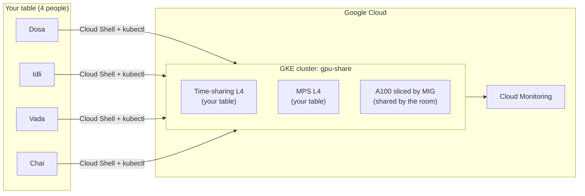
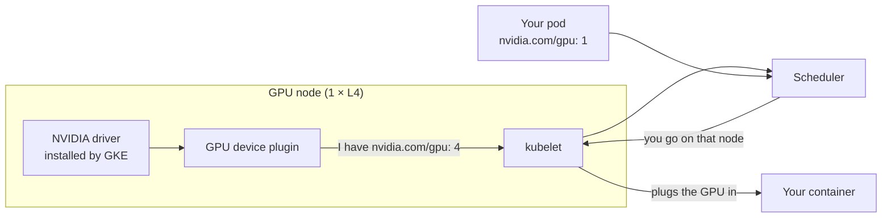
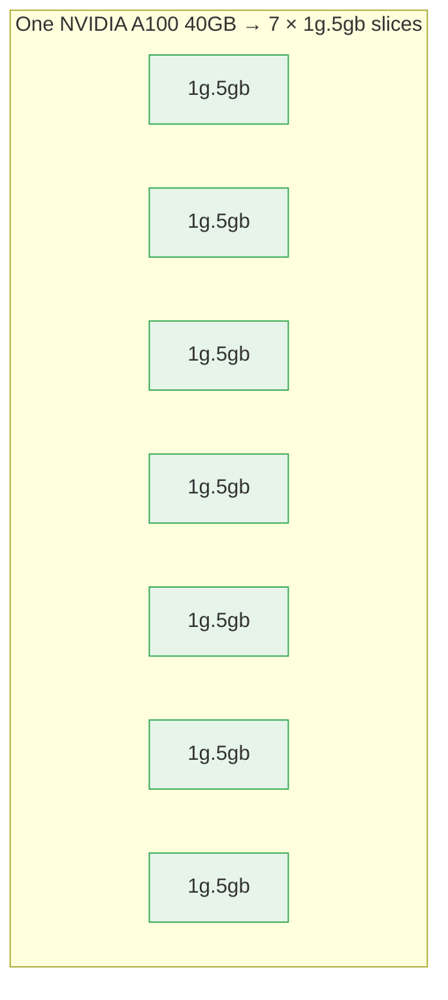
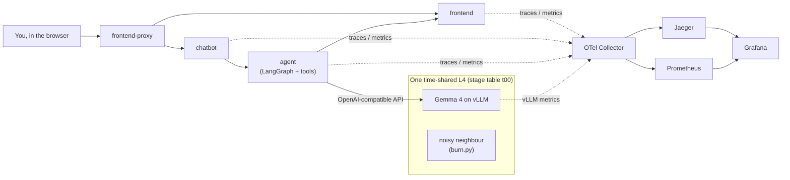
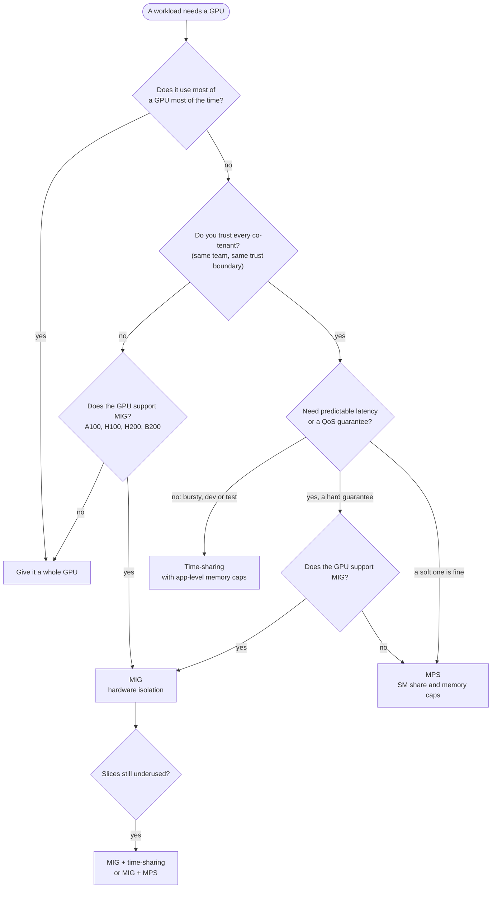

---
hide:
  - navigation
  - toc
title: "One GPU, Four Teams: hands-on GPU sharing on GKE"
---

<!-- GENERATED by tools/build_codelabs.py from tools/codelabs.yml. Edit the sources, not this file. -->

<div class="codelab-marker" data-catalog="../index.html"></div>

# One GPU, Four Teams: hands-on GPU sharing on GKE

<p class="codelab-bigtitle">One GPU, Four Teams: hands-on GPU sharing on GKE</p>

<div class="codelab-about" markdown>

### About this codelab

:material-text-box-outline: Last updated Nov 21, 2026

:material-account-circle: Written by DevFest Bengaluru

:material-timer-outline: 90 min

</div>

## 1. Introduction { data-mins="3" }

GPUs are the most expensive machines in a cluster, and Kubernetes hands them out **whole**. Today your table of four
shares **one real NVIDIA GPU** three different ways, and finds out what each way protects.



#### The story

It's Monday at a Bengaluru startup. Finance approved **one** L4 GPU for four teams. Each person at your table plays one:

| Team | Runs | Cares about |
|---|---|---|
| :material-food: **Dosa** | A Gemma chat assistant | Fast answers. Customers are waiting. |
| :material-rice: **Idli** | A nightly batch job | Throughput. It takes everything it can get. |
| :material-cookie: **Vada** | A data-science notebook | Idle most of the time, then suddenly busy |
| :material-tea: **Chai** | Evaluation jobs | Steady, medium load |

By the end you'll know which strategy keeps all four happy, and which one lets Idli quietly ruin Dosa's day.

#### What you'll do

- Put four programs on **one GPU** and watch them slow each other down
- Give each team a fixed share with **MPS**, then real hardware slices with **MIG**
- Serve **Gemma** with **vLLM** on a shared GPU, and fix the classic memory crash

#### What you'll need

- A laptop with a browser, and the **Google account** you registered with
- Nothing to install: everything runs in **Cloud Shell**, a terminal in your browser
- **No Kubernetes, GPU or Google Cloud experience.** Every command is given, and every task shows what you should see.
  If you have 10 minutes beforehand, do the **[GPU sharing foundations](foundations.md)** codelab first.
- You **don't** need your own cloud project, credits or GPUs on the day: the organisers run a shared cluster for you.

!!! info "How it works"
    Small **tasks**: copy a command, check **You should see**, click **Mark as done**. **Extra** tasks are optional.

**Estimated time:** 90 minutes, at the workshop (3:00–4:30 PM).
**Tested with:** GKE Standard (regular channel), NVIDIA L4 and A100 40GB, vLLM, Gemma 3 1B.

## 2. Before you begin { data-mins="17" }

### Open Cloud Shell and get the repo

!!! abstract "What you'll do"
    Open a terminal in your browser and download the workshop files.

!!! step "Open Cloud Shell"
    Go to **[shell.cloud.google.com](https://shell.cloud.google.com)** and sign in with your Google account. Accept the terms if asked.

    !!! see "You should see"
        A terminal with a prompt like `you@cloudshell:~$`.

    !!! tip "Paste not working?"
        Try ++ctrl+shift+v++ (Windows/Linux), ++cmd+v++ (Mac), or right-click → **Paste**.

!!! step "Get the workshop repo"
    ```bash
    git clone https://github.com/YOUR-ORG/gke-gpu-sharing-workshop.git
    cd gke-gpu-sharing-workshop
    ```

    !!! see "You should see"
        A few lines ending in `done.`, and your prompt ends in `~/gke-gpu-sharing-workshop$`.

    ??? why "Why this matters"
        Everyone now has the **same repo** the instructor uses: same scripts, same settings.

### Connect and run your first pod

!!! abstract "What you'll do"
    Once the cluster is ready, pick your team, connect to the cluster, and run a tiny practice pod.
    By the end you'll know the four commands you'll use all day.

    **New to Kubernetes?** Keep [Kubernetes basics](foundations.md#2) open in another tab.

!!! step "Find your table and pick a team"
    Look at the **table card** in front of you. It shows your **table id**, such as `t07`.

    Agree with the people at your table who plays which team. Write your names on the card.

    | Team | You'll be the one who… |
    |---|---|
    | `dosa` | serves the Gemma chat assistant (needs fast answers) |
    | `idli` | runs the greedy batch job (the noisy neighbour) |
    | `vada` | runs a bursty notebook |
    | `chai` | runs steady evaluation jobs |

    ??? why "Fewer than four people?"
        No problem. Pick any free team names. Each lab has a **Solo mode** tip for missing teams.

??? note "Missed the previous step? Open Cloud Shell and get the repo"
    Open **[shell.cloud.google.com](https://shell.cloud.google.com)**, sign in, then run:

    ```bash
    git clone https://github.com/YOUR-ORG/gke-gpu-sharing-workshop.git
    cd gke-gpu-sharing-workshop
    ```

!!! step "Connect to the cluster as your team"
    Replace `t07` and `dosa` with **your** table and team, then run:

    ```bash
    source scripts/attendee/setup.sh t07 dosa
    ```

    !!! see "You should see"
        ```text
        =====================================================
          One GPU, Four Teams | DevFest Bengaluru
          table     : t07
          team      : dosa
          namespace : t07-dosa
          cluster   : gpu-share (us-central1-a, project ...)
        =====================================================
        ```

    ??? why "Why this matters"
        This logs `kubectl` in to the shared cluster **as you**, switches you into your own **namespace** (your private area), and saves
        your table and team so the lab commands can use them.

    ??? failure "It says `get-credentials failed`"
        You're probably signed in with a different Google account. Run `gcloud config get account` to check, and ask a helper.


!!! step "Check your saved settings"
    ```bash
    echo "table=$TABLE team=$TEAM namespace=$NS"
    ```

    !!! see "You should see"
        ```text
        table=t07 team=dosa namespace=t07-dosa
        ```

    ??? why "Why this matters"
        Lab commands contain `${TABLE}` and `${TEAM}`. The terminal swaps in your values, so every command works for you without editing.

!!! step "Create your first pod (no GPU yet)"
    ```bash
    kubectl run hello --image=busybox --restart=Never -- echo "Hello from $TEAM at table $TABLE"
    ```

    !!! see "You should see"
        ```text
        pod/hello created
        ```

    ??? why "Why this matters"
        You just asked Kubernetes to run a tiny program. It picked a machine and started it there. This is the same thing
        you'll do with GPU programs later.

!!! step "Check its status"
    Run this a few times, until `STATUS` says `Completed`:

    ```bash
    kubectl get pods
    ```

    !!! see "You should see"
        ```text
        NAME    READY   STATUS      RESTARTS   AGE
        hello   0/1     Completed   0          6s
        ```

    ??? why "Status in one line"
        `Pending` = waiting for a machine · `ContainerCreating` = starting · `Running` = going · `Completed` = finished.

!!! step "Read what it printed"
    ```bash
    kubectl logs hello
    ```

    !!! see "You should see"
        ```text
        Hello from dosa at table t07
        ```

!!! step "Delete it"
    ```bash
    kubectl delete pod hello
    ```

    !!! see "You should see"
        ```text
        pod "hello" deleted
        ```

    ??? why "Why this matters"
        **Create → check → read → delete.** That's the loop for the whole workshop, just with bigger YAML and a GPU.

!!! step "Final check"
    ```bash
    kubectl get configmap gpu-scripts
    kubectl auth can-i create pods
    ```

    !!! see "You should see"
        A configmap called `gpu-scripts`, and the word `yes`.

    ??? why "What's in `gpu-scripts`?"
        Three small Python programs the labs use:

        | Script | What it does |
        |---|---|
        | `probe.py` | Prints what your container can see of the GPU: name, cores (SMs), free memory |
        | `burn.py` | Keeps the GPU 100% busy and prints its speed in **TFLOPS** every 5 s. This is the noisy neighbour. |
        | `memhog.py` | Grabs GPU memory 1 GiB at a time |

!!! step extra "Peek at the whole cluster"
    ```bash
    kubectl get nodes
    ```

    These are all the machines everyone in the room is sharing. You'll look closer in Step 3.

!!! checkpoint "Checkpoint"
    Your hello pod printed a message, `can-i` said `yes`, and `echo $NS` shows your namespace.
    **You're ready for [Step 3](gpu-sharing-on-gke.md#2).**

!!! tip "Opening a new terminal tab later?"
    Click **+** in Cloud Shell. Your table and team load automatically. If not, run
    `cd ~/gke-gpu-sharing-workshop && source scripts/attendee/setup.sh <table> <team>`.

## 3. How GKE gives a pod a GPU { data-mins="8" }

!!! abstract "What you'll do"
    Kubernetes doesn't really know what a GPU is. It sees each node as having a **number of GPU "chairs"**.
    You'll look at the GPU machines, count their chairs, and run your first pod that sits in one.



!!! step "List the GPU machines"
    ```bash
    kubectl get nodes -l cloud.google.com/gke-accelerator \
      -L cloud.google.com/gke-accelerator,cloud.google.com/gke-gpu-sharing-strategy,cloud.google.com/gke-max-shared-clients-per-gpu,cloud.google.com/gke-gpu-partition-size,workshop.devfest/table
    ```

    !!! see "You should see"
        A list of nodes with extra columns. There are three kinds:

        | Pool | `GKE-ACCELERATOR` | `GKE-GPU-SHARING-STRATEGY` | `MAX-SHARED-CLIENTS` | `PARTITION-SIZE` |
        |---|---|---|---|---|
        | `ts-l4` | `nvidia-l4` | `time-sharing` | `4` | |
        | `mps-l4` | `nvidia-l4` | `mps` | `4` | |
        | `mig-a100` | `nvidia-tesla-a100` | | | `1g.5gb` |

    ??? why "Why this matters"
        These **labels** are how you pick a sharing strategy. You never configure sharing in your pod; you choose a node that was
        **created** with it.

    ??? question "Reading this command"
        `-l …` keeps only nodes **with** a GPU label. `-L a,b,c` adds a column for each label. The `\` at the end of a line just continues the command.

!!! step "Find your table's time-sharing GPU"
    ```bash
    TS_NODE=$(kubectl get nodes -l workshop.devfest/table=$TABLE,cloud.google.com/gke-gpu-sharing-strategy=time-sharing -o name)
    echo $TS_NODE
    ```

    !!! see "You should see"
        One node name, like `node/gke-gpu-share-ts-l4-8c1f-x7k2`.

    ??? why "Why this matters"
        That's the **one GPU your whole table shares**. `$( … )` runs a command and saves its answer in the variable `TS_NODE`.

!!! step "Count its GPU chairs"
    ```bash
    kubectl describe $TS_NODE | grep -E "nvidia.com/gpu|Capacity|Allocatable"
    ```

    !!! see "You should see"
        ```text
        Capacity:
          nvidia.com/gpu:     4
        Allocatable:
          nvidia.com/gpu:     4
        ```

    ??? why "Why this matters"
        The node has **one** physical L4, but tells Kubernetes it has **4**, because its pool was created with
        `max-shared-clients-per-gpu=4`. The scheduler now sees **four chairs**.

        Does it know how much memory or speed each chair gets? **No, nothing at all.** Remember this for Step 4.

!!! step "Spot the \"keep out\" sign"
    ```bash
    kubectl describe $TS_NODE | grep -A1 Taints
    ```

    !!! see "You should see"
        ```text
        Taints:             nvidia.com/gpu=present:NoSchedule
        ```

    ??? why "Why this matters"
        A **taint** keeps ordinary pods off this expensive machine. Only pods that ask for a GPU get let in.
        GKE adds the matching permission to GPU pods for you automatically.

!!! step "See who makes the GPU appear"
    ```bash
    kubectl get daemonsets -n kube-system | grep -i -E "nvidia|gpu"
    ```

    !!! see "You should see"
        Entries for the **NVIDIA driver installer** and the **GPU device plugin**.

    ??? why "Why this matters"
        The **device plugin** runs on every GPU node. It reads the sharing setting and announces "4 GPUs" instead of "1".
        GKE manages it for you.


!!! step "Run your first GPU pod"
    This asks for **one** GPU chair on your table's time-sharing node, then prints what the container sees.

    ```bash
    kubectl apply -f - <<EOF
    apiVersion: v1
    kind: Pod
    metadata:
      name: probe
    spec:
      restartPolicy: Never
      nodeSelector:
        cloud.google.com/gke-gpu-sharing-strategy: time-sharing
        cloud.google.com/gke-max-shared-clients-per-gpu: "4"
        workshop.devfest/table: ${TABLE}
      containers:
      - name: probe
        image: ${IMAGE}
        command: ["bash", "-c", "/usr/local/nvidia/bin/nvidia-smi -L; ls /dev/nvidia*; python3 /scripts/probe.py"]
        env:
        - {name: LD_LIBRARY_PATH, value: /usr/local/nvidia/lib64}
        resources:
          limits: {nvidia.com/gpu: 1}
        volumeMounts: [{name: scripts, mountPath: /scripts}]
      volumes:
      - name: scripts
        configMap: {name: gpu-scripts}
    EOF
    ```

    !!! see "You should see"
        ```text
        pod/probe created
        ```

    ??? question "Reading this YAML, line by line"
        | Line | Meaning |
        |---|---|
        | `kind: Pod`, `name: probe` | create one pod called `probe` |
        | `restartPolicy: Never` | run once, don't restart |
        | `nodeSelector:` | only on a **time-sharing** node with **4** chairs at **your table** |
        | `image: ${IMAGE}` | the workshop image (PyTorch + vLLM) |
        | `command:` | list the GPU, list GPU device files, run `probe.py` |
        | `LD_LIBRARY_PATH` | where GKE put the NVIDIA driver libraries |
        | `nvidia.com/gpu: 1` | **ask for one GPU chair** |
        | `volumes` | make the `gpu-scripts` files appear in `/scripts` |

!!! step "Watch it start"
    ```bash
    kubectl get pod probe -o wide -w
    ```

    Wait until `STATUS` shows **`Completed`**, then press ++ctrl+c++ to stop watching.

    !!! see "You should see"
        The status move from `ContainerCreating` to `Running` to `Completed`. The `NODE` column shows your table's node.

    ??? why "Why this matters"
        `-w` means **watch**: the list updates live. `-o wide` adds the node name, so you can confirm the scheduler used your table's GPU.

!!! step "Read what your pod saw"
    ```bash
    kubectl logs probe
    ```

    !!! see "You should see"
        ```text
        GPU 0: NVIDIA L4 (UUID: GPU-3b1f6c2e-....)
        /dev/nvidia0  /dev/nvidiactl  /dev/nvidia-uvm ...
        pod                     : probe
        CUDA_MPS_* variables    : none (not an MPS node)
        device                  : NVIDIA L4
        SMs visible             : 58
        GPU memory free / total : 21.8 GiB / 22.0 GiB
        ```

    ??? why "Three things to notice"
        1. `nvidia-smi` isn't in the image. **GKE mounts the driver** into every GPU container at `/usr/local/nvidia`.
        2. You see the **whole** L4: all 58 SMs and all ~22 GiB. Time-sharing doesn't shrink what you see.
        3. **Write your GPU's UUID** (the `GPU-…` code) on your table card. Your teammates will compare in Step 4.

!!! step "Clean up"
    ```bash
    kubectl delete pod probe
    ```

    !!! see "You should see"
        ```text
        pod "probe" deleted
        ```

!!! step extra "See the permission GKE added to your pod"
    Run this **before** deleting the pod (re-create it with the earlier step if needed):

    ```bash
    kubectl get pod probe -o jsonpath='{.spec.tolerations}' | tr ',' '\n' | grep -i nvidia
    ```

    That's the **toleration** that lets your pod past the node's "keep out" taint. GKE injected it because you asked for a GPU.

!!! takeaway "Key takeaway"
    - A GPU is an **integer** the device plugin announces. Pods ask for whole numbers.
    - GPU sharing on GKE is a **node pool** setting. Pods choose it with a **nodeSelector**.
    - The driver comes from the **node**, mounted at `/usr/local/nvidia`.

!!! checkpoint "Checkpoint"
    You saw `nvidia.com/gpu: 4` on a one-GPU node, and your probe printed `NVIDIA L4`. **On to [Step 4](gpu-sharing-on-gke.md#3).**

## 4. GPU time-sharing { data-mins="17" }

!!! abstract "What you'll do"
    Your table's four people each put a program on the **same GPU**. You'll watch each other's speed drop
    (the **noisy neighbour**), then see one person's memory grab crash someone else's program.

**Time-sharing** means programs **take turns** on the GPU, like four passengers sharing one auto-rickshaw.

```mermaid
gantt
  dateFormat X
  axisFormat %s
  title One L4, time-sliced between four pods
  section GPU
  dosa :a1, 0, 1
  idli :a2, 1, 2
  vada :a3, 2, 3
  chai :a4, 3, 4
  dosa :a5, 4, 5
  idli :a6, 5, 6
  vada :a7, 6, 7
  chai :a8, 7, 8
```



!!! team "This lab is a team sport"
    Steps start with a **team name**. **Only that person runs the command**; everyone else watches their screen,
    then clicks **Mark as done** too. Wait for each other: the order matters.

    **Solo mode** (fewer than four people): open another Cloud Shell tab (**+**) and run
    `source scripts/attendee/setup.sh <table> <missing-team>` to play a second team yourself.

### Part A · The noisy neighbour

!!! step ":material-food: Dosa · Start a GPU workload alone"
    **Dosa only.** This pod keeps the GPU busy with maths and prints its speed every 5 seconds.

    ```bash
    kubectl apply -f - <<EOF
    apiVersion: v1
    kind: Pod
    metadata:
      name: burn
      labels: {app: burn, team: ${TEAM}}
    spec:
      nodeSelector:
        cloud.google.com/gke-gpu-sharing-strategy: time-sharing
        cloud.google.com/gke-max-shared-clients-per-gpu: "4"
        workshop.devfest/table: ${TABLE}
      containers:
      - name: burn
        image: ${IMAGE}
        command: ["bash", "-c", "/usr/local/nvidia/bin/nvidia-smi -L; exec python3 /scripts/burn.py"]
        env:
        - {name: LD_LIBRARY_PATH, value: /usr/local/nvidia/lib64}
        - {name: DUTY, value: "${DUTY:-1.0}"}
        resources:
          requests: {cpu: 500m, memory: 2Gi}
          limits: {nvidia.com/gpu: 1}
        volumeMounts: [{name: scripts, mountPath: /scripts}]
      volumes:
      - name: scripts
        configMap: {name: gpu-scripts}
    EOF
    ```

    !!! see "You should see"
        ```text
        pod/burn created
        ```

    ??? why "Why this matters"
        Same shape as Step 3's probe pod, just a different program (`burn.py`). It's the **greedy workload** we'll use all day.

!!! step ":material-food: Dosa · Watch your speed"
    ```bash
    kubectl logs -f burn
    ```

    !!! see "You should see"
        After 20–60 seconds (while the container starts):

        ```text
        GPU 0: NVIDIA L4 (UUID: GPU-3b1f6c2e-....)
        [burn] burning 8192x8192 fp16 matmuls on NVIDIA L4, duty=1.0
        10:42:05 [burn]    71.8 TFLOPS
        10:42:10 [burn]    72.3 TFLOPS
        ```

    **Write this number on the table card** as *"Dosa alone"*. Keep this running and keep watching.

    ??? why "Why this matters"
        This is the **baseline**: what one program gets with the GPU to itself. Your number may differ; what matters is how it **changes** next.

    !!! tip "Stuck on a screen that keeps scrolling?"
        `logs -f` follows forever. ++ctrl+c++ stops *watching*; the pod keeps running. Run the command again any time.

!!! step ":material-rice: Idli · Start the same workload"
    **Idli only.** Same command as Dosa:

    ```bash
    kubectl apply -f - <<EOF
    apiVersion: v1
    kind: Pod
    metadata:
      name: burn
      labels: {app: burn, team: ${TEAM}}
    spec:
      nodeSelector:
        cloud.google.com/gke-gpu-sharing-strategy: time-sharing
        cloud.google.com/gke-max-shared-clients-per-gpu: "4"
        workshop.devfest/table: ${TABLE}
      containers:
      - name: burn
        image: ${IMAGE}
        command: ["bash", "-c", "/usr/local/nvidia/bin/nvidia-smi -L; exec python3 /scripts/burn.py"]
        env:
        - {name: LD_LIBRARY_PATH, value: /usr/local/nvidia/lib64}
        - {name: DUTY, value: "${DUTY:-1.0}"}
        resources:
          requests: {cpu: 500m, memory: 2Gi}
          limits: {nvidia.com/gpu: 1}
        volumeMounts: [{name: scripts, mountPath: /scripts}]
      volumes:
      - name: scripts
        configMap: {name: gpu-scripts}
    EOF
    ```

    !!! see "Dosa should see, within ~30 seconds"
        ```text
        10:43:10 [burn]    72.0 TFLOPS
        10:43:15 [burn]    41.5 TFLOPS     <- Idli started
        10:43:20 [burn]    35.9 TFLOPS
        ```

    ??? why "Why this matters"
        **Nobody changed Dosa's pod**, yet its speed roughly **halved**. With time-sharing, your speed depends entirely on who else is on the GPU.

!!! step ":material-cookie: Vada + :material-tea: Chai · Join in"
    **Vada and Chai.** Run the same command:

    ```bash
    kubectl apply -f - <<EOF
    apiVersion: v1
    kind: Pod
    metadata:
      name: burn
      labels: {app: burn, team: ${TEAM}}
    spec:
      nodeSelector:
        cloud.google.com/gke-gpu-sharing-strategy: time-sharing
        cloud.google.com/gke-max-shared-clients-per-gpu: "4"
        workshop.devfest/table: ${TABLE}
      containers:
      - name: burn
        image: ${IMAGE}
        command: ["bash", "-c", "/usr/local/nvidia/bin/nvidia-smi -L; exec python3 /scripts/burn.py"]
        env:
        - {name: LD_LIBRARY_PATH, value: /usr/local/nvidia/lib64}
        - {name: DUTY, value: "${DUTY:-1.0}"}
        resources:
          requests: {cpu: 500m, memory: 2Gi}
          limits: {nvidia.com/gpu: 1}
        volumeMounts: [{name: scripts, mountPath: /scripts}]
      volumes:
      - name: scripts
        configMap: {name: gpu-scripts}
    EOF
    ```

    !!! see "Dosa should see"
        The number drop to roughly a **quarter** of the baseline. Write it on the card as *"Dosa with 3 neighbours"*.

!!! step "Everyone · Prove it's the same GPU"
    Everyone runs:

    ```bash
    kubectl logs burn | head -1
    ```

    !!! see "You should see"
        All four people get the **same** `UUID: GPU-…`.

    ??? why "Why this matters"
        Four pods, four namespaces, **one physical GPU**. That's GPU sharing.

!!! step extra ":material-cookie: Vada · Be a polite neighbour"
    Vada is a notebook: busy only now and then. Recreate Vada's pod at 20% busy:

    ```bash
    kubectl delete pod burn
    export DUTY=0.2
    ```

    Then run the **same burn command** again (from the step above). Dosa's number rises a little.

    **Why:** time-sharing hands an idle program's turns to the others. Good for bursty work, and also why your speed can change at any moment.

!!! question "Talk at your table (1 minute)"
    Dosa runs a chatbot that must answer fast. With time-sharing, can Dosa change anything **in its own pod** to protect itself from Idli?

    ??? success "Answer"
        **No.** Time-sharing has no priority, no compute limit and no memory limit. You'll meet strategies that do in Steps 6 and 7.

!!! step "Idli, Vada, Chai · Stop your workloads"
    **Everyone except Dosa:**

    ```bash
    kubectl delete pod burn
    unset DUTY
    ```

    !!! see "You should see"
        `pod "burn" deleted`. Dosa's speed climbs back up to the baseline.

### Part B · Memory is not protected

!!! step ":material-rice: Idli · Grab 20 GiB of GPU memory"
    **Idli only.** This program grabs memory 1 GiB at a time and holds it.

    ```bash
    kubectl apply -f - <<EOF
    apiVersion: v1
    kind: Pod
    metadata:
      name: memhog
    spec:
      nodeSelector:
        cloud.google.com/gke-gpu-sharing-strategy: time-sharing
        cloud.google.com/gke-max-shared-clients-per-gpu: "4"
        workshop.devfest/table: ${TABLE}
      containers:
      - name: memhog
        image: ${IMAGE}
        command: ["python3", "/scripts/memhog.py"]
        env:
        - {name: LD_LIBRARY_PATH, value: /usr/local/nvidia/lib64}
        - {name: GIB, value: "20"}
        resources:
          limits: {nvidia.com/gpu: 1}
        volumeMounts: [{name: scripts, mountPath: /scripts}]
      volumes:
      - name: scripts
        configMap: {name: gpu-scripts}
    EOF
    ```

    Then watch it:

    ```bash
    kubectl logs -f memhog
    ```

    !!! see "You should see"
        ```text
        [memhog] holding 19 GiB | device free   2.3 of  22.0 GiB
        [memhog] holding 20 GiB | device free   1.3 of  22.0 GiB
        [memhog] done. Holding 20 GiB until the pod is deleted.
        ```

    ??? why "Why this matters"
        Nothing stopped Idli from taking almost **all** the memory of a GPU it's supposed to share.

!!! step ":material-food: Dosa · Look at the GPU from inside your pod"
    **Dosa only.** Press ++ctrl+c++ to stop following your logs first.

    ```bash
    kubectl exec burn -- /usr/local/nvidia/bin/nvidia-smi --query-gpu=memory.used,memory.total --format=csv
    ```

    !!! see "You should see"
        Around `21000 MiB` used out of ~`23000 MiB`.

    ??? why "Why this matters"
        Dosa can **see** Idli's memory use. Tenants on a time-shared GPU see whole-GPU numbers about each other.

!!! step ":material-tea: Chai · Ask for a modest 4 GiB"
    **Chai only.** The same memory program, asking for just 4 GiB:

    ```bash
    kubectl apply -f - <<EOF
    apiVersion: v1
    kind: Pod
    metadata:
      name: memhog
    spec:
      nodeSelector:
        cloud.google.com/gke-gpu-sharing-strategy: time-sharing
        cloud.google.com/gke-max-shared-clients-per-gpu: "4"
        workshop.devfest/table: ${TABLE}
      containers:
      - name: memhog
        image: ${IMAGE}
        command: ["python3", "/scripts/memhog.py"]
        env:
        - {name: LD_LIBRARY_PATH, value: /usr/local/nvidia/lib64}
        - {name: GIB, value: "4"}
        resources:
          limits: {nvidia.com/gpu: 1}
        volumeMounts: [{name: scripts, mountPath: /scripts}]
      volumes:
      - name: scripts
        configMap: {name: gpu-scripts}
    EOF
    ```

    ```bash
    sleep 20; kubectl logs memhog
    ```

    !!! see "You should see"
        ```text
        [memhog] holding  1 GiB | device free   0.3 of  22.0 GiB
        [memhog] OUT OF MEMORY after 1 GiB: CUDA out of memory. Tried to allocate 1.00 GiB...
        ```

    !!! why "The gotcha"
        The pod that crashed is **Chai's**, the innocent one, not Idli's. With time-sharing, the **next** program to ask for memory is the one that fails.
        Every workload must cap its own memory, and you have to trust your neighbours to do the same.

!!! step "Everyone · Clean up"
    ```bash
    kubectl delete pod --all
    ```

    !!! see "You should see"
        Your pods deleted. `kubectl get pods` says `No resources found`.

### Part C · Gotchas

!!! step ":material-tea: Chai · Try to grab two GPU chairs"
    **Chai only.** Ask for **2** shared GPUs, hoping to get "half the GPU":

    ```bash
    kubectl apply -f - <<EOF
    apiVersion: v1
    kind: Pod
    metadata:
      name: greedy
    spec:
      restartPolicy: Never
      nodeSelector:
        cloud.google.com/gke-gpu-sharing-strategy: time-sharing
        workshop.devfest/table: ${TABLE}
      containers:
      - name: c
        image: ${IMAGE}
        command: ["sleep", "60"]
        resources:
          limits: {nvidia.com/gpu: 2}
    EOF
    sleep 10; kubectl get pod greedy -o jsonpath='{.status.reason}{"\n"}{.status.message}{"\n"}'
    ```

    !!! see "You should see"
        ```text
        UnexpectedAdmissionError
        Pod Allocate failed due to rpc error: ... [invalid request for sharing GPU (time-sharing), at most 1 nvidia.com/gpu can be requested on GPU nodes] ...
        ```

    ??? why "Why this matters"
        **On a shared GPU, a pod can ask for only one.** More chairs wouldn't mean more speed anyway: a chair is a turn in the queue, not a slice of the chip.

    ```bash
    kubectl delete pod greedy
    ```


!!! step extra "Everyone · Run out of chairs on an idle GPU"
    Everyone starts a pod that does **nothing** but hold a chair:

    ```bash
    kubectl apply -f - <<EOF
    apiVersion: v1
    kind: Pod
    metadata:
      name: idle
    spec:
      nodeSelector:
        cloud.google.com/gke-gpu-sharing-strategy: time-sharing
        workshop.devfest/table: ${TABLE}
      containers:
      - name: c
        image: ${IMAGE}
        command: ["sleep", "infinity"]
        resources:
          limits: {nvidia.com/gpu: 1}
    EOF
    ```

    Then **Dosa** runs it once more with `name: idle-2` and checks `kubectl describe pod idle-2 | tail -3`.
    You'll see `Insufficient nvidia.com/gpu`: the GPU is **0% busy**, but all four chairs are taken. Chairs count **pods**, not work.

    Everyone cleans up afterwards: `kubectl delete pod --all`

!!! takeaway "Key takeaway: time-sharing"
    - **Protects:** each program's memory addresses and crashes from the others.
    - **Doesn't protect:** your speed (depends on neighbours), your memory, or privacy of GPU metrics.
    - **Rules:** one shared GPU per container; chairs are a fixed count (up to 48 per GPU).
    - **Great for:** notebooks, dev/test, demos, low-traffic endpoints, in a trusted team.
    - **Want real memory limits on a shared GPU?** That's what [HAMi](../reference/hami.md) adds (take-home topic).

!!! checkpoint "Checkpoint"
    You watched Dosa's TFLOPS drop as neighbours joined, saw Chai crash because of Idli, and hit `UnexpectedAdmissionError`.
    **Next: [Step 5](gpu-sharing-on-gke.md#4)**, where you find the same story in Cloud Monitoring.

## 5. Watch it in Cloud Monitoring { data-mins="5" }

!!! abstract "What you'll do"
    Open Google Cloud's metrics page, find the GPU your table has been hammering, and discover what
    those charts **can't** tell you.

GKE automatically sends GPU numbers to **Cloud Monitoring**. For shared GPUs you get three, **per node**:

| Metric | Meaning |
|---|---|
| `duty_cycle` | % of time the GPU was busy (0–100) |
| `memory_used` | GPU memory in use, in bytes |
| `memory_total` | GPU memory size, in bytes |

!!! warning "Metrics are a few minutes behind"
    GKE samples about once a minute, and charts lag 1–3 minutes. So **start the load first**, then go and look.


!!! step ":material-rice: Idli + :material-tea: Chai · Make some noise"
    **Idli and Chai:** start a burn workload and **leave it running** for this whole lab.

    ```bash
    kubectl apply -f - <<EOF
    apiVersion: v1
    kind: Pod
    metadata:
      name: burn
      labels: {app: burn, team: ${TEAM}}
    spec:
      nodeSelector:
        cloud.google.com/gke-gpu-sharing-strategy: time-sharing
        cloud.google.com/gke-max-shared-clients-per-gpu: "4"
        workshop.devfest/table: ${TABLE}
      containers:
      - name: burn
        image: ${IMAGE}
        command: ["bash", "-c", "/usr/local/nvidia/bin/nvidia-smi -L; exec python3 /scripts/burn.py"]
        env:
        - {name: LD_LIBRARY_PATH, value: /usr/local/nvidia/lib64}
        - {name: DUTY, value: "${DUTY:-1.0}"}
        resources:
          requests: {cpu: 500m, memory: 2Gi}
          limits: {nvidia.com/gpu: 1}
        volumeMounts: [{name: scripts, mountPath: /scripts}]
      volumes:
      - name: scripts
        configMap: {name: gpu-scripts}
    EOF
    ```

    **Vada:** start a memory hog of 12 GiB:

    ```bash
    kubectl apply -f - <<EOF
    apiVersion: v1
    kind: Pod
    metadata:
      name: memhog
    spec:
      nodeSelector:
        cloud.google.com/gke-gpu-sharing-strategy: time-sharing
        cloud.google.com/gke-max-shared-clients-per-gpu: "4"
        workshop.devfest/table: ${TABLE}
      containers:
      - name: memhog
        image: ${IMAGE}
        command: ["python3", "/scripts/memhog.py"]
        env:
        - {name: LD_LIBRARY_PATH, value: /usr/local/nvidia/lib64}
        - {name: GIB, value: "12"}
        resources:
          limits: {nvidia.com/gpu: 1}
        volumeMounts: [{name: scripts, mountPath: /scripts}]
      volumes:
      - name: scripts
        configMap: {name: gpu-scripts}
    EOF
    ```

    **Dosa:** nothing to start. Go straight to the next step.

    !!! see "You should see"
        `pod/burn created` or `pod/memhog created`.

!!! step "Open Metrics Explorer"
    Run this to print the link, then open it:

    ```bash
    echo "https://console.cloud.google.com/monitoring/metrics-explorer?project=${WORKSHOP_PROJECT}"
    ```

    !!! see "You should see"
        The Google Cloud console with **Metrics Explorer** open, in the workshop project.

    !!! tip "Wrong project?"
        Check the project picker at the top of the console says the workshop project. The link above sets it for you.

!!! step "Switch the query editor to PromQL"
    In the query panel, find the **Builder / Code** (or **PromQL**) toggle at the top right and choose **PromQL**.

    ??? why "Why this matters"
        PromQL is a short text language for asking about metrics. Pasting a query is easier than clicking through menus.

!!! step "Build your table's query"
    This prints a query with **your** node names filled in:

    ```bash
    NODES=$(kubectl get nodes -l workshop.devfest/table=$TABLE -o jsonpath='{.items[*].metadata.name}' | tr ' ' '|')
    echo "kubernetes_io:node_accelerator_duty_cycle{monitored_resource=\"k8s_node\",cluster_name=\"$CLUSTER\",node_name=~\"$NODES\"}"
    ```

    Copy the printed line (it starts with `kubernetes_io:`), paste it into the PromQL box, and click **Run query**.

    !!! see "You should see"
        A line chart. Your table's **time-sharing** node climbs towards **100%**. The MPS node stays near 0 (nobody's used it yet).

!!! step "Now look at memory"
    In the query box, change `duty_cycle` to `memory_used` and run it again.

    !!! see "You should see"
        Your time-sharing node at roughly **12 GiB** (about 13,000,000,000 bytes), which is Vada's memory hog.

!!! step "Try to find out *which team* is using the GPU"
    In the query box, try:

    ```text
    kubernetes_io:container_accelerator_duty_cycle
    ```

    !!! see "You should see"
        **No data** for your pods.

    !!! why "The gotcha"
        On a normal, unshared GPU, GKE reports metrics **per container**. On **time-sharing and MPS** nodes those per-container metrics
        **aren't collected**: you only get one number for the whole GPU. Cloud Monitoring can say *"the GPU is 100% busy"*, but not **who** is using it.
        (On **MIG** nodes, `duty_cycle` isn't available at all.)


!!! step extra "Watch from the terminal instead"
    ```bash
    bash scripts/attendee/watch-gpu.sh
    ```

    It prints your table's duty cycle and memory every 30 seconds, using the same query through the API. ++ctrl+c++ to stop.

!!! step "Everyone · Clean up"
    ```bash
    kubectl delete pod --all
    ```

    !!! see "You should see"
        Your pods deleted.

!!! tip "Look up at the projector"
    The big screen shows **every** table's GPU on one dashboard. Can you spot yours? Which table is running hottest?

!!! takeaway "Key takeaway"
    - Shared-GPU nodes report `duty_cycle`, `memory_used` and `memory_total` **per node**.
    - They answer *"is this GPU overloaded or idle?"*, not *"who's using it?"*.
    - Allow 1–3 minutes of lag.


!!! checkpoint "Checkpoint"
    You found your table's GPU and saw it was busy, but not who was using it. **Next: [Step 6 · MPS](gpu-sharing-on-gke.md#5).**

## 6. NVIDIA MPS { data-mins="12" }

!!! abstract "What you'll do"
    The same experiment as Step 4, on a GPU set up with **NVIDIA MPS**. This time each of you gets a fixed
    **quarter** of the GPU. You'll see your speed stop depending on your neighbours, then find out how firm that quarter really is.

**MPS** is the **shared cab with assigned seats**: programs run **at the same time**, each capped at about **¼ of the cores and memory**.


### Part A · Meet MPS

!!! step "Everyone · Try MPS the wrong way first"
    Run this probe **without** the special `hostIPC` setting MPS needs:

    ```bash
    kubectl apply -f - <<EOF
    apiVersion: v1
    kind: Pod
    metadata:
      name: probe-noipc
    spec:
      restartPolicy: Never
      activeDeadlineSeconds: 90
      nodeSelector:
        cloud.google.com/gke-gpu-sharing-strategy: mps
        workshop.devfest/table: ${TABLE}
      containers:
      - name: probe
        image: ${IMAGE}
        command: ["python3", "/scripts/probe.py"]
        env:
        - {name: LD_LIBRARY_PATH, value: /usr/local/nvidia/lib64}
        resources:
          limits: {nvidia.com/gpu: 1}
        volumeMounts: [{name: scripts, mountPath: /scripts}]
      volumes:
      - name: scripts
        configMap: {name: gpu-scripts}
    EOF
    ```

    Then wait and look:

    ```bash
    sleep 45; kubectl logs probe-noipc; kubectl get pod probe-noipc
    ```

    !!! see "You should see"
        Either a message that it **can't reach a GPU**, or a pod still stuck that is killed after 90 seconds.

    !!! why "The gotcha"
        MPS programs talk to an **MPS control program** on the node through shared memory. Without `hostIPC: true`, they can't reach it.
        **Every MPS pod needs `hostIPC: true`.**

        `hostIPC` lets the pod share the node's inter-process communication, which is a security trade-off. Use MPS only between teams that trust each other.

!!! step "Everyone · Clean up the broken probe"
    ```bash
    kubectl delete pod probe-noipc
    ```

!!! step "Everyone · Now the right way"
    Same probe, with `hostIPC: true`:

    ```bash
    kubectl apply -f - <<EOF
    apiVersion: v1
    kind: Pod
    metadata:
      name: probe
    spec:
      restartPolicy: Never
      hostIPC: true
      nodeSelector:
        cloud.google.com/gke-gpu-sharing-strategy: mps
        workshop.devfest/table: ${TABLE}
      containers:
      - name: probe
        image: ${IMAGE}
        command: ["python3", "/scripts/probe.py"]
        env:
        - {name: LD_LIBRARY_PATH, value: /usr/local/nvidia/lib64}
        resources:
          limits: {nvidia.com/gpu: 1}
        volumeMounts: [{name: scripts, mountPath: /scripts}]
      volumes:
      - name: scripts
        configMap: {name: gpu-scripts}
    EOF
    ```

    ```bash
    sleep 20; kubectl logs probe
    ```

    !!! see "You should see"
        ```text
        CUDA_MPS_ACTIVE_THREAD_PERCENTAGE: 25
        CUDA_MPS_PINNED_DEVICE_MEM_LIMIT: 0=5622M
        device                  : NVIDIA L4
        SMs visible             : 14
        GPU memory free / total : 5.3 GiB / 22.0 GiB
        ```

    ??? why "Compare with Step 3"
        | | Step 3 (time-sharing) | Now (MPS) |
        |---|---|---|
        | SMs you can use | 58 | **~14** |
        | Memory you can use | ~22 GiB | **~5.5 GiB** |

        Each person now sees about **a quarter** of the GPU, and nobody changed their code.

!!! step "Everyone · Clean up"
    ```bash
    kubectl delete pod probe
    ```

### Part B · The noisy neighbour, again

!!! step ":material-food: Dosa · Start the workload alone"
    **Dosa only.**

    ```bash
    kubectl apply -f - <<EOF
    apiVersion: v1
    kind: Pod
    metadata:
      name: burn
      labels: {app: burn, team: ${TEAM}}
    spec:
      hostIPC: true
      nodeSelector:
        cloud.google.com/gke-gpu-sharing-strategy: mps
        workshop.devfest/table: ${TABLE}
      containers:
      - name: burn
        image: ${IMAGE}
        command: ["python3", "/scripts/burn.py"]
        env:
        - {name: LD_LIBRARY_PATH, value: /usr/local/nvidia/lib64}
        resources:
          requests: {cpu: 500m, memory: 2Gi}
          limits: {nvidia.com/gpu: 1}
        volumeMounts: [{name: scripts, mountPath: /scripts}]
      volumes:
      - name: scripts
        configMap: {name: gpu-scripts}
    EOF
    ```

    ```bash
    kubectl logs -f burn
    ```

    !!! see "You should see"
        TFLOPS lines every 5 seconds, **lower** than Dosa's Step 4 baseline. Write it on the card as *"MPS alone"*.

    ??? why "Why this matters"
        Dosa is capped at ~25% of the cores **even with the GPU to itself**. That's the price of a guaranteed seat.

!!! step ":material-rice: Idli, :material-cookie: Vada, :material-tea: Chai · Join in"
    **Idli first, then Vada and Chai**, each runs the same command while Dosa watches:

    ```bash
    kubectl apply -f - <<EOF
    apiVersion: v1
    kind: Pod
    metadata:
      name: burn
      labels: {app: burn, team: ${TEAM}}
    spec:
      hostIPC: true
      nodeSelector:
        cloud.google.com/gke-gpu-sharing-strategy: mps
        workshop.devfest/table: ${TABLE}
      containers:
      - name: burn
        image: ${IMAGE}
        command: ["python3", "/scripts/burn.py"]
        env:
        - {name: LD_LIBRARY_PATH, value: /usr/local/nvidia/lib64}
        resources:
          requests: {cpu: 500m, memory: 2Gi}
          limits: {nvidia.com/gpu: 1}
        volumeMounts: [{name: scripts, mountPath: /scripts}]
      volumes:
      - name: scripts
        configMap: {name: gpu-scripts}
    EOF
    ```

    !!! see "Dosa should see"
        The number stays **about the same**. Write it as *"MPS with 3 neighbours"*.

    ??? why "Why this matters"
        | | Time-sharing (Step 4) | MPS (now) |
        |---|---|---|
        | Dosa alone | high | lower (capped) |
        | Dosa + 3 neighbours | **~¼ of alone** | **~same as alone** |

        With MPS, Dosa's speed is **predictable**. It isn't perfectly flat, because memory bandwidth and caches are still shared.

!!! step "Idli, Vada, Chai · Stop your workloads"
    **Everyone except Dosa:**

    ```bash
    kubectl delete pod burn
    ```

### Part C · Memory caps, and how firm they are

!!! step ":material-rice: Idli · Try to grab 20 GiB again"
    **Idli only.**

    ```bash
    kubectl apply -f - <<EOF
    apiVersion: v1
    kind: Pod
    metadata:
      name: memhog
    spec:
      hostIPC: true
      nodeSelector:
        cloud.google.com/gke-gpu-sharing-strategy: mps
        workshop.devfest/table: ${TABLE}
      containers:
      - name: memhog
        image: ${IMAGE}
        command: ["python3", "/scripts/memhog.py"]
        env:
        - {name: LD_LIBRARY_PATH, value: /usr/local/nvidia/lib64}
        - {name: GIB, value: "20"}
        resources:
          limits: {nvidia.com/gpu: 1}
        volumeMounts: [{name: scripts, mountPath: /scripts}]
      volumes:
      - name: scripts
        configMap: {name: gpu-scripts}
    EOF
    ```

    ```bash
    kubectl logs -f memhog
    ```

    !!! see "You should see"
        ```text
        [memhog] holding  5 GiB | device free   0.3 of  22.0 GiB
        [memhog] OUT OF MEMORY after 5 GiB: CUDA out of memory...
        ```

    ??? why "Why this matters"
        This time the greedy program hits **its own** limit, around 5 GiB. Compare that with Step 4, where it took 20 GiB and crashed Chai.

!!! step ":material-tea: Chai · Ask for 4 GiB"
    **Chai only.**

    ```bash
    kubectl apply -f - <<EOF
    apiVersion: v1
    kind: Pod
    metadata:
      name: memhog
    spec:
      hostIPC: true
      nodeSelector:
        cloud.google.com/gke-gpu-sharing-strategy: mps
        workshop.devfest/table: ${TABLE}
      containers:
      - name: memhog
        image: ${IMAGE}
        command: ["python3", "/scripts/memhog.py"]
        env:
        - {name: LD_LIBRARY_PATH, value: /usr/local/nvidia/lib64}
        - {name: GIB, value: "4"}
        resources:
          limits: {nvidia.com/gpu: 1}
        volumeMounts: [{name: scripts, mountPath: /scripts}]
      volumes:
      - name: scripts
        configMap: {name: gpu-scripts}
    EOF
    ```

    ```bash
    sleep 20; kubectl logs memhog
    ```

    !!! see "You should see"
        `holding 4 GiB` and `done`. **It works this time**, because Idli couldn't take Chai's share.

!!! step ":material-rice: Idli · Change your own limit"
    **Idli only.** Delete the memory hog and try again, this time **setting the MPS limits yourself** to 16 GiB and 100% of cores:

    ```bash
    kubectl delete pod memhog
    ```

    ```bash
    kubectl apply -f - <<EOF
    apiVersion: v1
    kind: Pod
    metadata:
      name: memhog
    spec:
      hostIPC: true
      nodeSelector:
        cloud.google.com/gke-gpu-sharing-strategy: mps
        workshop.devfest/table: ${TABLE}
      containers:
      - name: memhog
        image: ${IMAGE}
        command: ["python3", "/scripts/memhog.py"]
        env:
        - {name: LD_LIBRARY_PATH, value: /usr/local/nvidia/lib64}
        - {name: GIB, value: "14"}
        - {name: CUDA_MPS_PINNED_DEVICE_MEM_LIMIT, value: "0=16G"}
        - {name: CUDA_MPS_ACTIVE_THREAD_PERCENTAGE, value: "100"}
        resources:
          limits: {nvidia.com/gpu: 1}
        volumeMounts: [{name: scripts, mountPath: /scripts}]
      volumes:
      - name: scripts
        configMap: {name: gpu-scripts}
    EOF
    ```

    ```bash
    kubectl logs -f memhog
    ```

    !!! see "You should see"
        How far does it get? Compare with the ~5 GiB wall from before.

    !!! why "The gotcha"
        The MPS limits are **just environment variables in the pod**. The GKE documentation shows pods raising and lowering them.
        That's handy for giving a big workload more room, and a problem if you thought they were a security wall.
        To enforce them, an admin must **block pods that set `CUDA_MPS_*`** (for example with an admission policy).

!!! step "Everyone · Clean up"
    ```bash
    kubectl delete pod --all
    ```

!!! step extra ":material-tea: Chai · Two seats are allowed here"
    In Step 4, asking for 2 GPUs was rejected. On an MPS node with **one** physical GPU, GKE allows it and gives you two shares:

    ```bash
    kubectl apply -f - <<EOF
    apiVersion: v1
    kind: Pod
    metadata:
      name: probe2
    spec:
      restartPolicy: Never
      hostIPC: true
      nodeSelector:
        cloud.google.com/gke-gpu-sharing-strategy: mps
        workshop.devfest/table: ${TABLE}
      containers:
      - name: probe2
        image: ${IMAGE}
        command: ["python3", "/scripts/probe.py"]
        env:
        - {name: LD_LIBRARY_PATH, value: /usr/local/nvidia/lib64}
        resources:
          limits: {nvidia.com/gpu: 2}
        volumeMounts: [{name: scripts, mountPath: /scripts}]
      volumes:
      - name: scripts
        configMap: {name: gpu-scripts}
    EOF
    ```

    ```bash
    sleep 20; kubectl logs probe2 | grep -E "THREAD|MEM_LIMIT|SMs|free"
    kubectl delete pod probe2
    ```

    You should see about **50%** of threads and ~11 GiB.

!!! takeaway "Key takeaway: MPS"
    - **Protects:** a fixed share of cores and memory per pod, so speed is predictable.
    - **Doesn't protect:** memory bandwidth and caches; crashes are less contained; **pods can change their own limits**.
    - **Requires:** `hostIPC: true` on every pod.
    - **Great for:** many small, steady inference or batch jobs from one trusted team.

!!! checkpoint "Checkpoint"
    Your probe showed `CUDA_MPS_ACTIVE_THREAD_PERCENTAGE: 25`, Dosa's speed held steady, and Idli hit a memory wall.
    **Next: [Step 7 · MIG](gpu-sharing-on-gke.md#6).**

## 7. Multi-instance GPU { data-mins="6" }

!!! abstract "What you'll do"
    This GPU is physically cut into **seven small GPUs**, each with its own cores and memory.
    You'll get one slice and check whether anyone else can affect it.



`1g.5gb` = **1/7 of the cores + 5 GB**. MIG needs a big GPU (A100, H100, H200…).


!!! step "Count the slices on one A100"
    ```bash
    MIG_NODE=$(kubectl get nodes -l cloud.google.com/gke-gpu-partition-size=${MIG_PARTITION} -o name | head -1)
    kubectl get $MIG_NODE -o jsonpath='{.status.allocatable.nvidia\.com/gpu}{"\n"}'
    ```

    !!! see "You should see"
        ```text
        7
        ```

    ??? why "Why this matters"
        One physical A100 shows up as **seven** separate GPUs to Kubernetes.

!!! step "Get a slice and look at it"
    ```bash
    kubectl apply -f - <<EOF
    apiVersion: v1
    kind: Pod
    metadata:
      name: probe-mig
    spec:
      restartPolicy: Never
      nodeSelector:
        cloud.google.com/gke-gpu-partition-size: ${MIG_PARTITION}
      containers:
      - name: probe
        image: ${IMAGE}
        command: ["bash", "-c", "/usr/local/nvidia/bin/nvidia-smi -L; python3 /scripts/probe.py"]
        env:
        - {name: LD_LIBRARY_PATH, value: /usr/local/nvidia/lib64}
        resources:
          limits: {nvidia.com/gpu: 1}
        volumeMounts: [{name: scripts, mountPath: /scripts}]
      volumes:
      - name: scripts
        configMap: {name: gpu-scripts}
    EOF
    ```

    ```bash
    sleep 25; kubectl logs probe-mig
    ```

    !!! see "You should see"
        ```text
        GPU 0: NVIDIA A100-SXM4-40GB (UUID: GPU-45eafa61-....)
          MIG 1g.5gb      Device  0: (UUID: MIG-7d1c....)
        device                  : NVIDIA A100-SXM4-40GB MIG 1g.5gb
        SMs visible             : 14
        GPU memory free / total : 4.6 GiB / 4.8 GiB
        ```

    ??? why "Compare with MPS"
        Both show a slice of the chip, but here the **total** memory is only ~4.8 GiB. The pod **can't even see** the rest of the GPU.
        No special settings, no `hostIPC`.

    !!! tip "Find your hardware neighbours"
        Compare the first-line `GPU-…` UUID with people around you. **Same UUID = same physical A100**, in different slices.

!!! step "Clean up the probe"
    ```bash
    kubectl delete pod probe-mig
    ```

!!! step "Run the noisy workload on your slice"
    ```bash
    kubectl apply -f - <<EOF
    apiVersion: v1
    kind: Pod
    metadata:
      name: burn-mig
      labels: {app: burn}
    spec:
      nodeSelector:
        cloud.google.com/gke-gpu-partition-size: ${MIG_PARTITION}
      containers:
      - name: burn
        image: ${IMAGE}
        command: ["python3", "/scripts/burn.py"]
        env:
        - {name: LD_LIBRARY_PATH, value: /usr/local/nvidia/lib64}
        - {name: MATRIX, value: "4096"}
        resources:
          requests: {cpu: 500m, memory: 2Gi}
          limits: {nvidia.com/gpu: 1}
        volumeMounts: [{name: scripts, mountPath: /scripts}]
      volumes:
      - name: scripts
        configMap: {name: gpu-scripts}
    EOF
    ```

    ```bash
    kubectl logs -f burn-mig
    ```

    !!! see "You should see"
        TFLOPS lines that stay **flat**, even though everyone in the room is doing the same thing and your A100 almost certainly has
        six busy neighbours. Compare numbers with someone on a different A100 and you'll get about the same.

    ??? why "Why this matters"
        Hardware isolation: each slice has its **own** cores, memory and bandwidth. Noisy neighbours can't reach you.

!!! step "Hit the memory wall"
    Press ++ctrl+c++, then:

    ```bash
    kubectl delete pod burn-mig
    ```

    ```bash
    kubectl apply -f - <<EOF
    apiVersion: v1
    kind: Pod
    metadata:
      name: memhog-mig
    spec:
      nodeSelector:
        cloud.google.com/gke-gpu-partition-size: ${MIG_PARTITION}
      containers:
      - name: memhog
        image: ${IMAGE}
        command: ["python3", "/scripts/memhog.py"]
        env:
        - {name: LD_LIBRARY_PATH, value: /usr/local/nvidia/lib64}
        - {name: GIB, value: "${MIG_MEMHOG_GIB:-8}"}
        resources:
          limits: {nvidia.com/gpu: 1}
        volumeMounts: [{name: scripts, mountPath: /scripts}]
      volumes:
      - name: scripts
        configMap: {name: gpu-scripts}
    EOF
    ```

    ```bash
    sleep 25; kubectl logs memhog-mig
    ```

    !!! see "You should see"
        `OUT OF MEMORY` after about **4 GiB**, the size of **your own** slice.

    ??? why "Why this matters"
        Unlike MPS, there's **no environment variable** to raise this. The limit is built into the hardware.

!!! step "Clean up"
    ```bash
    kubectl delete pod --all
    ```

!!! step extra "Try to take two slices"
    ```bash
    kubectl apply -f - <<EOF
    apiVersion: v1
    kind: Pod
    metadata:
      name: two-slices
    spec:
      restartPolicy: Never
      nodeSelector:
        cloud.google.com/gke-gpu-partition-size: ${MIG_PARTITION}
      containers:
      - name: c
        image: ${IMAGE}
        command: ["sleep", "30"]
        resources:
          limits: {nvidia.com/gpu: 2}
    EOF
    sleep 15; kubectl get pod two-slices -o jsonpath='{.status.reason}{"  "}{.status.message}{"\n"}'
    kubectl delete pod two-slices
    ```

    Rejected: **one slice per pod**. Two `1g.5gb` slices don't add up to a `2g.10gb`. Bigger slices need a node pool created with a bigger partition size:

    | GPU | Partition sizes (slices per GPU) |
    |---|---|
    | A100 40GB | `1g.5gb` (7) · `2g.10gb` (3) · `3g.20gb` (2) · `7g.40gb` (1) |
    | A100 80GB | `1g.10gb` (7) · `2g.20gb` (3) · `3g.40gb` (2) · `7g.80gb` (1) |
    | H100 80GB | `1g.10gb` (7) · `1g.20gb` (4) · `2g.20gb` (3) · `3g.40gb` (2) · `7g.80gb` (1) |
    | H200 141GB | `1g.18gb` (7) · `1g.35gb` (4) · `2g.35gb` (3) · `3g.71gb` (2) · `4g.71gb` (1) · `7g.141gb` (1) |

!!! tip "You can combine strategies"
    MIG **plus** time-sharing: `gpu-partition-size=1g.5gb,gpu-sharing-strategy=time-sharing,max-shared-clients-per-gpu=3` gives
    7 × 3 = **21** chairs on one A100. Slices are walled off from each other; pods inside a slice share it softly.

!!! takeaway "Key takeaway: MIG"
    - **Protects:** cores, memory, cache and bandwidth, in hardware. Predictable, and one slice's crash doesn't affect another.
    - **Costs:** only on the most expensive GPUs; fixed slice sizes per node pool; one slice per pod; no `duty_cycle` metric; unused slices are wasted.
    - **Great for:** sharing between teams that don't trust each other, and workloads with speed guarantees.

!!! checkpoint "Checkpoint"
    You saw `MIG 1g.5gb`, a flat TFLOPS line next to busy neighbours, and a hard memory wall.
    **Next: [Step 8 · Serving Gemma](gpu-sharing-on-gke.md#7).**

## 8. Serve Gemma with vLLM { data-mins="12" }

!!! abstract "What you'll do"
    Run a real AI chatbot, **[Gemma 3 1B](https://huggingface.co/google/gemma-3-1b-it)** (an open model from Google),
    with **[vLLM](https://docs.vllm.ai)**, a popular model server. Find out why your teammate's copy crashes, fix it with
    **one setting**, and measure how a noisy neighbour affects chat response time.

!!! info "No Hugging Face account needed today"
    Gemma normally needs a Hugging Face login. The organisers already downloaded it onto every GPU machine, so your
    pod loads it from local disk in seconds.

### Part A · Get ready

!!! step "Everyone · Save the Gemma helper"
    This **only saves** a small script (it doesn't start anything yet). Copy the whole box and paste it in one go:

    ```bash
    cat > /tmp/gemma.sh <<'OUTER'
    kubectl apply -f - <<EOF
    apiVersion: apps/v1
    kind: Deployment
    metadata:
      name: gemma
    spec:
      replicas: 1
      strategy: {type: Recreate}
      selector: {matchLabels: {app: gemma}}
      template:
        metadata:
          labels: {app: gemma, team: ${TEAM}}
        spec:
          nodeSelector:
            cloud.google.com/gke-gpu-sharing-strategy: time-sharing
            cloud.google.com/gke-max-shared-clients-per-gpu: "4"
            workshop.devfest/table: ${TABLE}
          containers:
          - name: vllm
            image: ${IMAGE}
            command: ["python3", "-m", "vllm.entrypoints.openai.api_server"]
            args:
            - --model=${MODEL}
            - --gpu-memory-utilization=${GPU_UTIL:-0.9}   # 0.9 is vLLM's default
            - --max-model-len=4096
            - --max-num-seqs=16
            - --enforce-eager
            - --port=8000
            env:
            - {name: LD_LIBRARY_PATH, value: /usr/local/nvidia/lib64}
            - {name: HF_HUB_CACHE, value: /models}
            - {name: HF_HUB_OFFLINE, value: "1"}
            ports: [{containerPort: 8000}]
            readinessProbe:
              httpGet: {path: /health, port: 8000}
              periodSeconds: 5
              failureThreshold: 60
            resources:
              requests: {cpu: 1500m, memory: 6Gi}
              limits: {memory: 10Gi, nvidia.com/gpu: 1}
            volumeMounts:
            - {name: models, mountPath: /models, readOnly: true}
            - {name: dshm, mountPath: /dev/shm}
          volumes:
          - name: models
            hostPath: {path: /var/lib/workshop/hf, type: Directory}
          - name: dshm
            emptyDir: {medium: Memory, sizeLimit: 1Gi}
    ---
    apiVersion: v1
    kind: Service
    metadata:
      name: gemma
    spec:
      selector: {app: gemma}
      ports: [{port: 8000, targetPort: 8000}]
    EOF
    OUTER
    echo "saved"
    ```

    !!! see "You should see"
        ```text
        saved
        ```

    ??? question "What's in it?"
        - A **Deployment** called `gemma`: keeps one vLLM server pod running.
        - A **Service** called `gemma`: a stable address for it on port 8000.
        - The key setting is **`--gpu-memory-utilization`**: *what fraction of the GPU's memory vLLM may take.* This lab is about that one line.
        - `bash /tmp/gemma.sh` deploys it with the default (0.9); `GPU_UTIL=0.2 bash /tmp/gemma.sh` deploys it with 20%.

### Part B · The gotcha

!!! step ":material-food: Dosa · Deploy Gemma with default settings"
    **Dosa only.**

    ```bash
    bash /tmp/gemma.sh
    kubectl rollout status deploy/gemma --timeout=5m
    ```

    !!! see "You should see"
        After a minute or two:

        ```text
        deployment "gemma" successfully rolled out
        ```

!!! step ":material-food: Dosa · How much memory did it take?"
    ```bash
    kubectl exec deploy/gemma -- /usr/local/nvidia/bin/nvidia-smi --query-gpu=memory.used,memory.total --format=csv
    ```

    !!! see "You should see"
        Roughly **20,000 MiB** used, for a model whose weights are only about **2 GB**.

    ??? why "Why this matters"
        By default vLLM grabs **90% of the GPU's memory** at startup, on purpose: it reserves space (the *KV cache*) to answer many requests fast.
        That's great on a GPU of your own, and a problem on a shared one.

!!! step ":material-cookie: Vada · Try to deploy your own Gemma"
    **Vada only.**

    ```bash
    bash /tmp/gemma.sh
    sleep 60; kubectl get pods
    kubectl logs deploy/gemma | grep -i -E "error|memory" | tail -3
    ```

    !!! see "You should see"
        ```text
        gemma-6d9c…   0/1   CrashLoopBackOff
        ValueError: Free memory on device (1.9/22.0 GiB) on startup is less than desired GPU memory utilization (0.9, 19.8 GiB)...
        ```

        (The exact wording depends on the vLLM version.)

    !!! why "The gotcha"
        Kubernetes happily put Vada's pod on the GPU: there was a free **chair**. Nothing checked **memory**.
        Servers that **reserve memory up front** (vLLM, TGI, TensorFlow…) assume they're alone on the GPU.

### Part C · Fix it

!!! step ":material-food: Dosa · Redeploy using 20% of the GPU"
    **Dosa first.** This frees the memory Dosa was holding:

    ```bash
    GPU_UTIL=0.2 bash /tmp/gemma.sh
    kubectl rollout status deploy/gemma --timeout=5m
    ```

    !!! see "You should see"
        `successfully rolled out`.

    ??? why "Why 0.2?"
        Four servers on one L4 means about a quarter of memory each, minus some headroom: **20%**.

!!! step ":material-cookie: Vada, :material-rice: Idli, :material-tea: Chai · Deploy at 20%"
    **Only after Dosa is ready**, the other three run:

    ```bash
    GPU_UTIL=0.2 bash /tmp/gemma.sh
    kubectl rollout status deploy/gemma --timeout=5m
    ```

    !!! see "You should see"
        `successfully rolled out` for everyone.

    !!! tip "Vada still crashing?"
        Kubernetes waits longer between each restart. Restart it right away with `kubectl delete pod -l app=gemma`.

!!! step "Everyone · Four chatbots, one GPU"
    ```bash
    kubectl exec deploy/gemma -- /usr/local/nvidia/bin/nvidia-smi --query-gpu=memory.used,memory.total --format=csv
    ```

    !!! see "You should see"
        Around **18,000 MiB** used in total: four Gemma servers sharing one L4.

### Part D · Chat with it and time it

!!! step "Everyone · Connect to your Gemma"
    ```bash
    kubectl port-forward svc/gemma 8000:8000 >/dev/null 2>&1 &
    sleep 3
    ```

    ??? why "What did that do?"
        It connects port 8000 in **your Cloud Shell** to **your Gemma server**, so `http://127.0.0.1:8000` reaches it.
        The `&` runs it in the background. Stop it later with `kill %1`.

!!! step "Everyone · Ask Gemma something"
    ```bash
    curl -s http://127.0.0.1:8000/v1/chat/completions -H 'Content-Type: application/json' -d "{
      \"model\": \"${MODEL}\",
      \"max_tokens\": 120,
      \"messages\": [{\"role\": \"user\", \"content\": \"Give me three tips for surviving Silk Board junction traffic.\"}]
    }" | jq -r '.choices[0].message.content'
    ```

    !!! see "You should see"
        Three (probably funny) tips from Gemma.

!!! step "Everyone · Measure response time"
    ```bash
    bash scripts/attendee/bench.sh 5
    ```

    !!! see "You should see"
        Five timings and an average, e.g. `average  1.10 s`. **Write Dosa's average on the card** as *"quiet GPU"*.

!!! step ":material-rice: Idli + :material-tea: Chai · Become noisy neighbours"
    **Idli and Chai:** stop serving and start the greedy workload instead:

    ```bash
    kill %1 2>/dev/null; kubectl delete deploy gemma
    ```

    ```bash
    kubectl apply -f - <<EOF
    apiVersion: v1
    kind: Pod
    metadata:
      name: burn
      labels: {app: burn, team: ${TEAM}}
    spec:
      nodeSelector:
        cloud.google.com/gke-gpu-sharing-strategy: time-sharing
        cloud.google.com/gke-max-shared-clients-per-gpu: "4"
        workshop.devfest/table: ${TABLE}
      containers:
      - name: burn
        image: ${IMAGE}
        command: ["bash", "-c", "/usr/local/nvidia/bin/nvidia-smi -L; exec python3 /scripts/burn.py"]
        env:
        - {name: LD_LIBRARY_PATH, value: /usr/local/nvidia/lib64}
        - {name: DUTY, value: "${DUTY:-1.0}"}
        resources:
          requests: {cpu: 500m, memory: 2Gi}
          limits: {nvidia.com/gpu: 1}
        volumeMounts: [{name: scripts, mountPath: /scripts}]
      volumes:
      - name: scripts
        configMap: {name: gpu-scripts}
    EOF
    ```

!!! step ":material-food: Dosa + :material-cookie: Vada · Measure again"
    ```bash
    bash scripts/attendee/bench.sh 5
    ```

    !!! see "You should see"
        A **higher** average, often 2× or more. Write it as *"with burn"*.

    ??? why "Why this matters"
        With time-sharing, every step of Gemma's answer **waits its turn** behind Idli's and Chai's maths.

!!! question "Talk at your table (2 minutes)"
    You run the platform. Dosa must answer chats quickly; Idli's batch job just has to finish overnight.
    Which strategy would you give each of them? Keep your answer for [Step 10](gpu-sharing-on-gke.md#9).

!!! step "Everyone · Clean up"
    ```bash
    kill %1 2>/dev/null; kubectl delete deploy,svc,pod --all
    ```

??? step extra "Gemma on a MIG slice (if you finish early)"
    Hardware isolation for the team that needs fast answers:

    ```bash
    sed -e 's/gke-gpu-sharing-strategy: time-sharing/gke-gpu-partition-size: ${MIG_PARTITION}/' \
        -e '/gke-max-shared-clients-per-gpu/d' -e '/workshop.devfest\/table/d' \
        -e 's/max-model-len=4096/max-model-len=2048/' /tmp/gemma.sh > /tmp/gemma-mig.sh
    GPU_UTIL=0.85 bash /tmp/gemma-mig.sh
    kubectl rollout status deploy/gemma --timeout=5m
    kubectl port-forward svc/gemma 8000:8000 >/dev/null 2>&1 &
    sleep 3; bash scripts/attendee/bench.sh 5
    ```

    Slower than a quiet L4 (a slice is 1/7 of an A100), but it **doesn't change** when neighbours get busy.
    Clean up afterwards: `kill %1; kubectl delete deploy,svc --all`

??? step extra "Gemma on MPS (if you finish early)"
    ```bash
    sed -e 's/gke-gpu-sharing-strategy: time-sharing/gke-gpu-sharing-strategy: mps/' \
        -e 's/^    spec:$/    spec:\n      hostIPC: true/' /tmp/gemma.sh > /tmp/gemma-mps.sh
    GPU_UTIL=0.2 bash /tmp/gemma-mps.sh
    ```

    MPS caps this pod at about 5.5 GiB, so `0.2` (≈4.4 GiB) fits but `0.9` fails, and this time **MPS** refuses, not a neighbour.
    Clean up afterwards: `kubectl delete deploy,svc --all`

!!! takeaway "Key takeaway"
    - Model servers like vLLM **reserve ~90% of GPU memory** by default. On a shared GPU, set `--gpu-memory-utilization`.
    - **Every** co-tenant needs a budget, and they must add up to less than the GPU.
    - For chat services with speed promises, isolate them: **MIG** (hard) or **MPS** (soft).

!!! checkpoint "Checkpoint"
    You chatted with your own Gemma, saw the 90% default crash a teammate, and measured the noisy-neighbour slowdown.
    **Now watch the big screen for the [Finale](gpu-sharing-on-gke.md#8)**, then [Step 10](gpu-sharing-on-gke.md#9).

## 9. Finale: the Astronomy Shop { data-mins="4" }

!!! abstract "What you'll see"
    Everything from today, in a **real application**. The **OpenTelemetry Astronomy Shop** is the official
    OpenTelemetry demo: a web shop made of ~20 microservices, with full traces, metrics and logs. Its **AI shopping
    assistant** runs on a live Gemma model on a **time-shared L4**, just like yours in Step 8.
    Then the instructor switches on a **noisy neighbour** on that same GPU, and we watch the slowdown travel through the traces.



### What to watch for

<p class="hint">Select each tab to see what's on screen at each moment.</p>

=== "1 · The shop works"

    The instructor opens the shop, browses telescopes and asks the **AI assistant** something like
    *"Which telescope is best for a beginner under $500?"*. It answers in a few seconds, using live Gemma calling the shop's own APIs as tools.

=== "2 · The trace"

    In **Jaeger**, one request becomes a **trace**: chatbot → agent → LLM call → shop services. The **LLM call** span shows how long Gemma took.
    This is the per-request view Cloud Monitoring couldn't give you in Step 5.

=== "3 · Noisy neighbour ON"

    One command starts `burn.py` on the **same** GPU. The same question now takes noticeably longer.
    In Jaeger, the **LLM span grows** while every other span stays the same. *The slowdown is in the GPU, not the code.*

=== "4 · The GPU's side of the story"

    **Grafana** shows vLLM's own metrics (time to first token, request latency) rising. **Cloud Monitoring** shows the stage node's
    duty cycle at 100%. App traces, model metrics and GPU metrics, all telling the same story.

=== "5 · The fix"

    Noisy neighbour **OFF**, and latency drops back. In production you'd move the assistant to a **MIG slice** or
    an **MPS** share (Steps 6–7), or move the batch job elsewhere. Exactly the decision you'll make in Step 10.

!!! question "Think about it while you watch"
    If you only had the shop's traces, how would you know the slow LLM span was caused by **another team's** batch job?
    (Hint: Step 5. You'd need the GPU's metrics, and you'd only see them per node.)


### For the instructor: run it

!!! warning "Set up before the session, not during it"
    Run `07-otel-demo.sh` during the T-60 minute setup. Gemma 4 downloads several GB on first start. See the
    [facilitator guide](../facilitator/index.md) and the [rehearsal checklist](../facilitator/rehearsal.md).

!!! step "Open the shop"
    ```bash
    kubectl -n otel-demo port-forward svc/frontend-proxy 8080:8080
    ```

    In Cloud Shell, click **Web Preview → Preview on port 8080**. Keep these tabs ready:

    | Path | What |
    |---|---|
    | `/` | the shop |
    | `/chatbot/` | AI shopping assistant |
    | `/jaeger/ui/` | traces |
    | `/grafana/` | dashboards |

!!! step "Ask the assistant (quiet GPU)"
    In `/chatbot/`, ask: *"Which telescope would you recommend for a beginner, and what accessories go with it?"*

    !!! see "The room should see"
        An answer within a few seconds that mentions real products from the shop.

!!! step "Show the trace"
    In **Jaeger**, choose service **`agent`** → **Find Traces** → open the newest one. Expand it to the **LLM call** span
    (OpenLLMetry instrumentation; names vary by version, but look for the span with `gen_ai.*` / `llm.*` attributes).

    !!! see "The room should see"
        A waterfall of spans, with the LLM call taking most of the time. Read its duration out loud.

!!! step "Switch on the noisy neighbour"
    ```bash
    kubectl -n otel-demo scale deploy/noisy-neighbour --replicas=1
    ```

    Wait ~30 seconds for it to start, then **ask the same question** again.

    !!! see "The room should see"
        A slower answer. In Jaeger, the new trace's LLM span is **longer**; the other spans look the same.

!!! step "Show the GPU's side"
    - **Grafana** → **Explore** → Prometheus data source → search metrics for **`vllm`** (e.g. request latency, time to first token).
    - **Cloud Monitoring** dashboard from [06-dashboard.sh](../facilitator/index.md#scripts): the stage node at 100% duty cycle.

!!! step "Switch it off and land the message"
    ```bash
    kubectl -n otel-demo scale deploy/noisy-neighbour --replicas=0
    ```

    Say: *"Same app, same code, same model. The only change was a neighbour on the GPU. Which sharing strategy would you give this assistant?"*
    Then go to [Step 10](gpu-sharing-on-gke.md#9).

??? failure "If the live model misbehaves on stage"
    Small models sometimes fumble tool calls. Fallbacks, in order:

    1. Ask a simpler question ("What telescopes do you sell?").
    2. Show the noisy neighbour with **your Step 8 Gemma** and `bench.sh` instead, and show traces from the shop's normal traffic.
    3. Switch the assistant back to recorded answers (`USE_VCR=True` in `otel-demo-values.yaml`, then `helm upgrade`). The traces still look great, but the GPU story is lost.

### Try it at home

The Astronomy Shop runs on any Kubernetes cluster. In your own project (see [Run it in your own project](own-project.md#0)):

```bash
# 1. the shop on its own (no GPU needed; the assistant uses recorded answers)
helm repo add open-telemetry https://open-telemetry.github.io/opentelemetry-helm-charts
helm install otel-demo open-telemetry/opentelemetry-demo -n otel-demo --create-namespace
kubectl -n otel-demo port-forward svc/frontend-proxy 8080:8080

# 2. with a live model on your GPU: label your L4 node as t00, then
HF_TOKEN=hf_... STAGE_TABLE=t00 ./scripts/facilitator/07-otel-demo.sh
```

A small GKE cluster (one `e2-standard-8` CPU node) is enough for the shop. Add one L4 for the live assistant.

!!! tip "Another crowd-pleaser: Agent Substrate"
    Agent Substrate has a playful demo, shown at KubeCon, where agents roam a pixel-art conference from their own sandboxes on Kubernetes.
    It's about packing **mostly-idle agents** densely, not about sharing GPUs, so it's not part of today. If you're curious, start at
    [learn.agentsubstrate.dev](https://learn.agentsubstrate.dev/) and read [What's next](../reference/whats-next.md).

!!! takeaway "Key takeaway"
    - GPU sharing problems show up **in your app's latency**, far from the GPU.
    - **Traces** tell you *which step* got slow; **GPU metrics** tell you *why*. You need both.
    - Pick the sharing strategy from the workload's needs: a latency-sensitive assistant shouldn't time-share with a greedy batch job.

**Links:** [OpenTelemetry Demo docs](https://opentelemetry.io/docs/demo/) · [Agent service](https://opentelemetry.io/docs/demo/services/agent/) · [Helm chart](https://github.com/open-telemetry/opentelemetry-helm-charts/tree/main/charts/opentelemetry-demo)

## 10. Choose a strategy { data-mins="3" }

!!! abstract "What you'll do"
    Put everything side by side, pick the right strategy for each team, clean up, and take it all home.

!!! step "Fill in your table card"
    Look at the numbers you wrote down in Steps 4, 6, 7 and 8. Did they match the table below?

### The comparison you just measured

| | **Whole GPU** | **Time-sharing** | **NVIDIA MPS** | **Multi-instance GPU** |
|---|---|---|---|---|
| How it shares | not shared | takes turns (time slices) | runs at the same time, SM % caps | hardware partitions |
| Compute isolation | :material-check-all: | :material-close: depends on neighbours | :material-check: SM % cap (bandwidth still shared) | :material-check-all: |
| Memory limit | n/a | :material-close: none | :material-check: per client, **set by the client** | :material-check-all: hardware |
| Error isolation | :material-check-all: | :material-check: per process | :material-alert: weaker | :material-check-all: |
| Burst into idle GPU | n/a | :material-check: yes | :material-close: capped | :material-close: capped |
| Slots per GPU | 1 | up to 48 | up to 48 | up to 7 |
| `nvidia.com/gpu` per container | any | **1 only** | >1 only on 1-GPU nodes | **1 only** |
| Special pod config | | | `hostIPC: true` | |
| GPUs | all | all NVIDIA (not G4 fractional) | all NVIDIA (Volta+ recommended) | A100, H100, H200, B200, GB200, RTX PRO 6000 |
| Per-pod GPU metrics | :material-check: container-level | :material-close: node only | :material-close: node only | :material-close: no `duty_cycle` |
| Set where | | node pool | node pool | node pool (fixed partition size) |

### Choose a strategy



#### In one line each

- **Bursty, trusted, dev/test** → **time-sharing** (cap memory in the app)
- **Many small steady jobs, one team** → **MPS**
- **Production or untrusted tenants, latency promises** → **MIG**
- **Big training jobs** → a **whole GPU**

??? note "Checklist before you share a GPU in real life"
    1. Do the workloads' **peak** memory budgets add up to less than the GPU?
    2. Does the framework **preallocate** memory (vLLM, TGI, TensorFlow)? Set its fraction.
    3. Anyone **outside your trust boundary**? Only MIG, or don't share.
    4. Any pod asking for **more than one** shared GPU? It will be rejected.
    5. Deployments on full GPUs: `strategy: Recreate`.
    6. MPS needs `hostIPC: true`.
    7. GPU metrics show the GPU, not the team. Add workload metrics.

## 11. Clean up { data-mins="1" }

!!! abstract "What you'll do"
    Remove everything you created, so the GPU is free for the next person and nothing keeps running.

!!! step "Delete everything you started"
    ```bash
    kill %1 2>/dev/null; kubectl delete deploy,svc,pod --all
    ```

    !!! see "You should see"
        Your deployments, services and pods deleted. `kubectl get pods` now says `No resources found`.

    ??? why "Why this matters"
        Pods on a shared GPU hold chairs (and memory) until you delete them, even when they're idle.

!!! step "Check nothing is left"
    ```bash
    kubectl get all
    ```

    !!! see "You should see"
        Nothing except, possibly, the default `kubernetes` service. The organisers delete the shared cluster right after the session.

!!! note "Doing this in your own project?"
    Deleting pods isn't enough there: **GPU nodes bill every second they exist**. Follow the last step of
    [Run it in your own project](own-project.md) to delete the GPU node pool or the whole cluster.

!!! step "Tell us how it went"
    Scan the feedback QR code on your table card. It takes one minute and helps the next workshop.

## 12. Congratulations { data-mins="0" }

You shared one GPU between four teams in three different ways, and felt the trade-offs first-hand: the noisy neighbour
under time-sharing, the fixed (and not-so-firm) seats of MPS, and the hardware walls of MIG. Then you served a real model on a
shared GPU and saw the same problem show up in a real app's traces.

#### What you've learned

- How GKE exposes a GPU to a pod, and why the scheduler only counts "chairs"
- What **time-sharing**, **NVIDIA MPS** and **MIG** each isolate, and what they don't
- Why pods on a shared GPU can ask for only one GPU, and why model servers need an explicit **memory budget**
- How to read GPU metrics, and why they can't tell you **which team** is using a shared GPU
- How to choose a sharing strategy for a real workload

#### Take it home

- **[Run the labs on one Jarvislabs GPU VM](jarvislabs-solo.md)**: build the same cluster yourself on a single GPU VM, then play all four teams.
- **[Run it in your own Google Cloud project](own-project.md)**: the same labs on GKE with one cheap L4, using your DevFest credits.
- **[Cheat sheet](../reference/cheatsheet.md)**: every flag, label and command from today on one page.
- **[HAMi](../reference/hami.md)**: the CNCF project that adds requestable, enforced GPU memory and compute limits on top of sharing.
- **[Beyond GKE](../reference/beyond-gke.md)**: how these strategies map to the NVIDIA GPU Operator on any Kubernetes cluster.
- **[What's next: AICR and Agent Substrate](../reference/whats-next.md)**: two new open-source projects just below and just above today's topic.

#### Other codelabs

These are standalone, so do them in any order.

- **[GPU sharing foundations](foundations.md)**: CPUs vs GPUs, Kubernetes and GKE basics, the three strategies explained.
- **[Run the labs on one Jarvislabs GPU VM](jarvislabs-solo.md)**: the do-it-yourself version of today's cluster.
- **[Run it in your own Google Cloud project](own-project.md)**: repeat every step on GKE.
- **[The GKE edition of this workshop](gpu-sharing-on-gke.md)** · **[The Jarvislabs edition](gpu-sharing-jarvislabs.md)**: same steps, different cluster.

#### Reference docs

- [About GPU sharing strategies in GKE](https://cloud.google.com/kubernetes-engine/docs/concepts/timesharing-gpus)
- [Configure GPU time-sharing](https://cloud.google.com/kubernetes-engine/docs/how-to/timesharing-gpus) · [NVIDIA MPS](https://cloud.google.com/kubernetes-engine/docs/how-to/nvidia-mps-gpus) · [Multi-instance GPUs](https://cloud.google.com/kubernetes-engine/docs/how-to/gpus-multi)
- [Serve Gemma on GKE GPUs with vLLM](https://cloud.google.com/kubernetes-engine/docs/tutorials/serve-gemma-gpu-vllm)
- [NVIDIA MPS documentation](https://docs.nvidia.com/deploy/mps/index.html) · [NVIDIA MIG user guide](https://docs.nvidia.com/datacenter/tesla/mig-user-guide/)
- [OpenTelemetry Demo](https://opentelemetry.io/docs/demo/)

!!! success "Thank you"
    Thanks for sharing a GPU with us at DevFest Bengaluru!
