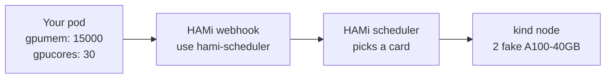

---
hide:
  - navigation
  - toc
title: "Lab 2: HAMi on your laptop (no GPU needed)"
---

<!-- GENERATED by tools/build_codelabs.py from tools/codelabs.yml. Edit the sources, not this file. -->

<div class="codelab-marker" data-catalog="../index.html"></div>

# Lab 2: HAMi on your laptop (no GPU needed)

<p class="codelab-bigtitle">Lab 2: HAMi on your laptop (no GPU needed)</p>

<div class="codelab-about" markdown>

### About this codelab

:material-text-box-outline: Last updated Nov 21, 2026

:material-account-circle: Written by DevFest Bengaluru

:material-timer-outline: 35 min + 15 min at home

</div>

## 1. Introduction { data-mins="2" }

You don't need a GPU for this part. You build a Kubernetes cluster on your laptop with **kind**, give it two **fake NVIDIA A100
cards**, and the **real HAMi scheduler** decides which team gets which slice of which card. It's the same decision HAMi makes on a
real GPU cluster: only the cards are pretend.

Based on HAMi's own [ContainerDays 2026 lab](https://workshop.project-hami.io/labs/containerdays-singapore/), with every command
written out (no setup script) so you can see each piece.



| # | Problem | Fix |
|---|---|---|
| 1 | Kubernetes can't see a GPU | a **device plugin** (HAMi's mock one) |
| 2 | A whole GPU per pod is wasteful | ask for **memory (MB)** and **compute (%)** with HAMi |
| 3 | What if it doesn't fit? | HAMi says so: `CardInsufficientMemory` |
| 4 | Which card should a pod go to? | **binpack** or **spread** |
| 5 | Reserved isn't the same as used | two sets of metrics |

**What a fake GPU can't show:** real memory and compute limits inside the container. Your instructor shows that part live on a real H200.

**Time:** ~35 minutes in the room, plus ~15 minutes at home before the workshop.

## 2. Before the workshop (at home) { data-mins="15" }

Conference Wi-Fi is slow. Do this section at home: it downloads about 2 GB.

!!! step "Install the tools"
    You need **Docker** running ([Docker Desktop](https://www.docker.com/products/docker-desktop/), OrbStack or Colima) with
    4 CPUs and 8 GB of memory free.

    ```bash
    # kind (Kubernetes in Docker), kubectl, helm, jq and git (macOS; on Windows use winget or choco, on Linux your package manager)
    brew install kind kubectl helm jq git
    # check each one answers
    docker version --format '{{.Server.Version}}'; kind version; kubectl version --client; helm version --short
    ```

!!! step "Download the images"
    ```bash
    # the Kubernetes node image kind runs
    docker pull kindest/node:v1.37.0
    # HAMi, its mock device plugin, and a helper for HAMi's certificates
    docker pull docker.io/projecthami/hami:v2.10.0
    docker pull docker.io/projecthami/mock-device-plugin:latest
    docker pull docker.io/liangjw/kube-webhook-certgen:v1.1.1
    # a tiny image for the team pods, and a fake vLLM server
    docker pull busybox:1.36
    docker pull ghcr.io/llm-d/llm-d-inference-sim:v0.12.0
    ```

!!! step "Build the mock GPU monitor"
    It turns "load" into GPU usage numbers, the way HAMi's monitor does on a real GPU. It has no published image yet, so we build it.

    ```bash
    # its source code
    git clone https://github.com/fishman/hami-mock-monitor ~/hami-mock-monitor
    # build the image on your laptop (~2 min)
    docker build -t hami-mock-monitor:dev ~/hami-mock-monitor
    ```

    !!! see "You should see"
        `naming to docker.io/library/hami-mock-monitor:dev` at the end.

## 3. Create your cluster { data-mins="3" }

!!! step "A Kubernetes cluster in one container"
    ```bash
    # one-node Kubernetes cluster called hami-lab (~1 min)
    kind create cluster --name hami-lab --image kindest/node:v1.37.0
    # kubectl now talks to it
    kubectl get nodes
    ```

    !!! see "You should see"
        `hami-lab-control-plane   Ready   control-plane`. One node that is both the control plane and the worker.

!!! step "Copy the images into the cluster"
    The cluster has its own image store. Load what you downloaded, so nothing comes over the Wi-Fi.

    ```bash
    # copy each image from Docker into the kind node
    for img in docker.io/projecthami/hami:v2.10.0 docker.io/projecthami/mock-device-plugin:latest docker.io/liangjw/kube-webhook-certgen:v1.1.1 busybox:1.36 ghcr.io/llm-d/llm-d-inference-sim:v0.12.0 hami-mock-monitor:dev; do kind load docker-image $img --name hami-lab; done
    ```

## 4. Problem 1: Kubernetes can't see a GPU { data-mins="3" }

!!! step "Dosa asks for a GPU"
    ```bash
    # a pod that asks for one NVIDIA GPU
    kubectl apply -f - <<'EOF'
    apiVersion: v1
    kind: Pod
    metadata: {name: gpu-dosa}
    spec:
      containers:
      - name: app
        image: busybox:1.36
        command: ["sleep", "86400"]
        resources: {limits: {nvidia.com/gpu: 1}}
    EOF
    # is it running?
    kubectl get pod gpu-dosa
    # why not?
    kubectl describe pod gpu-dosa | tail -2
    ```

    !!! see "You should see"
        `Pending` and `0/1 nodes are available: 1 Insufficient nvidia.com/gpu`.

!!! problem "No node has `nvidia.com/gpu`"
    ```bash
    # what the node offers: cpu, memory, pods ... no GPU
    kubectl get node hami-lab-control-plane -o jsonpath='{.status.allocatable}' | jq
    # remove the pending pod; we'll ask again the HAMi way
    kubectl delete pod gpu-dosa
    ```

    A GPU only appears in Kubernetes when a **device plugin** on the node advertises it.

## 5. Fix: install HAMi with two fake GPUs { data-mins="6" }

!!! step "Mark the node as a GPU node"
    ```bash
    # HAMi only manages nodes with this label
    kubectl label node hami-lab-control-plane gpu=on
    ```

!!! step "Install HAMi"
    ```bash
    # HAMi's Helm chart
    helm repo add hami-charts https://project-hami.github.io/HAMi/ && helm repo update hami-charts
    # HAMi 2.10 with the MOCK device plugin instead of the real one (there's no real GPU here) (~2 min)
    helm install hami hami-charts/hami -n kube-system --version 2.10.0 --set devicePlugin.enabled=false --set mockDevicePlugin.enabled=true --set mockDevicePlugin.image.tag=latest --set scheduler.kubeScheduler.image.registry=registry.k8s.io --set scheduler.kubeScheduler.image.repository=kube-scheduler --wait --timeout 8m
    # HAMi's parts: the scheduler (with its webhook) and the mock device plugin
    kubectl -n kube-system get pods | grep hami
    ```

    !!! see "You should see"
        `hami-scheduler-…   2/2   Running` (scheduler + webhook) and `hami-mock-device-plugin-…   Running`.

!!! step "Describe two fake A100 cards"
    On a real GPU node, HAMi's device plugin reads the cards from the NVIDIA driver and writes them on the node. Here we write them ourselves.

    ```bash
    # the node's GPU count: 2 cards x 10 slices each = 20 (the mock plugin checks this)
    kubectl patch node hami-lab-control-plane --subresource=status --type=json -p '[{"op":"add","path":"/status/capacity/nvidia.com~1gpu","value":"20"}]'
    # the card list HAMi's scheduler reads: two A100-40GB, 40960 MB and 100% compute each
    kubectl annotate node hami-lab-control-plane --overwrite 'hami.io/node-nvidia-register=[{"id":"GPU-mock-0","index":0,"count":10,"devmem":40960,"devcore":100,"type":"NVIDIA-A100-SXM4-40GB","health":true,"numa":0,"mode":"hami-core"},{"id":"GPU-mock-1","index":1,"count":10,"devmem":40960,"devcore":100,"type":"NVIDIA-A100-SXM4-40GB","health":true,"numa":0,"mode":"hami-core"}]'
    ```

!!! step "Install the mock GPU monitor"
    ```bash
    # the monitor you built at home; completeBinds=true finishes each GPU booking the way the real plugin would
    helm install hami-mock-monitor ~/hami-mock-monitor/charts/hami-mock-monitor -n kube-system --set image.repository=hami-mock-monitor --set image.tag=dev --set image.pullPolicy=IfNotPresent --set completeBinds=true --wait
    ```

!!! solution "The node now has GPUs, in slices"
    ```bash
    # GPU resources the node advertises now (run again after a few seconds if empty)
    kubectl get node hami-lab-control-plane -o json | jq '.status.allocatable | with_entries(select(.key | startswith("nvidia.com")))'
    # the two cards, as HAMi sees them
    kubectl get node hami-lab-control-plane -o jsonpath='{.metadata.annotations.hami\.io/node-nvidia-register}' | jq
    ```

    !!! see "You should see"
        `"nvidia.com/gpu": "20"`, `"nvidia.com/gpumem": "81920"` (MB, both cards), `"nvidia.com/gpucores": "200"` (% , both cards).

    ??? question "What if a card's `health` was `false`?"
        The scheduler would skip that card: only one A100 would be offered.

## 6. Problem 2: share a GPU { data-mins="5" }

With plain Kubernetes, `nvidia.com/gpu: 1` means **a whole card**. With HAMi, a pod also says **how much memory** and **how much compute**.

!!! step "Three teams, a slice each"
    ```bash
    # Dosa, Idli and Vada each ask for 15000 MB and 30% of ONE card
    for t in dosa idli vada; do
    kubectl apply -f - <<EOF
    apiVersion: v1
    kind: Pod
    metadata:
      name: gpu-$t
      annotations: {hami-mock-monitor.io/load-source: seed}
    spec:
      containers:
      - name: app
        image: busybox:1.36
        command: ["sleep", "86400"]
        resources:
          limits: {nvidia.com/gpu: 1, nvidia.com/gpumem: 15000, nvidia.com/gpucores: 30}
    EOF
    done
    # all three start
    kubectl wait --for=condition=Ready pod/gpu-dosa pod/gpu-idli pod/gpu-vada --timeout=120s
    ```

!!! step "Which card did each team get?"
    ```bash
    # HAMi writes its decision on each pod: card, type, MB, % compute
    for t in dosa idli vada; do echo -n "$t  "; kubectl get pod gpu-$t -o jsonpath='{.metadata.annotations.hami\.io/vgpu-devices-allocated}{"\n"}'; done
    ```

    !!! see "You should see"
        Something like `dosa  GPU-mock-1,NVIDIA,15000,30:;`. Three pods on **two cards**: at least two teams share one A100.

!!! step "Who scheduled them?"
    ```bash
    # you never asked for it, but the pod is handled by HAMi's scheduler
    kubectl get pod gpu-dosa -o jsonpath='{.spec.schedulerName}{"\n"}'
    ```

    !!! see "You should see"
        `hami-scheduler`. HAMi's **webhook** changed it when the pod was created.

!!! takeaway "How HAMi books a slice"
    1. The **webhook** sends GPU pods to `hami-scheduler`.
    2. The **scheduler** reads the card list on the node, finds a card with enough free MB and %, and writes it on the pod
       (`hami.io/vgpu-devices-allocated`).
    3. The **device plugin** gives the container that card. On a real GPU, **HAMi-core** inside the container then enforces the
       MB and % limits.

## 7. Problem 3: what if it doesn't fit? { data-mins="3" }

!!! step "Chai asks for too much"
    ```bash
    # 45000 MB: bigger than any one 40960 MB card
    kubectl apply -f - <<'EOF'
    apiVersion: v1
    kind: Pod
    metadata: {name: gpu-chai}
    spec:
      containers:
      - name: app
        image: busybox:1.36
        command: ["sleep", "86400"]
        resources:
          limits: {nvidia.com/gpu: 1, nvidia.com/gpumem: 45000, nvidia.com/gpucores: 30}
    EOF
    # status, and HAMi's reason
    sleep 5; kubectl get pod gpu-chai; kubectl get events --field-selector involvedObject.name=gpu-chai | tail -2
    ```

    !!! see "You should see"
        `Pending` and `CardInsufficientMemory`. The node has 81920 MB in total, but **no single card** has 45000 MB.

!!! step "Clean up"
    ```bash
    # remove the four team pods
    kubectl delete pod gpu-dosa gpu-idli gpu-vada gpu-chai
    ```

## 8. Problem 4: which card? { data-mins="5" }

HAMi can **binpack** (fill one card first, keep the other free for a big job) or **spread** (one pod per card, fewer neighbours).
A pod picks with an annotation.

!!! step "Binpack: same card"
    ```bash
    # two pods asking to be packed together
    for t in dosa idli; do
    kubectl apply -f - <<EOF
    apiVersion: v1
    kind: Pod
    metadata:
      name: pack-$t
      annotations: {hami.io/gpu-scheduler-policy: binpack}
    spec:
      containers:
      - name: app
        image: busybox:1.36
        command: ["sleep", "86400"]
        resources:
          limits: {nvidia.com/gpu: 1, nvidia.com/gpumem: 15000, nvidia.com/gpucores: 30}
    EOF
    done
    kubectl wait --for=condition=Ready pod/pack-dosa pod/pack-idli --timeout=120s
    # which card each got
    for p in pack-dosa pack-idli; do echo -n "$p  "; kubectl get pod $p -o jsonpath='{.metadata.annotations.hami\.io/vgpu-devices-allocated}{"\n"}'; done
    ```

    !!! see "You should see"
        The **same** `GPU-mock-X` twice.

!!! step "Spread: different cards"
    ```bash
    # remove them, then the same two pods with the spread policy
    kubectl delete pod pack-dosa pack-idli
    for t in dosa idli; do
    kubectl apply -f - <<EOF
    apiVersion: v1
    kind: Pod
    metadata:
      name: spread-$t
      annotations: {hami.io/gpu-scheduler-policy: spread}
    spec:
      containers:
      - name: app
        image: busybox:1.36
        command: ["sleep", "86400"]
        resources:
          limits: {nvidia.com/gpu: 1, nvidia.com/gpumem: 15000, nvidia.com/gpucores: 30}
    EOF
    done
    kubectl wait --for=condition=Ready pod/spread-dosa pod/spread-idli --timeout=120s
    for p in spread-dosa spread-idli; do echo -n "$p  "; kubectl get pod $p -o jsonpath='{.metadata.annotations.hami\.io/vgpu-devices-allocated}{"\n"}'; done
    ```

    !!! see "You should see"
        `GPU-mock-0` and `GPU-mock-1`: one pod per card. Same requests, different policy, different placement.

    ??? note "The other axis: which node"
        `hami.io/node-scheduler-policy: binpack|spread` does the same across **nodes**. Our cluster has one node, so there's nothing to choose.

## 9. Problem 5: reserved isn't used { data-mins="5" }

!!! step "What HAMi reserved"
    ```bash
    # the scheduler's metrics: how much of each card is BOOKED (read through the API server, no port-forward)
    kubectl get --raw "/api/v1/namespaces/kube-system/pods/$(kubectl -n kube-system get pod -l app.kubernetes.io/component=hami-scheduler -o jsonpath='{.items[0].metadata.name}'):9395/proxy/metrics" | grep '^hami_' | grep -v build_info
    ```

!!! step "A fake vLLM server"
    ```bash
    # a vLLM-compatible simulator on a third of a card; its busy-ness goes up and down every 2 minutes
    kubectl apply -f - <<'EOF'
    apiVersion: v1
    kind: Pod
    metadata:
      name: sim
      annotations: {hami-mock-monitor.io/load-source: vllm}
    spec:
      containers:
      - name: sim
        image: ghcr.io/llm-d/llm-d-inference-sim:v0.12.0
        args: ["--model=fake-model", "--port=8000", "--max-num-seqs=5", '--fake-metrics={"running-requests":"oscillate:0:5:2m"}']
        ports: [{name: http, containerPort: 8000}]
        resources:
          limits: {nvidia.com/gpu: 1, nvidia.com/gpumem: 13653, nvidia.com/gpucores: 33}
    EOF
    kubectl wait --for=condition=Ready pod/sim --timeout=120s
    ```

!!! step "What it actually uses"
    ```bash
    # the monitor's metrics: how much each pod USES; run it a few times, 30 s apart
    kubectl get --raw "/api/v1/namespaces/kube-system/pods/$(kubectl -n kube-system get pod -l app.kubernetes.io/name=hami-mock-monitor -o jsonpath='{.items[0].metadata.name}'):9394/proxy/metrics" | grep '^hami_' | grep 'pod="sim"'
    ```

    !!! see "You should see"
        Utilisation moving between **0 and ~33%**, while memory stays at **~90% of its limit**: vLLM grabs its memory up front,
        busy or not. (That's the vLLM gotcha, on a pretend GPU.)

!!! takeaway "Two numbers"
    **Reserved** (scheduler) is what's booked: it goes on the **capacity** dashboard. **Used** (monitor) is what's burning: it goes
    on the **cost and efficiency** report. A card can be 73% booked and 20% used.

## 10. What the real GPU adds, and clean up { data-mins="2" }

On a real GPU node, HAMi also injects **HAMi-core** into each container: a pod that asked for 15000 MB **can't** use more, and
one that asked for 30% gets about 30% of the cores. Your instructor shows that live on an H200.

??? note "Want the dashboard? HAMi WebUI (after the workshop)"
    The HAMi lab's [WebUI section](https://workshop.project-hami.io/labs/containerdays-singapore/#after-the-session-see-it-in-the-hami-webui)
    adds Prometheus and the HAMi WebUI to this same cluster.

??? note "Other schedulers and DRA"
    **KAI Scheduler** and **Volcano** can make the placement decisions and still use HAMi-core for the limits.
    **HAMi-DRA** turns `nvidia.com/gpu` requests into Kubernetes DRA ResourceClaims. Read more in the
    [HAMi lab, Lab 4](https://workshop.project-hami.io/labs/containerdays-singapore/#lab-4-beyond-the-default-scheduler).

!!! step "Delete the cluster"
    ```bash
    # removes the whole cluster (one Docker container)
    kind delete cluster --name hami-lab
    ```

!!! success "Done"
    You installed a real GPU scheduler, gave four teams slices of two GPUs, watched one request fail for a clear reason, changed where
    pods land with one annotation, and saw why reserved and used are different numbers. All without a GPU.
