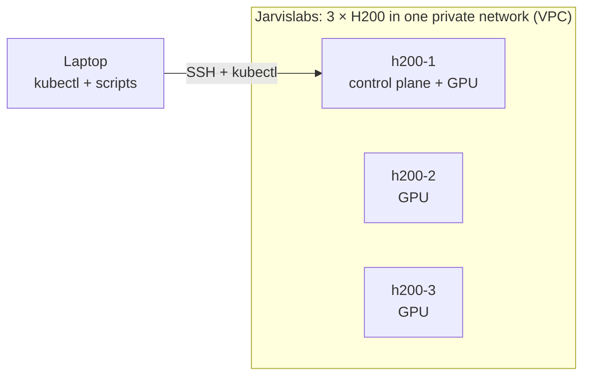

---
hide:
  - navigation
  - toc
title: "One GPU, Four Teams: a 3-VM Jarvislabs demo with kubeadm"
---

<!-- GENERATED by tools/build_codelabs.py from tools/codelabs.yml. Edit the sources, not this file. -->

<div class="codelab-marker" data-catalog="../index.html"></div>

# One GPU, Four Teams: a 3-VM Jarvislabs demo with kubeadm

<p class="codelab-bigtitle">One GPU, Four Teams: a 3-VM Jarvislabs demo with kubeadm</p>

<div class="codelab-about" markdown>

### About this codelab

:material-text-box-outline: Last updated Nov 21, 2026

:material-account-circle: Written by DevFest Bengaluru

:material-timer-outline: 90 min live + prep the day before

</div>

## 1. Introduction { data-mins="3" }

GPUs are the most expensive machines in a cluster, and giving every workload a whole one isn't always necessary.
We build a Kubernetes cluster from **3 Jarvislabs H200 GPU VMs**, all from a laptop, and then hit the real problems one by one:
how Kubernetes exposes and hands out a GPU, **time-slicing**, **NVIDIA MPS** and **multi-instance GPU (MIG)**, a noisy neighbour
on purpose, the gotchas that surprise teams, and **Gemma served with vLLM** on a shared GPU.



| # | Problem we hit | Fix |
|---|---|---|
| 1 | Does this app need a GPU? | measure it: CPU vs GPU |
| 2 | Kubernetes can't see the GPU | the **device plugin** (NVIDIA GPU Operator) |
| 3 | One idle pod takes a whole GPU, others wait | **time-slicing** |
| 4 | Time-slicing: noisy neighbour, no memory limits, one shared GPU per pod | **MPS**: caps per pod |
| 5 | MPS limits are soft | **MIG**: hardware slices |
| 6 | Model servers grab 90% of the GPU's memory | a memory budget per server |

**The four teams:** :material-food: **Dosa** (chat assistant) · :material-rice: **Idli** (greedy batch job) ·
:material-cookie: **Vada** (notebook) · :material-tea: **Chai** (evaluations). Each team's work is a pod named after it.

**You need:** 3 × H200 **VMs** on Jarvislabs in the **same private network**, with your SSH key · a laptop with `kubectl`,
`helm`, `jq` · a **Hugging Face** token with Gemma access · this repo. The cluster is built with **kubeadm**, the standard
Kubernetes installer, with **Cilium** as the pod network.

**Time:** 90 minutes live, plus ~15 minutes of prep the day before.

## 2. Prepare (the day before) { data-mins="25" }

!!! step "Get the repo and the laptop tools"
    ```bash
    # the workshop repo, with every script used below
    git clone https://github.com/YOUR-ORG/gke-gpu-sharing-workshop.git && cd gke-gpu-sharing-workshop
    # kubectl, helm and jq (macOS)
    brew install kubectl helm jq
    ```

!!! step "Describe your 3 VMs"
    ```bash
    # your settings: each VM's public IP, private IP and name, plus your SSH key
    cp scripts/demo/demo.conf.example scripts/demo/demo.conf && open -e scripts/demo/demo.conf
    # load them: $H1 $H2 $H3 = public IPs, $P1 $P2 $P3 = private IPs (run in every new terminal)
    source scripts/demo/env.sh
    # let plain "ssh root@..." use your Jarvislabs key
    ssh-add "$SSH_KEY"
    ```

    The **private IPs** (same VPC) are what the VMs use to talk to each other. Find them in the Jarvislabs console, or with
    `ssh root@$H1 hostname -I`.

!!! step "Check everything"
    ```bash
    # your Hugging Face token, only kept in this terminal
    export HF_TOKEN=hf_...
    # checks laptop tools, SSH to each VM, each VM's GPU and the private network
    ./scripts/demo/00-check.sh
    ```

    !!! see "You should see"
        `OK` for every line: each VM's GPU (`h200-1: NVIDIA H200, 143771 MiB`), its private IP, and that it reaches h200-1 privately.

Next, prepare **each VM** for kubeadm. Do it by hand on **h200-1** (`ssh root@$H1`), then repeat on h200-2 and h200-3.

!!! tip "Fast way: all 3 VMs at once"
    `./scripts/demo/01-prep.sh` runs exactly the steps below on every VM in parallel (~10 min).
    `OK   h200-1  >> Ready for kubeadm (v1.36.x)` for each one means you can skip to [Build the cluster](#3).

!!! step "On the VM: check the GPU driver"
    ```bash
    # log in to the VM (run the rest of this section there)
    ssh root@$H1
    # the driver is installed if this lists the H200
    nvidia-smi -L
    ```

    ??? failure "`nvidia-smi: command not found`"
        `apt-get update && apt-get install -y ubuntu-drivers-common && ubuntu-drivers install --gpgpu && reboot`, then log in again.

!!! step "On the VM: kernel settings Kubernetes needs"
    ```bash
    # Kubernetes needs swap off (now and after reboot)
    swapoff -a && sed -i '/\sswap\s/ s/^/#/' /etc/fstab
    # kernel modules for container networking
    printf "overlay\nbr_netfilter\n" > /etc/modules-load.d/k8s.conf && modprobe overlay && modprobe br_netfilter
    # let the VM forward pod traffic
    printf "net.bridge.bridge-nf-call-iptables=1\nnet.bridge.bridge-nf-call-ip6tables=1\nnet.ipv4.ip_forward=1\n" > /etc/sysctl.d/99-k8s.conf && sysctl --system >/dev/null
    ```

!!! step "On the VM: NVIDIA Container Toolkit"
    ```bash
    # NVIDIA's package repository
    curl -fsSL https://nvidia.github.io/libnvidia-container/gpgkey | gpg --dearmor --yes -o /usr/share/keyrings/nvidia-container-toolkit-keyring.gpg
    curl -fsSL https://nvidia.github.io/libnvidia-container/stable/deb/nvidia-container-toolkit.list | sed 's#deb https://#deb [signed-by=/usr/share/keyrings/nvidia-container-toolkit-keyring.gpg] https://#' > /etc/apt/sources.list.d/nvidia-container-toolkit.list
    # the toolkit: lets containers use the GPU
    apt-get update -q && apt-get install -y -q nvidia-container-toolkit
    ```

!!! step "On the VM: containerd, with NVIDIA as the default runtime"
    ```bash
    # Jarvislabs images may run Docker: stop it so it doesn't fight containerd
    systemctl stop docker docker.socket 2>/dev/null; systemctl disable docker docker.socket 2>/dev/null
    # the container runtime Kubernetes talks to
    apt-get install -y -q containerd
    # its default config, using systemd cgroups (what the kubelet expects)
    mkdir -p /etc/containerd && containerd config default > /etc/containerd/config.toml && sed -i 's/SystemdCgroup = false/SystemdCgroup = true/' /etc/containerd/config.toml
    # make every container start through the NVIDIA runtime, then restart
    nvidia-ctk runtime configure --runtime=containerd --set-as-default && systemctl restart containerd
    ```

!!! step "On the VM: kubeadm, kubelet and kubectl"
    ```bash
    # the Kubernetes package repository (v1.36)
    mkdir -p /etc/apt/keyrings && curl -fsSL https://pkgs.k8s.io/core:/stable:/v1.36/deb/Release.key | gpg --dearmor --yes -o /etc/apt/keyrings/kubernetes-apt-keyring.gpg
    echo "deb [signed-by=/etc/apt/keyrings/kubernetes-apt-keyring.gpg] https://pkgs.k8s.io/core:/stable:/v1.36/deb/ /" > /etc/apt/sources.list.d/kubernetes.list
    # install the three tools and stop apt from upgrading them
    apt-get update -q && apt-get install -y -q kubelet kubeadm kubectl && apt-mark hold kubelet kubeadm kubectl
    ```

!!! step "On the VM: use the private network, and pre-pull images"
    ```bash
    # THIS VM's private IP, from demo.conf (h200-1 here; each VM uses its own)
    NODE_IP=10.0.0.21
    # the kubelet registers this node with its private IP, so nodes talk over the VPC
    echo "KUBELET_EXTRA_ARGS=--node-ip=$NODE_IP" > /etc/default/kubelet && systemctl restart kubelet
    # download Kubernetes' own images now, not during the demo
    kubeadm config images pull
    # start downloading the ~10 GB vLLM image in the background
    nohup ctr -n k8s.io images pull docker.io/vllm/vllm-openai:latest >/var/log/workshop-image-pull.log 2>&1 &
    # back to the laptop
    exit
    ```

    !!! see "You should see"
        `kubeadm config images pull` lists `registry.k8s.io/kube-apiserver:v1.36.x`, `etcd`, `coredns` … all pulled.

    Now repeat this section on `ssh root@$H2` and `ssh root@$H3`.

## 3. Build the cluster { data-mins="10" }

!!! step "1. Create the control plane on h200-1"
    ```bash
    # workshop settings for this terminal (run in every new terminal)
    source scripts/demo/env.sh
    # kubeadm init: start the API server, scheduler, controller manager and etcd on h200-1, on its private IP (~1 min)
    ssh root@$H1 kubeadm init --node-name h200-1 --apiserver-advertise-address $P1 --apiserver-cert-extra-sans $H1,127.0.0.1 --pod-network-cidr 10.244.0.0/16
    ```

    !!! see "You should see"
        `Your Kubernetes control-plane has initialized successfully!` and a `kubeadm join ...` line (we create a fresh one later).

    ??? question "What do the flags mean?"
        `--apiserver-advertise-address`: the other VMs reach the API server on the **private** IP. `--apiserver-cert-extra-sans`:
        the certificate also accepts the **public** IP, so your laptop can connect. `--pod-network-cidr`: the IP range for pods;
        each node gets a `/24` slice of it.

!!! step "2. kubectl on your laptop"
    ```bash
    # copy the admin kubeconfig to the laptop, pointing it at h200-1's public IP
    ssh root@$H1 cat /etc/kubernetes/admin.conf | sed "s#server: https://.*:6443#server: https://$API_HOST:6443#" > $KUBECONFIG
    # the machines in the cluster
    kubectl get nodes
    # the control plane's own pods
    kubectl get pods -n kube-system
    ```

    ??? failure "kubectl times out"
        Port 6443 on the public IP isn't open to your laptop. Set `API_VIA=tunnel` in `demo.conf`, run `./scripts/demo/tunnel.sh`
        (an SSH tunnel), `source scripts/demo/env.sh`, and repeat this step.

!!! problem "The node is `NotReady`"
    `h200-1   NotReady   control-plane`, and the two `coredns` pods are `Pending`. kubeadm doesn't include a **pod network**,
    so pods can't get IP addresses yet.

!!! solution "3. Fix: install Cilium as the pod network"
    ```bash
    # Cilium's Helm chart
    helm repo add cilium https://helm.cilium.io/ && helm repo update cilium
    # Cilium: VXLAN tunnel between the VMs' private IPs; pod IPs from each node's 10.244.x.0/24 slice (kubeadm's range)
    helm install cilium cilium/cilium -n kube-system --set routingMode=tunnel --set tunnelProtocol=vxlan --set ipam.mode=kubernetes
    # wait for the Cilium agent and operator (~1-2 min)
    kubectl -n kube-system rollout status ds/cilium && kubectl -n kube-system rollout status deploy/cilium-operator
    # Ready now, and coredns Running
    kubectl get nodes; kubectl get pods -n kube-system
    ```

    !!! see "You should see"
        `daemon set "cilium" successfully rolled out`, then `h200-1   Ready   control-plane`.

    ??? note "Same as the VirtualBox + Tailscale version, minus two things"
        No `MTU=1280` (that was only for Tailscale's smaller packets; the VPC uses the normal MTU) and no Tailscale IPs: everything
        uses the VPC private IPs. `ipam.mode=kubernetes` is new: Cilium's default pod range is `10.0.0.0/8`, which can clash with a `10.x` VPC.

    ??? why "Why Cilium?"
        It's a CNCF graduated pod network built on **eBPF** (programs in the Linux kernel), so it's fast and comes with network policy
        and observability (Hubble). Between VMs it uses a VXLAN tunnel over the private IPs, so the VPC needs no extra routes.

!!! step "4. Get h200-1 ready for workshop pods"
    ```bash
    # h200-1 has a GPU too: remove the "control plane only" taint so it runs workloads
    kubectl taint nodes h200-1 node-role.kubernetes.io/control-plane:NoSchedule-
    # labels the workshop scripts use to find GPU nodes
    kubectl label node h200-1 workshop.devfest/gpu=true workshop.devfest/table=h200-1
    # the small Python programs the demo pods run
    kubectl create configmap gpu-scripts --from-file=workloads/probe.py --from-file=workloads/burn.py --from-file=workloads/memhog.py
    # your Hugging Face token, stored in the cluster for Gemma
    kubectl create secret generic hf-token --from-literal=token="$HF_TOKEN"
    ```

!!! tip "Shortcut"
    `./scripts/demo/02-control-plane.sh` runs steps 1 to 4 in one go (useful for rehearsals and re-runs).

## 4. Problem 1: does it need a GPU? { data-mins="3" }

!!! step "Run the work on the CPU"
    ```bash
    # big matrix multiplications on the CPU only (no GPU requested)
    ./scripts/k8s/pod.sh burn-cpu
    # its speed, printed every 5 s (Ctrl+C to stop watching)
    kubectl logs -f burn-cpu
    ```

    !!! see "You should see"
        `... on CPU (N cores)` and **a few TFLOPS**. Remember the number.

!!! step "Ask for a GPU"
    ```bash
    # the same work, asking for nvidia.com/gpu: 1
    ./scripts/k8s/pod.sh burn-gpu
    # is it running? and if not, why?
    kubectl get pod burn-gpu; kubectl describe pod burn-gpu | tail -2
    ```

    !!! see "You should see"
        `Pending` and `0/1 nodes are available: 1 Insufficient nvidia.com/gpu`.

    ??? question "Show the YAML"
        ```bash
        # every pod.sh pod is plain YAML; --show prints it instead of creating it
        ./scripts/k8s/pod.sh burn-gpu --show
        ```

## 5. Problem 2: Kubernetes can't see the GPU { data-mins="6" }

!!! problem "The machine has a GPU, but Kubernetes doesn't know"
    ```bash
    # the VM itself sees its H200...
    ssh root@$H1 nvidia-smi -L
    # ...but the node advertises no nvidia.com/gpu
    kubectl describe node h200-1 | grep -A6 Allocatable
    ```

!!! solution "Fix: a device plugin (NVIDIA GPU Operator)"
    ```bash
    # install NVIDIA's device plugin, GPU labels, DCGM metrics and MIG manager (~3 min)
    ./scripts/k8s/gpu-operator.sh
    # the node now advertises 1 GPU
    kubectl get node h200-1 -o jsonpath='{.status.allocatable.nvidia\.com/gpu}{"\n"}'
    # and the pending pod starts on its own
    kubectl get pod burn-gpu -w
    ```

!!! step "CPU vs GPU, and how the GPU got into the pod"
    ```bash
    # the same work on the GPU
    kubectl logs burn-gpu | tail -2
    # the GPU the device plugin assigned to this pod
    kubectl exec burn-gpu -- nvidia-smi -L
    # tidy up
    kubectl delete pod burn-cpu burn-gpu
    ```

    !!! see "You should see"
        **Hundreds** of TFLOPS vs a few on the CPU. That's why we pay for GPUs.

!!! takeaway "How Kubernetes exposes a GPU"
    The **driver** is on the machine. The **device plugin** advertises `nvidia.com/gpu: N` on the node. A pod asks for a **whole number**;
    the scheduler just **counts**. The **container runtime** plugs the chosen GPU into the container.

## 6. Problem 3: one pod, one whole GPU { data-mins="7" }

!!! step "Add the other two GPU machines (kubeadm join)"
    ```bash
    # a fresh join command from the control plane: its private address, a token and the CA certificate hash
    JOIN=$(ssh root@$H1 kubeadm token create --print-join-command); echo $JOIN
    # h200-2 and h200-3 join over the private network (~1 min each)
    ssh root@$H2 "$JOIN --node-name h200-2"
    ssh root@$H3 "$JOIN --node-name h200-3"
    # mark them as workshop GPU nodes
    kubectl label node h200-2 workshop.devfest/gpu=true workshop.devfest/table=h200-2
    kubectl label node h200-3 workshop.devfest/gpu=true workshop.devfest/table=h200-3
    # Cilium starts on the new nodes; wait, then all 3 are Ready, with their private IPs
    kubectl -n kube-system rollout status ds/cilium; kubectl get nodes -o wide
    # every GPU in "exclusive" mode: 1 GPU = 1 pod
    ./scripts/k8s/mode.sh exclusive
    ```

    !!! see "You should see"
        Three `Ready` nodes with `INTERNAL-IP` = the private IPs, then `h200-1 1`, `h200-2 1`, `h200-3 1` in the GPU column.

    ??? failure "A node stays `NotReady` or the join hangs"
        `ssh root@$H2 journalctl -u kubelet -n 30`. Check the VPC lets the VMs reach each other on TCP 6443, 10250, 4240 and UDP 8472
        (Cilium's tunnel). To retry: `ssh root@$H2 kubeadm reset -f`, then join again. Shortcut: `./scripts/demo/03-join.sh h200-2`.

!!! step "Four teams, three GPUs"
    ```bash
    # each team starts a pod that holds a GPU and does nothing (like an open notebook)
    ./scripts/k8s/pod.sh hold dosa idli vada chai
    # where did they land?
    kubectl get pods -o wide
    ```

    !!! see "You should see"
        Three `Running`, **one per node**, and one `Pending` (`Insufficient nvidia.com/gpu`).

!!! step "How busy are those GPUs?"
    ```bash
    # utilisation of the GPU that Dosa's pod is holding
    kubectl exec hold-dosa -- nvidia-smi --query-gpu=utilization.gpu,memory.used --format=csv
    # clean up
    kubectl delete pod -l app=hold
    ```

    !!! see "You should see"
        `0 %` and almost no memory used.

!!! problem "One idle pod holds an entire H200"
    Kubernetes hands out GPUs **whole**: whole numbers, first come first served, knowing nothing about how busy a GPU is.

## 7. Strategy 1: time-slicing { data-mins="15" }

!!! step "Give each machine a sharing strategy"
    ```bash
    # h200-1: time-slicing, 4 pods take turns on the GPU
    NODE=h200-1 ./scripts/k8s/mode.sh ts
    # h200-2: NVIDIA MPS, 4 pods run together, each capped (next section)
    NODE=h200-2 ./scripts/k8s/mode.sh mps
    # h200-3: MIG, the GPU cut into 7 hardware slices (a few minutes; used later)
    NODE=h200-3 ./scripts/k8s/mode.sh mig
    ```

    !!! see "You should see"
        GPU column: `h200-1 4`, `h200-2 4`, `h200-3 7` (MIG may need a few minutes).

    ??? why "It's just a label"
        Each node's label picks a device plugin config from `scripts/k8s/device-plugin-config.yaml`. One H200 now advertises 4 "GPUs".

!!! step "Dosa alone: the baseline"
    ```bash
    # everything in this section runs on the time-slicing machine
    export TABLE=h200-1
    # Dosa's GPU-hungry job
    ./scripts/k8s/pod.sh burn dosa
    # Dosa's speed (Ctrl+C to stop watching)
    kubectl logs -f burn-dosa
    ```

    !!! see "You should see"
        A steady number, e.g. `620 TFLOPS`. Write it down.

!!! step "Noisy neighbours"
    ```bash
    # the other three teams start the same job on the same GPU
    ./scripts/k8s/pod.sh burn idli vada chai
    # watch Dosa again
    kubectl logs -f burn-dosa
    # proof it's one GPU: all four show the same UUID
    for t in dosa idli vada chai; do kubectl exec burn-$t -- nvidia-smi -L; done
    ```

    !!! see "You should see"
        Dosa drops to about **a quarter**, with the same `GPU-…` UUID in all four pods.

!!! problem "Noisy neighbour"
    Nobody touched Dosa's pod, yet it's 4× slower. With time-slicing **your speed depends on your neighbours**.

!!! step "Watch it in monitoring"
    ```bash
    # Prometheus + Grafana with NVIDIA's GPU dashboard (~3 min, once)
    ./scripts/k8s/monitoring.sh
    # Grafana's address: open it → Dashboards → NVIDIA DCGM Exporter
    echo "http://$CP_IP:30300"
    ```

    !!! see "You should see"
        h200-1 at ~100% utilisation. GPU metrics are **per GPU**: they can't tell you **which team** is causing it.

    ??? failure "Grafana doesn't open"
        Port 30300 may be blocked. Use `kubectl -n monitoring port-forward svc/monitoring-grafana 3000:80` and open `http://localhost:3000`.

!!! step "No memory limits"
    ```bash
    # stop the jobs
    kubectl delete pod -l app=burn
    # Idli grabs 130 GiB of the H200's ~140
    ./scripts/k8s/pod.sh memhog idli 130
    # Chai asks for a modest 20 GiB
    sleep 45; ./scripts/k8s/pod.sh memhog chai 20
    # what happened to Chai?
    sleep 20; kubectl logs memhog-chai | tail -1
    ```

    !!! see "You should see"
        Chai: `OUT OF MEMORY after 9 GiB`. **The polite pod crashes, not the greedy one.**

!!! step "Gotcha: only one shared GPU per pod"
    ```bash
    # one pod asking for 2 time-sliced "GPUs"
    ./scripts/k8s/pod.sh greedy
    # why did it fail?
    sleep 10; kubectl get pod greedy -o jsonpath='{.status.reason}{"\n"}'
    # clean up
    kubectl delete pod --all
    ```

    !!! see "You should see"
        `UnexpectedAdmissionError`. A time-slice is a turn in the queue, not a piece of the chip.

!!! takeaway "Time-slicing"
    **Isolates:** each process's memory addresses and crashes. **Doesn't isolate:** speed, memory, metrics. One shared GPU per pod.
    **Good for:** bursty, trusted work like notebooks and dev/test.

## 8. Strategy 2: NVIDIA MPS { data-mins="8" }

!!! step "What an MPS pod gets"
    ```bash
    # everything in this section runs on the MPS machine
    export TABLE=h200-2
    # print what the GPU looks like from inside an MPS pod
    ./scripts/k8s/pod.sh probe
    sleep 30; kubectl logs probe; kubectl delete pod probe
    ```

    !!! see "You should see"
        About **a quarter of the GPU**: fewer SMs, and a memory cap around 35 GiB.

!!! step "The noisy neighbour test, again"
    ```bash
    # Dosa alone
    ./scripts/k8s/pod.sh burn dosa
    sleep 40; kubectl logs burn-dosa | tail -1
    # three neighbours join
    ./scripts/k8s/pod.sh burn idli vada chai
    sleep 40; kubectl logs burn-dosa | tail -1
    ```

    !!! see "You should see"
        Dosa is capped lower than with time-slicing, but **barely changes** when the others start.

!!! step "Memory is capped too"
    ```bash
    # stop the jobs; Idli tries to grab 50 GiB
    kubectl delete pod -l app=burn; ./scripts/k8s/pod.sh memhog idli 50
    # Idli stops at its own ~35 GiB cap
    sleep 30; kubectl logs memhog-idli | tail -1; kubectl delete pod --all
    ```

!!! problem "MPS limits are soft"
    The caps are environment variables inside the pod (`CUDA_MPS_*`), pods need `hostIPC: true` (pod.sh adds it), and one crashing
    client can affect the others. Fine for **one trusted team**, not a wall.

## 9. Strategy 3: multi-instance GPU (MIG) { data-mins="7" }

!!! step "Seven GPUs from one"
    ```bash
    # everything in this section runs on the MIG machine
    export TABLE=h200-3
    # it now advertises 7 slices
    kubectl get node h200-3 -o jsonpath='{.status.allocatable.nvidia\.com/gpu}{"\n"}'
    # what a slice looks like from inside
    ./scripts/k8s/pod.sh probe
    sleep 30; kubectl logs probe; kubectl delete pod probe
    ```

    !!! see "You should see"
        `MIG 1g.18gb Device 0` and **~17 GiB total**: the pod can't even see the rest of the GPU.

!!! step "Noisy neighbours can't reach you"
    ```bash
    # four jobs, one per slice (smaller matrix to fit a slice)
    MATRIX=4096 ./scripts/k8s/pod.sh burn dosa idli vada chai
    # their speeds
    sleep 40; for t in dosa idli vada chai; do kubectl logs burn-$t | tail -1; done
    ```

    !!! see "You should see"
        Four **equal, steady** numbers. Each slice has its own cores, memory and bandwidth.

!!! step "A hard memory wall"
    ```bash
    # stop the jobs; Idli tries 24 GiB on its 18 GB slice
    kubectl delete pod -l app=burn; ./scripts/k8s/pod.sh memhog idli 24
    # it stops at its slice, and no setting can raise that
    sleep 30; kubectl logs memhog-idli | tail -1; kubectl delete pod --all
    ```

!!! takeaway "MIG"
    **Isolates:** compute, memory, bandwidth and faults, in hardware. **Costs:** big GPUs only (A100, H100, H200…), slice sizes fixed
    up front, one slice per pod.

## 10. Serve Gemma with vLLM on a shared GPU { data-mins="11" }

!!! step "A model server, the default way"
    ```bash
    # back on the time-slicing machine: Dosa's Gemma server with vLLM's defaults
    export TABLE=h200-1
    TEAM=dosa ./scripts/k8s/gemma.sh
    # wait until it's ready (~2-3 min the first time)
    kubectl rollout status deploy/gemma-dosa --timeout=10m
    # how much GPU memory did a 2 GB model take?
    kubectl exec deploy/gemma-dosa -- nvidia-smi --query-gpu=memory.used --format=csv
    ```

    !!! see "You should see"
        About **125 GB** used. vLLM reserves **90% of the GPU** up front, on purpose, to answer fast.

!!! step "A second team tries"
    ```bash
    # Vada's server: same defaults, same GPU
    TEAM=vada ./scripts/k8s/gemma.sh
    # it crashes; read why
    sleep 90; kubectl logs deploy/gemma-vada | grep -i -m1 memory
    ```

    !!! see "You should see"
        `Free memory on device ... is less than desired GPU memory utilization (0.9 ...)`, then `CrashLoopBackOff`.

!!! problem "Model servers preallocate memory"
    Kubernetes put Vada's pod there because a time-slice was free. Nothing checked memory.

!!! solution "Fix: give every server a memory budget"
    ```bash
    # redeploy Dosa with 20% of the GPU (~28 GB); this frees what it was holding
    GPU_UTIL=0.2 TEAM=dosa ./scripts/k8s/gemma.sh && kubectl rollout status deploy/gemma-dosa --timeout=10m
    # then Vada, also 20%
    GPU_UTIL=0.2 TEAM=vada ./scripts/k8s/gemma.sh && kubectl rollout status deploy/gemma-vada --timeout=10m
    ```

!!! step "Talk to it, then add a noisy neighbour"
    ```bash
    # connect the laptop to Dosa's server
    kubectl port-forward svc/gemma-dosa 8000:8000 >/dev/null 2>&1 &
    # ask Gemma something
    curl -s localhost:8000/v1/chat/completions -H 'Content-Type: application/json' -d '{"model":"'$MODEL'","max_tokens":80,"messages":[{"role":"user","content":"Three tips for Silk Board traffic?"}]}' | jq -r '.choices[0].message.content'
    # response time on a quiet GPU
    bash scripts/attendee/bench.sh 5
    # Idli starts a batch job on the same GPU, then time it again
    ./scripts/k8s/pod.sh burn idli; sleep 30; bash scripts/attendee/bench.sh 5
    ```

    !!! see "You should see"
        Answers get **slower** with the batch job on the same time-sliced GPU. For a chat service with speed promises: MPS or MIG.

!!! step "Clean up"
    ```bash
    # stop the port-forward and remove everything we started
    kill %1 2>/dev/null; kubectl delete deploy --all; kubectl delete svc gemma-dosa gemma-vada; kubectl delete pod --all
    ```

## 11. Choose a strategy { data-mins="4" }

| | Time-slicing | MPS | MIG |
|---|---|---|---|
| Speed with neighbours | drops | steady (capped) | steady |
| Memory limit | **none** | yes, soft | yes, hardware |
| GPUs | any NVIDIA | any NVIDIA | A100 / H100 / H200 / B200 |
| Pods per GPU | up to 48 | up to 48 | up to 7 |
| Shared GPUs per pod | **1** | 1 | **1** slice |
| Needs | nothing | `hostIPC: true` | slice size fixed up front |

- **Bursty, trusted, dev/test** → **time-slicing**, and cap memory in each app
- **Many steady jobs from one team** → **MPS**
- **Untrusted tenants or latency promises** → **MIG**
- **Big training jobs** → a **whole GPU**
- **Model servers on any shared GPU** → always set a memory budget (`--gpu-memory-utilization`)

??? note "Bonus: HAMi, enforced memory limits on any GPU"
    [HAMi](https://project-hami.io) (CNCF) lets a pod ask for `nvidia.com/gpumem` (MB) and `nvidia.com/gpucores` (%), and enforces both.

    ```bash
    # switch h200-2 to HAMi (installs it the first time)
    NODE=h200-2 ./scripts/k8s/mode.sh hami
    # Idli asks for 40 GiB but its pod is limited to 20 GB
    export TABLE=h200-2; ./scripts/k8s/pod.sh hami-memhog idli 40
    # it stops at its own 20 GB, enforced
    sleep 30; kubectl logs memhog-idli | tail -1; kubectl delete pod --all
    ```

## 12. Clean up { data-mins="3" }

!!! step "Tear everything down"
    ```bash
    # kubeadm reset: undo init/join on every VM, and remove the CNI config
    for ip in $H3 $H2 $H1; do ssh root@$ip "kubeadm reset -f; rm -rf /etc/cni/net.d"; done
    # forget the cluster on the laptop
    rm -f $KUBECONFIG
    ```

    Then **delete the 3 VMs** in the Jarvislabs console, and revoke the **Hugging Face token**.
    (`./scripts/demo/99-cleanup.sh` does the reset too.)

!!! success "Done"
    From three bare GPU machines to a shared GPU cluster: how Kubernetes exposes and hands out GPUs, all three sharing strategies,
    each one broken on purpose, and a real model on a shared GPU. Every command is in this repo to run again.
