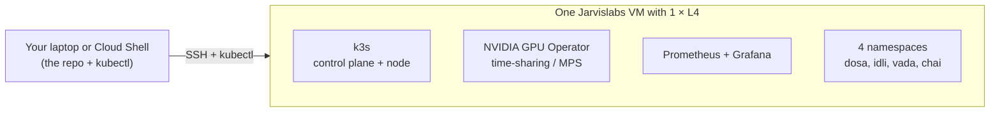

---
hide:
  - navigation
  - toc
title: "Run the GPU sharing labs on one Jarvislabs GPU VM"
---

<!-- GENERATED by tools/build_codelabs.py from tools/codelabs.yml. Edit the sources, not this file. -->

<div class="codelab-marker" data-catalog="../index.html"></div>

# Run the GPU sharing labs on one Jarvislabs GPU VM

<p class="codelab-bigtitle">Run the GPU sharing labs on one Jarvislabs GPU VM</p>

<div class="codelab-about" markdown>

### About this codelab

:material-text-box-outline: Last updated Nov 21, 2026

:material-account-circle: Written by DevFest Bengaluru

:material-timer-outline: 90 min + VM setup

</div>

## 1. Introduction { data-mins="3" }

!!! abstract "What you'll do"
    Build the workshop's GPU cluster yourself on **a single Jarvislabs GPU VM**: Kubernetes (k3s), NVIDIA's GPU Operator,
    GPU sharing and monitoring, all with the workshop's scripts. Then play all four teams in four terminal tabs and repeat every
    step of the workshop.



### What you'll need

- A **Jarvislabs** account with credits
- A terminal with `ssh`, `kubectl`, `helm`, `jq`, `curl` and `envsubst`. **Cloud Shell** has all of them.
- A free **Hugging Face** account that has accepted the [Gemma 3 licence](https://huggingface.co/google/gemma-3-1b-it), and a **read** token

### Cost

You pay per minute while the VM exists. An L4 VM for 2 hours costs a few dollars; check current prices on
[jarvislabs.ai](https://jarvislabs.ai). **Delete the VM when you're done** (last step).

## 2. Rent one GPU VM { data-mins="5" }

!!! step "Create the VM"
    In the Jarvislabs console, create a **VM** (not a template/container instance) with **1 × L4**, Ubuntu, and at least
    **8 vCPU / 32 GB RAM** and **150 GB** disk. Add your **SSH public key**.

    !!! see "You should see"
        The VM running, with a public IP address.

    !!! why "Why a VM?"
        Kubernetes needs root access and its own container runtime. Template instances are containers, so they can't run it.

!!! step "Check you can reach it"
    ```bash
    ssh root@<vm-ip> nvidia-smi -L
    ```

    !!! see "You should see"
        `GPU 0: NVIDIA L4 (UUID: GPU-…)`, or a message that `nvidia-smi` isn't found (the next steps install the driver).

## 3. Get the repo and configure it { data-mins="5" }

!!! step "Clone the workshop repo"
    ```bash
    git clone https://github.com/YOUR-ORG/gke-gpu-sharing-workshop.git
    cd gke-gpu-sharing-workshop
    cp scripts/jarvislabs/jl.conf.example scripts/jarvislabs/jl.conf
    ```

!!! step "Describe your one VM"
    Edit `scripts/jarvislabs/jl.conf`. Use the **same IP** as the server and as the only GPU node. That's what turns on **solo mode**:

    ```bash
    export SSH_KEY="$HOME/.ssh/id_ed25519"
    export SERVER_PUBLIC_IP="<vm-ip>"
    export SERVER_PRIVATE_IP="<vm-ip>"
    export GPU_NODES="
    <vm-ip> t01 table
    "
    export KC_SECRET="solo"
    export ATTENDEES_CSV="me.csv"
    ```

    !!! why "Solo mode"
        When the server's IP is also a GPU node, the scripts install one combined k3s node, skip the agent join, and don't
        taint the node (so the monitoring pods can run there too).

!!! step "Create your four teams"
    ```bash
    printf "email,table,team\nme,t01,dosa\nme,t01,idli\nme,t01,vada\nme,t01,chai\n" > scripts/jarvislabs/me.csv
    ```

!!! step "Point workshop.conf at your VM"
    In `workshop.conf`, make sure `PLATFORM="jarvislabs"` and set (inside the Jarvislabs block):

    ```bash
    export KUBECONFIG_BASE_URL="file://$HOME/gke-gpu-sharing-workshop/scripts/jarvislabs/out/kubeconfigs"
    export PROM_URL="http://<vm-ip>:30090"
    export GRAFANA_URL="http://<vm-ip>:30300"
    ```

    !!! why "file:// ?"
        You're the only attendee, so `setup.sh` can read your team's access file straight from disk; no download server needed.
        Adjust the path if you cloned the repo somewhere other than your home folder.

## 4. Prepare the VM { data-mins="25" }

!!! step "Run the preflight check"
    ```bash
    export HF_TOKEN=hf_...
    ./scripts/jarvislabs/00-doctor.sh
    ```

    !!! see "You should see"
        `OK` for your tools, SSH and the GPU. `WARN` lines about the toolkit, image, Gemma and ports are fine at this point.

!!! step "Install the slow parts"
    ```bash
    ./scripts/jarvislabs/prep-hosts.sh
    ```

    Installs the NVIDIA driver (if missing), the container toolkit, the ~10 GB workshop image and the Gemma model. Takes 10–20 minutes.

    !!! see "You should see"
        `OK <vm-ip> (table t01)`.

    ??? failure "REBOOT <vm-ip>"
        The driver was just installed. Run `ssh root@<vm-ip> reboot`, wait a minute, and run `prep-hosts.sh` again.

## 5. Build the cluster { data-mins="15" }

!!! step "Build it"
    ```bash
    ./scripts/jarvislabs/up.sh
    ```

    !!! see "You should see"
        Five `STAGE` banners and a green **CLUSTER READY**. Stage 4 also starts a small download server; you won't need it in solo mode.

    !!! why "What just happened"
        The same five stages the instructor ran live: k3s, GPU node, **GPU Operator** with the sharing configs, your namespaces, a status check.

!!! step "Check the GPU shows 4 slots"
    ```bash
    ./scripts/jarvislabs/status.sh
    ```

    !!! see "You should see"
        Your node with `STRATEGY=time-sharing` and `GPU=4`.

## 6. Become four teams { data-mins="3" }

!!! step "Open four terminal tabs"
    In each tab, from the repo folder, become a different team:

    ```bash
    source scripts/attendee/setup.sh t01 dosa     # tab 1
    source scripts/attendee/setup.sh t01 idli     # tab 2
    source scripts/attendee/setup.sh t01 vada     # tab 3
    source scripts/attendee/setup.sh t01 chai     # tab 4
    ```

    !!! see "You should see"
        The workshop banner in each tab, with `cluster: Plan B backup cluster (Jarvislabs)` and a different namespace.

## 7. Do the workshop steps { data-mins="60" }

!!! step "Follow the workshop codelab"
    Open **[One GPU, Four Teams (Jarvislabs edition)](gpu-sharing-jarvislabs.md)** and do steps 3 to 10.
    When a task names a team, switch to that tab.

!!! step "Switch strategies yourself"
    Before **NVIDIA MPS**, delete all pods in every tab, then:

    ```bash
    ./scripts/jarvislabs/04-switch-strategy.sh mps
    ```

    Before **Serve Gemma with vLLM**, switch back:

    ```bash
    ./scripts/jarvislabs/04-switch-strategy.sh ts
    ```

    !!! why "Why this matters"
        That one label change is all it takes: NVIDIA's device plugin restarts with a different config, and the same GPU is now shared a different way.

!!! tip "Memory on one VM"
    Everything shares one machine, so in the Gemma step run **two** Gemma servers (Dosa and Vada) rather than four.

## 8. Try MIG (optional) { data-mins="10" }

!!! step extra "Use an H100 or H200 VM instead"
    MIG needs a data-centre GPU. Create a VM with **1 × H100 or H200**, set its line in `GPU_NODES` to role `mig`
    (for example `<vm-ip> - mig`, also as the server), set `MIG_CONFIG`/`MIG_PROFILE` in `jl.conf` (H200: `all-1g.18gb` / `1g.18gb`)
    and `MIG_PARTITION` in `workshop.conf`, then run `prep-hosts.sh` and `up.sh` again.

    Whether MIG mode can be enabled depends on how the VM exposes the GPU. If `status.sh` never shows `GPU=7`, MIG isn't available on that VM.

## 9. Delete the VM { data-mins="2" }

!!! step "Stop the meter"
    Delete the VM in the Jarvislabs console. That removes the cluster too.

    !!! see "You should see"
        The VM gone from your instance list, and billing stopped.

    !!! tip "Want to keep the prep for later?"
        Run `YES=1 ./scripts/jarvislabs/reset.sh` to remove only Kubernetes, and **pause** the VM if Jarvislabs allows it. Paused VMs may get a new IP, so update `jl.conf` before the next `up.sh`.
