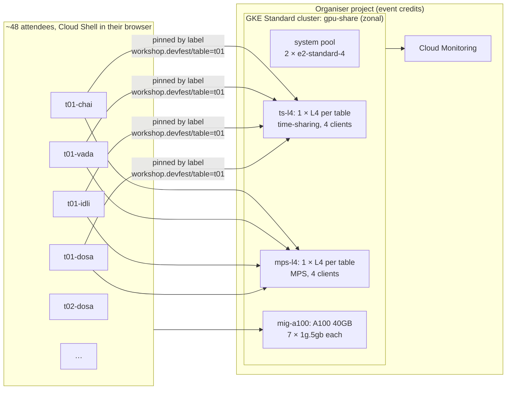

# Facilitator guide

This section is for **you, the organiser**. Attendees don't need it.

!!! success "Session: 3:00–4:30 PM (90 minutes)"
    Jarvislabs options: the **[3-VM kubeadm demo](../codelabs/jarvislabs-demo.md)**, or the **[live-built table cluster](../codelabs/planb-build.md)**
    with the **[Run of show](run-of-show.md)**. The GKE sections below apply if your GPU quota is approved in time.

## How the room is set up

- **One namespace per attendee** (`<table>-<team>`), with the `edit` role, a GPU quota of 3, and read-only access to nodes.
- **Each table of four shares one L4** in the time-sharing pool and one L4 in the MPS pool. Nodes carry a
  `workshop.devfest/table=tNN` label, and the lab manifests select on it. That's what makes "one GPU, four teams" literal.
- **MIG nodes are shared by everyone.** Hardware isolation makes table pinning unnecessary there.
- **One container image** for everything (`vllm/vllm-openai`, which includes PyTorch), pre-pulled onto every GPU node.
  **Gemma is pre-downloaded** into a hostPath cache, so attendees need no Hugging Face token and nobody waits on downloads.

!!! tip "Have a backup"
    If GKE isn't available on the day (credits, quota, GPU stock), run the same workshop on the
    **[Plan B · Jarvislabs](../planb/index.md)** backup cluster. Decide using its go/no-go table.

!!! tip "Have a backup"
    If GKE isn't available on the day, run the workshop on Jarvislabs: see **[Plan B · Jarvislabs](../planb/index.md)**.

## Who pays? Credits and attendees' $5

!!! warning "Attendees' $5 credits can't run the live labs"
    A new project or account usually has **0 GPU quota**, free-trial accounts can't use GPUs at all, and quota
    increases can take days. Don't plan on 50 people getting GPU quota on the day.

    **Run the live labs on one organiser project** and ask Google (your GDG/DevRel contact) for **event credits on
    that project**. Attendees then use their $5 for the [take-home](../codelabs/own-project.md#0) version.

## Capacity and cost (example: 48 attendees = 12 tables)

| Pool | Nodes | Machine | GPUs | Approx. on-demand $/h each* |
|---|---|---|---|---|
| system | 2 | `e2-standard-4` | 0 | ~0.15 |
| `ts-l4` | 12 | `g2-standard-8` | 12 × L4 | ~0.85 |
| `mps-l4` | 12 | `g2-standard-8` | 12 × L4 | ~0.85 |
| `mig-a100` | 7 | `a2-highgpu-1g` | 7 × A100 40GB → 49 slices | ~3.7 |
| `demo-cpu` (finale) | 2 | `e2-standard-8` | 0 | ~0.27 |
| + 1 stage L4 in `ts-l4` (finale) | 1 | `g2-standard-8` | 1 × L4 | ~0.85 |

For **4 hours** (90 minutes of setup, 2 hours of workshop, 30 minutes of buffer) that comes to roughly
**$180–220**. The GKE management fee is small next to that.

\* Indicative `us-central1` prices. They vary by region and change, so check the [pricing calculator](https://cloud.google.com/products/calculator).
To save money: `POOLS="ts mps"` (skip A100s) and run Step 7 as a projector demo on a single A100 node (`MIG_NODES=1`).

### Quota to request (2–3 weeks before)

| Quota (region of your zone) | For 12 tables + 7 A100 |
|---|---|
| `NVIDIA_L4_GPUS` | 24 |
| `NVIDIA_A100_GPUS` | 7 |
| `GPUS_ALL_REGIONS` (global) | 31 |
| `CPUS` (regional) + per-family CPU quotas for G2 / A2 if shown | ~290 |
| `SSD_TOTAL_GB` / `DISKS_TOTAL_GB` | 31 × 200 GB |

Quota doesn't guarantee **capacity**. L4 and A100 stockouts happen. For peace of mind, create a
[specific reservation](https://cloud.google.com/compute/docs/instances/reservations-overview) on the morning
of the event, and have a fallback zone ready in `workshop.conf`.

## Timeline

| When | What |
|---|---|
| **T-3 weeks** | Get event credits on the organiser project. Request quota. Fork the repo and fill in `workshop.conf`. Make sure the registration form collects the **Google account email** each attendee will use. |
| **T-1 week** | **Full rehearsal** with `TABLES=1 MIG_NODES=1` (cost: a few dollars). Go through the [rehearsal checklist](rehearsal.md). Pin `IMAGE` to the tag you tested. |
| **T-2 days** | Email attendees the [Module 1 · Foundations](../codelabs/foundations.md#0) link: the 20-minute primer plus "open Cloud Shell once and accept the terms". Remind them to use the Google account they registered with. |
| **T-1 day** | Export the final attendee CSV (`email,table,team`). Print [table cards](table-card.md). Deploy the site (or plan to run it locally). |
| **T-90 min** | `TABLES=13 POOLS="ts mps mig demo" 01-create-cluster.sh` (12 tables + 1 stage L4) (pools take ~10–20 min; MIG nodes reboot once). |
| **T-60 min** | `STAGE=1 02-label-tables.sh` (reserves stage GPU `t00`), `03-onboard-attendees.sh attendees.csv`, `HF_TOKEN=… 04-prepull-and-cache.sh`, `05-smoke-test.sh`, `06-dashboard.sh`, `HF_TOKEN=… 07-otel-demo.sh` (finale; Gemma 4 download takes a while). |
| **T-10 min** | Projector: the site, Cloud Shell, and the monitoring dashboard in tabs. |
| **During Step 2** | Walk-ins: add rows to a CSV and run `03-onboard-attendees.sh` on them. Keep **1–2 spare tables** for walk-ins. |
| **Right after** | `99-teardown.sh attendees.csv`, and revoke the HF token. |

## Scripts

All in `scripts/facilitator/`, all read `workshop.conf`:

| Script | Does |
|---|---|
| `01-create-cluster.sh` | Cluster + `ts-l4`, `mps-l4`, `mig-a100` pools (`TABLES`, `MIG_NODES`, `POOLS`, `SPOT`) |
| `02-label-tables.sh` | Labels L4 nodes `t01…tNN`. Re-run if a node is recreated. |
| `03-onboard-attendees.sh` | IAM, namespaces, RBAC, quota, scripts configmap from a CSV (`GROUP=` for a Google Group) |
| `04-prepull-and-cache.sh` | DaemonSet that pulls the image and caches Gemma on every GPU node |
| `05-smoke-test.sh` | Runs `probe.py` on time-sharing, MPS and MIG |
| `06-dashboard.sh` | Cloud Monitoring dashboard for the projector |
| `07-otel-demo.sh` | Finale: OpenTelemetry Astronomy Shop + live Gemma 4 on the stage GPU + a switchable noisy neighbour |
| `99-teardown.sh` | Deletes the cluster and removes IAM bindings |

## Helpers

Plan one helper per ~12 attendees. Brief them on [Troubleshooting](../reference/troubleshooting.md).
Most problems will be: the wrong Google account, a table not going in order, and leftover pods holding slots.
