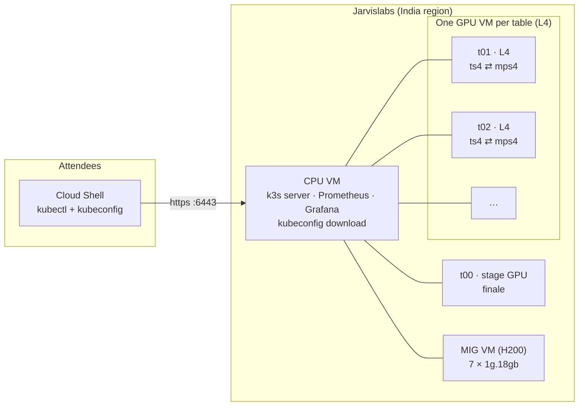

# Plan B · Jarvislabs backup cluster

Facilitator · Plan B
:material-timer-outline: build: ~2 hours the day before
[Build it :material-arrow-right:](../codelabs/planb-build.md#0){ .skip }

!!! success "Jarvislabs options"
    - **Live demo on 3 VMs with kubeadm:** the **[Jarvislabs demo codelab](../codelabs/jarvislabs-demo.md)**, run from your laptop end to end.
    - **Live-built table cluster for attendees:** **[Build the workshop cluster on Jarvislabs (live)](../codelabs/planb-build.md)**.
    `workshop.conf` defaults to `PLATFORM="jarvislabs"`; switch it to `"gke"` if your GPU quota is approved.

!!! abstract "What this is"
    A complete backup in case **GKE isn't available** on the day: credits don't arrive, quota isn't approved, GPUs are out of stock
    in the zone, or the project breaks. Plan B runs **the same labs, the same commands and the same scripts** on a small Kubernetes
    cluster (k3s) built from **Jarvislabs GPU VMs**. Attendees still use **Cloud Shell**, or any terminal with `kubectl`.

## What changes for attendees: almost nothing

| | Plan A (GKE) | Plan B (Jarvislabs) |
|---|---|---|
| Terminal | Cloud Shell | Cloud Shell (or any terminal with `kubectl`) |
| Step 2 setup command | `source scripts/attendee/setup.sh t07 dosa` | **the same** (it downloads a kubeconfig instead of using Google IAM) |
| Lab manifests | GKE labels | **the same**: nodes carry GKE-compatible labels |
| Time-sharing / MPS | two node pools | one GPU VM per table, **switched** by the facilitator between labs |
| MIG | A100 `1g.5gb` | H200 `1g.18gb` (or H100/A100), via NVIDIA MIG manager |
| Step 5 monitoring | Cloud Monitoring | **Grafana + DCGM exporter** ([steps](differences.md#step-5-grafana-instead-of-cloud-monitoring)) |
| Gemma / vLLM, finale | GKE | **the same** |

Every lab page has a small **:material-alert: Plan B** box where something differs. Attendee-facing details are on [What changes on Plan B](differences.md).

## How it's built

- **k3s** is a lightweight, certified Kubernetes. One CPU VM is the server; every GPU VM joins as a node.
- **NVIDIA GPU Operator** provides what GKE manages for you: the **device plugin** (with time-slicing, MPS and MIG configs),
  **DCGM exporter** for GPU metrics, and **MIG manager**. The host driver and container toolkit are installed by our script.
- Nodes get the **same labels as GKE** (`cloud.google.com/gke-gpu-sharing-strategy`, `…/gke-max-shared-clients-per-gpu`,
  `…/gke-gpu-partition-size`, `workshop.devfest/table`), so every lab manifest works unchanged.
- The workshop image is rebuilt on each node with a tiny **`nvidia-smi` path shim**, so commands like
  `/usr/local/nvidia/bin/nvidia-smi` work exactly as on GKE.

## When to switch: go / no-go

| When | Check | If it fails |
|---|---|---|
| **T-7 days** | GKE credits received, quota approved, rehearsal passed | Rehearse Plan B too ([build](../codelabs/planb-build.md#0) with 1 table) |
| **T-1 day, evening** | `01-create-cluster.sh` dry run in the zone; GPU stock looks OK | **Build Plan B** fully tonight, keep VMs **paused** if Jarvislabs allows, otherwise budget for them running |
| **T-90 min** | GKE pools create successfully | Start Plan B VMs, set `PLATFORM="jarvislabs"` in `workshop.conf`, push |
| **T-30 min** | `05-smoke-test.sh` passes on GKE | Switch to Plan B (it's already built), announce it at the start |

!!! tip "The switch for attendees is one line"
    In `workshop.conf`, change `export PLATFORM="gke"` to `export PLATFORM="jarvislabs"`, fill in the three Plan B URLs,
    and push. Attendees `git clone` at Step 2, so they pick it up automatically.

## Cost (example: 12 tables)

| VMs | Count | Notes |
|---|---|---|
| CPU VM (k3s server, monitoring, kubeconfig download) | 1 | 8 vCPU / 32 GB if you also run the finale |
| L4 GPU VM (one per table) | 12 | same GPU as Plan A, so lab numbers match |
| Stage GPU VM (finale) | 1 | L4 is enough |
| MIG VM (H200 or H100) | 1 | Step 7 as a demo, or 7 attendees at a time |

Check current prices on [jarvislabs.ai](https://jarvislabs.ai). They bill per minute, so you only pay while VMs exist. Delete everything right after the event.

!!! warning "Verify on Jarvislabs before you rely on it"
    These are the assumptions this plan makes. Check each one during a 1-table rehearsal ([checklist](../codelabs/planb-build.md#7)):
    VMs (not container instances) with **root SSH**; **Docker** available; the **NVIDIA driver** present or installable; VMs can reach
    each other (private networking or public IPs) and attendees can reach **port 6443** on the server; **MIG mode** can be enabled on the H200/H100 VM.
