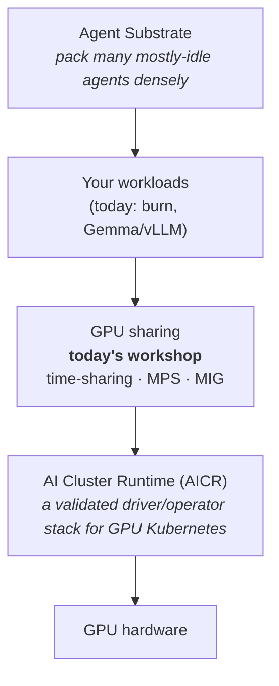

# What's next: AICR and Agent Substrate

These two new open-source projects aren't part of the hands-on labs. They sit on either side of today's topic,
so they're worth knowing about. Both are new and changing quickly, so check their docs for current details.

## NVIDIA AI Cluster Runtime (AICR)

Select each tab to learn more.

=== "What it is"

    An open-source NVIDIA project that publishes **validated, version-locked "recipes"** for GPU-accelerated Kubernetes clusters.
    A recipe captures a known-good combination of **drivers, operators, kernel and system settings**, and produces
    artifacts for Helm, Argo CD, Flux or Helmfile. Recipes are built from layers (base, environment, intent, hardware),
    and the `aicr` CLI can snapshot a cluster, generate recipes and validate them.

=== "How it relates to today"

    On **GKE**, Google installs and manages the GPU driver and device plugin for you. That's why Step 3 just worked.
    AICR matters most when **you** own that layer: self-managed clusters, on-prem, or rented GPU VMs. In those places,
    the NVIDIA GPU Operator settings for time-slicing, MPS or MIG ([Beyond GKE](beyond-gke.md)) are exactly the kind of
    configuration a recipe pins down and validates.

=== "When to look at it"

    - You're building GPU Kubernetes outside GKE and keep getting bitten by driver/operator version mismatches.
    - You run inference stacks like **NVIDIA Dynamo** and want a tested runtime underneath.

**Read more:** [AICR docs](https://docs.nvidia.com/aicr/overview/introduction/) · [GitHub: NVIDIA/aicr](https://github.com/NVIDIA/aicr)

## Agent Substrate

=== "What it is"

    A **Kubernetes-native runtime for workloads that are idle most of the time**: AI agents, sandboxes and stateful services.
    Instead of one always-on pod per agent, it decouples an agent's lifecycle from the pod so agents can be packed densely, paused and
    resumed quickly. It's open source, runs on any Kubernetes, and Google has published guidance for running it on GKE.

=== "How it relates to today"

    It's the **same economics** as GPU sharing, one level up. Today you saw that one workload per GPU wastes an expensive chip.
    Agent Substrate makes the same point about one pod per agent: most agents sit waiting. In an agentic app the agents
    themselves (planning, calling tools) can be packed with Agent Substrate, while the **model they call** runs on a shared GPU
    with the techniques from Steps 4–8.

=== "When to look at it"

    - You're building agents that run many short, sandboxed tool calls.
    - You want scale-to-zero and fast resume for lots of mostly-idle agents.

**Read more:** [About Agent Substrate on GKE](https://docs.cloud.google.com/kubernetes-engine/ai-ml/about-agent-substrate) ·
[GitHub: agent-substrate/substrate](https://github.com/agent-substrate/substrate) ·
[NVIDIA blog](https://developer.nvidia.com/blog/agent-substrate-advancing-kubernetes-for-agents-at-scale/)

!!! takeaway "Key takeaway"
    - **AICR** keeps the layer *under* GPU sharing consistent (drivers, operators). GKE does this for you; AICR helps everywhere else.
    - **Agent Substrate** applies the "don't waste idle capacity" idea to *agents* above the GPU.
    - Today's skills, knowing what each sharing strategy does and doesn't isolate, apply to both.
