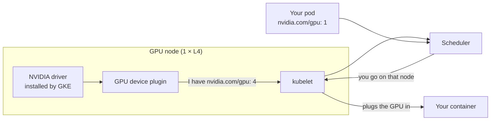

# Step 3 · How GKE gives a pod a GPU

<div class="lesson-head" markdown>
<span class="pill">Module 2 · Step 3 of 7</span>
<span class="pill time">:material-timer-outline: 15 min</span>
<span class="pill who">:material-account: everyone on their own</span>
[Skip to Step 4 :material-arrow-right:](02-time-sharing.md){ .skip }
</div>

!!! abstract "What you'll do"
    Kubernetes doesn't really know what a GPU is. It sees each node as having a **number of GPU "chairs"**.
    You'll look at the GPU machines, count their chairs, and run your first pod that sits in one.



!!! step "List the GPU machines"
    ```bash
    kubectl get nodes -l cloud.google.com/gke-accelerator \
      -L cloud.google.com/gke-accelerator,cloud.google.com/gke-gpu-sharing-strategy,cloud.google.com/gke-max-shared-clients-per-gpu,cloud.google.com/gke-gpu-partition-size,workshop.devfest/table
    ```

    !!! see "You should see"
        A list of nodes with extra columns. There are three kinds:

        | Pool | `GKE-ACCELERATOR` | `GKE-GPU-SHARING-STRATEGY` | `MAX-SHARED-CLIENTS` | `PARTITION-SIZE` |
        |---|---|---|---|---|
        | `ts-l4` | `nvidia-l4` | `time-sharing` | `4` | |
        | `mps-l4` | `nvidia-l4` | `mps` | `4` | |
        | `mig-a100` | `nvidia-tesla-a100` | | | `1g.5gb` |

    !!! why "Why this matters"
        These **labels** are how you pick a sharing strategy. You never configure sharing in your pod; you choose a node that was
        **created** with it.

    ??? question "Reading this command"
        `-l …` keeps only nodes **with** a GPU label. `-L a,b,c` adds a column for each label. The `\` at the end of a line just continues the command.

!!! step "Find your table's time-sharing GPU"
    ```bash
    TS_NODE=$(kubectl get nodes -l workshop.devfest/table=$TABLE,cloud.google.com/gke-gpu-sharing-strategy=time-sharing -o name)
    echo $TS_NODE
    ```

    !!! see "You should see"
        One node name, like `node/gke-gpu-share-ts-l4-8c1f-x7k2`.

    !!! why "Why this matters"
        That's the **one GPU your whole table shares**. `$( … )` runs a command and saves its answer in the variable `TS_NODE`.

!!! step "Count its GPU chairs"
    ```bash
    kubectl describe $TS_NODE | grep -E "nvidia.com/gpu|Capacity|Allocatable"
    ```

    !!! see "You should see"
        ```text
        Capacity:
          nvidia.com/gpu:     4
        Allocatable:
          nvidia.com/gpu:     4
        ```

    !!! why "Why this matters"
        The node has **one** physical L4, but tells Kubernetes it has **4**, because its pool was created with
        `max-shared-clients-per-gpu=4`. The scheduler now sees **four chairs**.

        Does it know how much memory or speed each chair gets? **No, nothing at all.** Remember this for Step 4.

!!! step "Spot the \"keep out\" sign"
    ```bash
    kubectl describe $TS_NODE | grep -A1 Taints
    ```

    !!! see "You should see"
        ```text
        Taints:             nvidia.com/gpu=present:NoSchedule
        ```

    !!! why "Why this matters"
        A **taint** keeps ordinary pods off this expensive machine. Only pods that ask for a GPU get let in.
        GKE adds the matching permission to GPU pods for you automatically.

!!! step "See who makes the GPU appear"
    ```bash
    kubectl get daemonsets -n kube-system | grep -i -E "nvidia|gpu"
    ```

    !!! see "You should see"
        Entries for the **NVIDIA driver installer** and the **GPU device plugin**.

    !!! why "Why this matters"
        The **device plugin** runs on every GPU node. It reads the sharing setting and announces "4 GPUs" instead of "1".
        GKE manages it for you.

??? planb "On the Plan B (Jarvislabs) cluster?"
    The organisers labelled the nodes with the **same GKE labels**, so the commands above work. Two differences:

    - The NVIDIA software runs in its own namespace. Use `kubectl get daemonsets -n gpu-operator` to see the **device plugin**,
      **DCGM exporter** and **MIG manager**. Here *you* (the platform team) install them, not Google.
    - There's only one GPU machine per table. The organisers **switch it** between time-sharing and MPS between labs, instead of having two pools.

!!! step "Run your first GPU pod"
    This asks for **one** GPU chair on your table's time-sharing node, then prints what the container sees.

    ```bash
    kubectl apply -f - <<EOF
    apiVersion: v1
    kind: Pod
    metadata:
      name: probe
    spec:
      restartPolicy: Never
      nodeSelector:
        cloud.google.com/gke-gpu-sharing-strategy: time-sharing
        cloud.google.com/gke-max-shared-clients-per-gpu: "4"
        workshop.devfest/table: ${TABLE}
      containers:
      - name: probe
        image: ${IMAGE}
        command: ["bash", "-c", "/usr/local/nvidia/bin/nvidia-smi -L; ls /dev/nvidia*; python3 /scripts/probe.py"]
        env:
        - {name: LD_LIBRARY_PATH, value: /usr/local/nvidia/lib64}
        resources:
          limits: {nvidia.com/gpu: 1}
        volumeMounts: [{name: scripts, mountPath: /scripts}]
      volumes:
      - name: scripts
        configMap: {name: gpu-scripts}
    EOF
    ```

    !!! see "You should see"
        ```text
        pod/probe created
        ```

    ??? question "Reading this YAML, line by line"
        | Line | Meaning |
        |---|---|
        | `kind: Pod`, `name: probe` | create one pod called `probe` |
        | `restartPolicy: Never` | run once, don't restart |
        | `nodeSelector:` | only on a **time-sharing** node with **4** chairs at **your table** |
        | `image: ${IMAGE}` | the workshop image (PyTorch + vLLM) |
        | `command:` | list the GPU, list GPU device files, run `probe.py` |
        | `LD_LIBRARY_PATH` | where GKE put the NVIDIA driver libraries |
        | `nvidia.com/gpu: 1` | **ask for one GPU chair** |
        | `volumes` | make the `gpu-scripts` files appear in `/scripts` |

!!! step "Watch it start"
    ```bash
    kubectl get pod probe -o wide -w
    ```

    Wait until `STATUS` shows **`Completed`**, then press ++ctrl+c++ to stop watching.

    !!! see "You should see"
        The status move from `ContainerCreating` to `Running` to `Completed`. The `NODE` column shows your table's node.

    !!! why "Why this matters"
        `-w` means **watch**: the list updates live. `-o wide` adds the node name, so you can confirm the scheduler used your table's GPU.

!!! step "Read what your pod saw"
    ```bash
    kubectl logs probe
    ```

    !!! see "You should see"
        ```text
        GPU 0: NVIDIA L4 (UUID: GPU-3b1f6c2e-....)
        /dev/nvidia0  /dev/nvidiactl  /dev/nvidia-uvm ...
        pod                     : probe
        CUDA_MPS_* variables    : none (not an MPS node)
        device                  : NVIDIA L4
        SMs visible             : 58
        GPU memory free / total : 21.8 GiB / 22.0 GiB
        ```

    !!! why "Three things to notice"
        1. `nvidia-smi` isn't in the image. **GKE mounts the driver** into every GPU container at `/usr/local/nvidia`.
        2. You see the **whole** L4: all 58 SMs and all ~22 GiB. Time-sharing doesn't shrink what you see.
        3. **Write your GPU's UUID** (the `GPU-…` code) on your table card. Your teammates will compare in Step 4.

!!! step "Clean up"
    ```bash
    kubectl delete pod probe
    ```

    !!! see "You should see"
        ```text
        pod "probe" deleted
        ```

!!! step extra "See the permission GKE added to your pod"
    Run this **before** deleting the pod (re-create it with the earlier step if needed):

    ```bash
    kubectl get pod probe -o jsonpath='{.spec.tolerations}' | tr ',' '\n' | grep -i nvidia
    ```

    That's the **toleration** that lets your pod past the node's "keep out" taint. GKE injected it because you asked for a GPU.

## Test your knowledge

<div class="quiz" data-answer="b">
  <p class="q">Your table's node has one L4 but shows <code>nvidia.com/gpu: 4</code>. What does each of those "4" guarantee?</p>
  <button data-opt="a">A quarter of the GPU's memory each</button>
  <button data-opt="b">Nothing about memory or speed. It's just a count of how many pods may share</button>
  <button data-opt="c">A quarter of the GPU's cores each</button>
  <div class="explain">The scheduler only counts chairs. How much memory and compute each pod really gets depends on the sharing strategy and on the neighbours, which is exactly what Step 4 tests.</div>
</div>

!!! takeaway "Key takeaway"
    - A GPU is an **integer** the device plugin announces. Pods ask for whole numbers.
    - GPU sharing on GKE is a **node pool** setting. Pods choose it with a **nodeSelector**.
    - The driver comes from the **node**, mounted at `/usr/local/nvidia`.

!!! checkpoint "Checkpoint"
    You saw `nvidia.com/gpu: 4` on a one-GPU node, and your probe printed `NVIDIA L4`. **On to [Step 4](02-time-sharing.md).**
