# Step 4 · GPU time-sharing

<div class="lesson-head" markdown>
<span class="pill">Module 2 · Step 4 of 7</span>
<span class="pill time">:material-timer-outline: 20 min</span>
<span class="pill who">:material-account-group: whole table, in order</span>
[Skip to Step 5 :material-arrow-right:](03-monitoring.md){ .skip }
</div>

!!! abstract "What you'll do"
    Your table's four people each put a program on the **same GPU**. You'll watch each other's speed drop
    (the **noisy neighbour**), then see one person's memory grab crash someone else's program.

**Time-sharing** means programs **take turns** on the GPU, like four passengers sharing one auto-rickshaw.

```mermaid
gantt
  dateFormat X
  axisFormat %s
  title One L4, time-sliced between four pods
  section GPU
  dosa :a1, 0, 1
  idli :a2, 1, 2
  vada :a3, 2, 3
  chai :a4, 3, 4
  dosa :a5, 4, 5
  idli :a6, 5, 6
  vada :a7, 6, 7
  chai :a8, 7, 8
```



!!! team "This lab is a team sport"
    Steps start with a **team name**. **Only that person runs the command**; everyone else watches their screen,
    then clicks **Mark as done** too. Wait for each other: the order matters.

    **Solo mode** (fewer than four people): open another Cloud Shell tab (**+**) and run
    `source scripts/attendee/setup.sh <table> <missing-team>` to play a second team yourself.

## Part A · The noisy neighbour

!!! step ":material-food: Dosa · Start a GPU workload alone"
    **Dosa only.** This pod keeps the GPU busy with maths and prints its speed every 5 seconds.

    ```bash
    kubectl apply -f - <<EOF
    apiVersion: v1
    kind: Pod
    metadata:
      name: burn
      labels: {app: burn, team: ${TEAM}}
    spec:
      nodeSelector:
        cloud.google.com/gke-gpu-sharing-strategy: time-sharing
        cloud.google.com/gke-max-shared-clients-per-gpu: "4"
        workshop.devfest/table: ${TABLE}
      containers:
      - name: burn
        image: ${IMAGE}
        command: ["bash", "-c", "/usr/local/nvidia/bin/nvidia-smi -L; exec python3 /scripts/burn.py"]
        env:
        - {name: LD_LIBRARY_PATH, value: /usr/local/nvidia/lib64}
        - {name: DUTY, value: "${DUTY:-1.0}"}
        resources:
          requests: {cpu: 500m, memory: 2Gi}
          limits: {nvidia.com/gpu: 1}
        volumeMounts: [{name: scripts, mountPath: /scripts}]
      volumes:
      - name: scripts
        configMap: {name: gpu-scripts}
    EOF
    ```

    !!! see "You should see"
        ```text
        pod/burn created
        ```

    !!! why "Why this matters"
        Same shape as Step 3's probe pod, just a different program (`burn.py`). It's the **greedy workload** we'll use all day.

!!! step ":material-food: Dosa · Watch your speed"
    ```bash
    kubectl logs -f burn
    ```

    !!! see "You should see"
        After 20–60 seconds (while the container starts):

        ```text
        GPU 0: NVIDIA L4 (UUID: GPU-3b1f6c2e-....)
        [burn] burning 8192x8192 fp16 matmuls on NVIDIA L4, duty=1.0
        10:42:05 [burn]    71.8 TFLOPS
        10:42:10 [burn]    72.3 TFLOPS
        ```

    **Write this number on the table card** as *"Dosa alone"*. Keep this running and keep watching.

    !!! why "Why this matters"
        This is the **baseline**: what one program gets with the GPU to itself. Your number may differ; what matters is how it **changes** next.

    !!! tip "Stuck on a screen that keeps scrolling?"
        `logs -f` follows forever. ++ctrl+c++ stops *watching*; the pod keeps running. Run the command again any time.

!!! step ":material-rice: Idli · Start the same workload"
    **Idli only.** Same command as Dosa:

    ```bash
    kubectl apply -f - <<EOF
    apiVersion: v1
    kind: Pod
    metadata:
      name: burn
      labels: {app: burn, team: ${TEAM}}
    spec:
      nodeSelector:
        cloud.google.com/gke-gpu-sharing-strategy: time-sharing
        cloud.google.com/gke-max-shared-clients-per-gpu: "4"
        workshop.devfest/table: ${TABLE}
      containers:
      - name: burn
        image: ${IMAGE}
        command: ["bash", "-c", "/usr/local/nvidia/bin/nvidia-smi -L; exec python3 /scripts/burn.py"]
        env:
        - {name: LD_LIBRARY_PATH, value: /usr/local/nvidia/lib64}
        - {name: DUTY, value: "${DUTY:-1.0}"}
        resources:
          requests: {cpu: 500m, memory: 2Gi}
          limits: {nvidia.com/gpu: 1}
        volumeMounts: [{name: scripts, mountPath: /scripts}]
      volumes:
      - name: scripts
        configMap: {name: gpu-scripts}
    EOF
    ```

    !!! see "Dosa should see, within ~30 seconds"
        ```text
        10:43:10 [burn]    72.0 TFLOPS
        10:43:15 [burn]    41.5 TFLOPS     <- Idli started
        10:43:20 [burn]    35.9 TFLOPS
        ```

    !!! why "Why this matters"
        **Nobody changed Dosa's pod**, yet its speed roughly **halved**. With time-sharing, your speed depends entirely on who else is on the GPU.

!!! step ":material-cookie: Vada + :material-tea: Chai · Join in"
    **Vada and Chai.** Run the same command:

    ```bash
    kubectl apply -f - <<EOF
    apiVersion: v1
    kind: Pod
    metadata:
      name: burn
      labels: {app: burn, team: ${TEAM}}
    spec:
      nodeSelector:
        cloud.google.com/gke-gpu-sharing-strategy: time-sharing
        cloud.google.com/gke-max-shared-clients-per-gpu: "4"
        workshop.devfest/table: ${TABLE}
      containers:
      - name: burn
        image: ${IMAGE}
        command: ["bash", "-c", "/usr/local/nvidia/bin/nvidia-smi -L; exec python3 /scripts/burn.py"]
        env:
        - {name: LD_LIBRARY_PATH, value: /usr/local/nvidia/lib64}
        - {name: DUTY, value: "${DUTY:-1.0}"}
        resources:
          requests: {cpu: 500m, memory: 2Gi}
          limits: {nvidia.com/gpu: 1}
        volumeMounts: [{name: scripts, mountPath: /scripts}]
      volumes:
      - name: scripts
        configMap: {name: gpu-scripts}
    EOF
    ```

    !!! see "Dosa should see"
        The number drop to roughly a **quarter** of the baseline. Write it on the card as *"Dosa with 3 neighbours"*.

!!! step "Everyone · Prove it's the same GPU"
    Everyone runs:

    ```bash
    kubectl logs burn | head -1
    ```

    !!! see "You should see"
        All four people get the **same** `UUID: GPU-…`.

    !!! why "Why this matters"
        Four pods, four namespaces, **one physical GPU**. That's GPU sharing.

!!! step extra ":material-cookie: Vada · Be a polite neighbour"
    Vada is a notebook: busy only now and then. Recreate Vada's pod at 20% busy:

    ```bash
    kubectl delete pod burn
    export DUTY=0.2
    ```

    Then run the **same burn command** again (from the step above). Dosa's number rises a little.

    **Why:** time-sharing hands an idle program's turns to the others. Good for bursty work, and also why your speed can change at any moment.

!!! question "Talk at your table (1 minute)"
    Dosa runs a chatbot that must answer fast. With time-sharing, can Dosa change anything **in its own pod** to protect itself from Idli?

    ??? success "Answer"
        **No.** Time-sharing has no priority, no compute limit and no memory limit. You'll meet strategies that do in Steps 6 and 7.

!!! step "Idli, Vada, Chai · Stop your workloads"
    **Everyone except Dosa:**

    ```bash
    kubectl delete pod burn
    unset DUTY
    ```

    !!! see "You should see"
        `pod "burn" deleted`. Dosa's speed climbs back up to the baseline.

## Part B · Memory is not protected

!!! step ":material-rice: Idli · Grab 20 GiB of GPU memory"
    **Idli only.** This program grabs memory 1 GiB at a time and holds it.

    ```bash
    kubectl apply -f - <<EOF
    apiVersion: v1
    kind: Pod
    metadata:
      name: memhog
    spec:
      nodeSelector:
        cloud.google.com/gke-gpu-sharing-strategy: time-sharing
        cloud.google.com/gke-max-shared-clients-per-gpu: "4"
        workshop.devfest/table: ${TABLE}
      containers:
      - name: memhog
        image: ${IMAGE}
        command: ["python3", "/scripts/memhog.py"]
        env:
        - {name: LD_LIBRARY_PATH, value: /usr/local/nvidia/lib64}
        - {name: GIB, value: "20"}
        resources:
          limits: {nvidia.com/gpu: 1}
        volumeMounts: [{name: scripts, mountPath: /scripts}]
      volumes:
      - name: scripts
        configMap: {name: gpu-scripts}
    EOF
    ```

    Then watch it:

    ```bash
    kubectl logs -f memhog
    ```

    !!! see "You should see"
        ```text
        [memhog] holding 19 GiB | device free   2.3 of  22.0 GiB
        [memhog] holding 20 GiB | device free   1.3 of  22.0 GiB
        [memhog] done. Holding 20 GiB until the pod is deleted.
        ```

    !!! why "Why this matters"
        Nothing stopped Idli from taking almost **all** the memory of a GPU it's supposed to share.

!!! step ":material-food: Dosa · Look at the GPU from inside your pod"
    **Dosa only.** Press ++ctrl+c++ to stop following your logs first.

    ```bash
    kubectl exec burn -- /usr/local/nvidia/bin/nvidia-smi --query-gpu=memory.used,memory.total --format=csv
    ```

    !!! see "You should see"
        Around `21000 MiB` used out of ~`23000 MiB`.

    !!! why "Why this matters"
        Dosa can **see** Idli's memory use. Tenants on a time-shared GPU see whole-GPU numbers about each other.

!!! step ":material-tea: Chai · Ask for a modest 4 GiB"
    **Chai only.** The same memory program, asking for just 4 GiB:

    ```bash
    kubectl apply -f - <<EOF
    apiVersion: v1
    kind: Pod
    metadata:
      name: memhog
    spec:
      nodeSelector:
        cloud.google.com/gke-gpu-sharing-strategy: time-sharing
        cloud.google.com/gke-max-shared-clients-per-gpu: "4"
        workshop.devfest/table: ${TABLE}
      containers:
      - name: memhog
        image: ${IMAGE}
        command: ["python3", "/scripts/memhog.py"]
        env:
        - {name: LD_LIBRARY_PATH, value: /usr/local/nvidia/lib64}
        - {name: GIB, value: "4"}
        resources:
          limits: {nvidia.com/gpu: 1}
        volumeMounts: [{name: scripts, mountPath: /scripts}]
      volumes:
      - name: scripts
        configMap: {name: gpu-scripts}
    EOF
    ```

    ```bash
    sleep 20; kubectl logs memhog
    ```

    !!! see "You should see"
        ```text
        [memhog] holding  1 GiB | device free   0.3 of  22.0 GiB
        [memhog] OUT OF MEMORY after 1 GiB: CUDA out of memory. Tried to allocate 1.00 GiB...
        ```

    !!! why "The gotcha"
        The pod that crashed is **Chai's**, the innocent one, not Idli's. With time-sharing, the **next** program to ask for memory is the one that fails.
        Every workload must cap its own memory, and you have to trust your neighbours to do the same.

!!! step "Everyone · Clean up"
    ```bash
    kubectl delete pod --all
    ```

    !!! see "You should see"
        Your pods deleted. `kubectl get pods` says `No resources found`.

## Part C · Gotchas

!!! step ":material-tea: Chai · Try to grab two GPU chairs"
    **Chai only.** Ask for **2** shared GPUs, hoping to get "half the GPU":

    ```bash
    kubectl apply -f - <<EOF
    apiVersion: v1
    kind: Pod
    metadata:
      name: greedy
    spec:
      restartPolicy: Never
      nodeSelector:
        cloud.google.com/gke-gpu-sharing-strategy: time-sharing
        workshop.devfest/table: ${TABLE}
      containers:
      - name: c
        image: ${IMAGE}
        command: ["sleep", "60"]
        resources:
          limits: {nvidia.com/gpu: 2}
    EOF
    sleep 10; kubectl get pod greedy -o jsonpath='{.status.reason}{"\n"}{.status.message}{"\n"}'
    ```

    !!! see "You should see"
        ```text
        UnexpectedAdmissionError
        Pod Allocate failed due to rpc error: ... [invalid request for sharing GPU (time-sharing), at most 1 nvidia.com/gpu can be requested on GPU nodes] ...
        ```

    !!! why "Why this matters"
        **On a shared GPU, a pod can ask for only one.** More chairs wouldn't mean more speed anyway: a chair is a turn in the queue, not a slice of the chip.

    ```bash
    kubectl delete pod greedy
    ```

??? planb "On the Plan B (Jarvislabs) cluster?"
    The rejection comes from NVIDIA's device plugin (`failRequestsGreaterThanOne: true`), not GKE, so the error text is different,
    but it's still an `UnexpectedAdmissionError` and the lesson is the same.

!!! step extra "Everyone · Run out of chairs on an idle GPU"
    Everyone starts a pod that does **nothing** but hold a chair:

    ```bash
    kubectl apply -f - <<EOF
    apiVersion: v1
    kind: Pod
    metadata:
      name: idle
    spec:
      nodeSelector:
        cloud.google.com/gke-gpu-sharing-strategy: time-sharing
        workshop.devfest/table: ${TABLE}
      containers:
      - name: c
        image: ${IMAGE}
        command: ["sleep", "infinity"]
        resources:
          limits: {nvidia.com/gpu: 1}
    EOF
    ```

    Then **Dosa** runs it once more with `name: idle-2` and checks `kubectl describe pod idle-2 | tail -3`.
    You'll see `Insufficient nvidia.com/gpu`: the GPU is **0% busy**, but all four chairs are taken. Chairs count **pods**, not work.

    Everyone cleans up afterwards: `kubectl delete pod --all`

## Test your knowledge

<div class="flipcards">
  <div class="flip">
    <div class="front"><p>Under time-sharing, what happens to your speed when neighbours start?</p></div>
    <div class="back"><p>It <b>drops</b>. You share turns with everyone.</p></div>
  </div>
  <div class="flip">
    <div class="front"><p>Is GPU memory limited per pod under time-sharing?</p></div>
    <div class="back"><p><b>No.</b> One greedy pod can starve the rest.</p></div>
  </div>
  <div class="flip">
    <div class="front"><p>Can a pod request <code>nvidia.com/gpu: 2</code> on a time-shared node?</p></div>
    <div class="back"><p><b>No.</b> GKE rejects it with <code>UnexpectedAdmissionError</code>.</p></div>
  </div>
</div>

!!! takeaway "Key takeaway: time-sharing"
    - **Protects:** each program's memory addresses and crashes from the others.
    - **Doesn't protect:** your speed (depends on neighbours), your memory, or privacy of GPU metrics.
    - **Rules:** one shared GPU per container; chairs are a fixed count (up to 48 per GPU).
    - **Great for:** notebooks, dev/test, demos, low-traffic endpoints, in a trusted team.
    - **Want real memory limits on a shared GPU?** That's what [HAMi](../reference/hami.md) adds (take-home topic).

!!! checkpoint "Checkpoint"
    You watched Dosa's TFLOPS drop as neighbours joined, saw Chai crash because of Idli, and hit `UnexpectedAdmissionError`.
    **Next: [Step 5](03-monitoring.md)**, where you find the same story in Cloud Monitoring.
