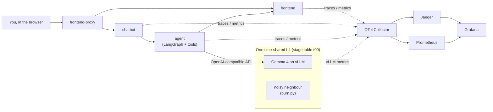

# Finale · The Astronomy Shop on a shared GPU

<div class="lesson-head" markdown>
<span class="pill">Module 2 · Finale</span>
<span class="pill time">:material-timer-outline: 5 min</span>
<span class="pill who">:material-projector-screen: watch the big screen</span>
[Skip to Step 10 :material-arrow-right:](07-decision-guide.md){ .skip }
</div>

!!! abstract "What you'll see"
    Everything from today, in a **real application**. The **OpenTelemetry Astronomy Shop** is the official
    OpenTelemetry demo: a web shop made of ~20 microservices, with full traces, metrics and logs. Its **AI shopping
    assistant** runs on a live Gemma model on a **time-shared L4**, just like yours in Step 8.
    Then the instructor switches on a **noisy neighbour** on that same GPU, and we watch the slowdown travel through the traces.



## What to watch for

<p class="hint">Select each tab to see what's on screen at each moment.</p>

=== "1 · The shop works"

    The instructor opens the shop, browses telescopes and asks the **AI assistant** something like
    *"Which telescope is best for a beginner under $500?"*. It answers in a few seconds, using live Gemma calling the shop's own APIs as tools.

=== "2 · The trace"

    In **Jaeger**, one request becomes a **trace**: chatbot → agent → LLM call → shop services. The **LLM call** span shows how long Gemma took.
    This is the per-request view Cloud Monitoring couldn't give you in Step 5.

=== "3 · Noisy neighbour ON"

    One command starts `burn.py` on the **same** GPU. The same question now takes noticeably longer.
    In Jaeger, the **LLM span grows** while every other span stays the same. *The slowdown is in the GPU, not the code.*

=== "4 · The GPU's side of the story"

    **Grafana** shows vLLM's own metrics (time to first token, request latency) rising. **Cloud Monitoring** shows the stage node's
    duty cycle at 100%. App traces, model metrics and GPU metrics, all telling the same story.

=== "5 · The fix"

    Noisy neighbour **OFF**, and latency drops back. In production you'd move the assistant to a **MIG slice** or
    an **MPS** share (Steps 6–7), or move the batch job elsewhere. Exactly the decision you'll make in Step 10.

!!! question "Think about it while you watch"
    If you only had the shop's traces, how would you know the slow LLM span was caused by **another team's** batch job?
    (Hint: Step 5. You'd need the GPU's metrics, and you'd only see them per node.)

??? planb "Running on the Plan B (Jarvislabs) cluster?"
    The finale works the same on Plan B: `07-otel-demo.sh` only needs `kubectl` and `helm`, and a stage GPU labelled `t00`.
    For *"the GPU's side of the story"*, show the **DCGM dashboard in Grafana** (`$GRAFANA_URL`) instead of Cloud Monitoring.
    The demo CPU pool doesn't exist on Plan B, so make sure the k3s server VM has room (8+ vCPU, 32 GB), or add a second CPU VM.

## For the instructor: run it

!!! warning "Set up before the session, not during it"
    Run `07-otel-demo.sh` during the T-60 minute setup. Gemma 4 downloads several GB on first start. See the
    [facilitator guide](../facilitator/index.md) and the [rehearsal checklist](../facilitator/rehearsal.md).

!!! step "Open the shop"
    ```bash
    kubectl -n otel-demo port-forward svc/frontend-proxy 8080:8080
    ```

    In Cloud Shell, click **Web Preview → Preview on port 8080**. Keep these tabs ready:

    | Path | What |
    |---|---|
    | `/` | the shop |
    | `/chatbot/` | AI shopping assistant |
    | `/jaeger/ui/` | traces |
    | `/grafana/` | dashboards |

!!! step "Ask the assistant (quiet GPU)"
    In `/chatbot/`, ask: *"Which telescope would you recommend for a beginner, and what accessories go with it?"*

    !!! see "The room should see"
        An answer within a few seconds that mentions real products from the shop.

!!! step "Show the trace"
    In **Jaeger**, choose service **`agent`** → **Find Traces** → open the newest one. Expand it to the **LLM call** span
    (OpenLLMetry instrumentation; names vary by version, but look for the span with `gen_ai.*` / `llm.*` attributes).

    !!! see "The room should see"
        A waterfall of spans, with the LLM call taking most of the time. Read its duration out loud.

!!! step "Switch on the noisy neighbour"
    ```bash
    kubectl -n otel-demo scale deploy/noisy-neighbour --replicas=1
    ```

    Wait ~30 seconds for it to start, then **ask the same question** again.

    !!! see "The room should see"
        A slower answer. In Jaeger, the new trace's LLM span is **longer**; the other spans look the same.

!!! step "Show the GPU's side"
    - **Grafana** → **Explore** → Prometheus data source → search metrics for **`vllm`** (e.g. request latency, time to first token).
    - **Cloud Monitoring** dashboard from [06-dashboard.sh](../facilitator/index.md#scripts): the stage node at 100% duty cycle.

!!! step "Switch it off and land the message"
    ```bash
    kubectl -n otel-demo scale deploy/noisy-neighbour --replicas=0
    ```

    Say: *"Same app, same code, same model. The only change was a neighbour on the GPU. Which sharing strategy would you give this assistant?"*
    Then go to [Step 10](07-decision-guide.md).

??? failure "If the live model misbehaves on stage"
    Small models sometimes fumble tool calls. Fallbacks, in order:

    1. Ask a simpler question ("What telescopes do you sell?").
    2. Show the noisy neighbour with **your Step 8 Gemma** and `bench.sh` instead, and show traces from the shop's normal traffic.
    3. Switch the assistant back to recorded answers (`USE_VCR=True` in `otel-demo-values.yaml`, then `helm upgrade`). The traces still look great, but the GPU story is lost.

## Try it at home

The Astronomy Shop runs on any Kubernetes cluster. In your own project (see [Run it in your own project](../reference/own-project.md)):

```bash
# 1. the shop on its own (no GPU needed; the assistant uses recorded answers)
helm repo add open-telemetry https://open-telemetry.github.io/opentelemetry-helm-charts
helm install otel-demo open-telemetry/opentelemetry-demo -n otel-demo --create-namespace
kubectl -n otel-demo port-forward svc/frontend-proxy 8080:8080

# 2. with a live model on your GPU: label your L4 node as t00, then
HF_TOKEN=hf_... STAGE_TABLE=t00 ./scripts/facilitator/07-otel-demo.sh
```

A small GKE cluster (one `e2-standard-8` CPU node) is enough for the shop. Add one L4 for the live assistant.

!!! tip "Another crowd-pleaser: Agent Substrate"
    Agent Substrate has a playful demo, shown at KubeCon, where agents roam a pixel-art conference from their own sandboxes on Kubernetes.
    It's about packing **mostly-idle agents** densely, not about sharing GPUs, so it's not part of today. If you're curious, start at
    [learn.agentsubstrate.dev](https://learn.agentsubstrate.dev/) and read [What's next](../reference/whats-next.md).

!!! takeaway "Key takeaway"
    - GPU sharing problems show up **in your app's latency**, far from the GPU.
    - **Traces** tell you *which step* got slow; **GPU metrics** tell you *why*. You need both.
    - Pick the sharing strategy from the workload's needs: a latency-sensitive assistant shouldn't time-share with a greedy batch job.

**Links:** [OpenTelemetry Demo docs](https://opentelemetry.io/docs/demo/) · [Agent service](https://opentelemetry.io/docs/demo/services/agent/) · [Helm chart](https://github.com/open-telemetry/opentelemetry-helm-charts/tree/main/charts/opentelemetry-demo)
