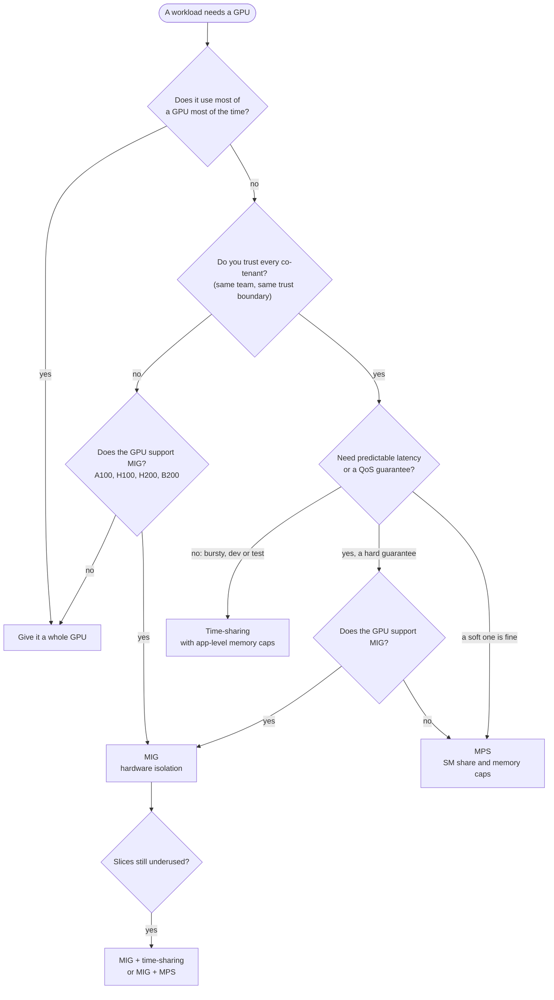

# Step 10 · Decision guide & wrap-up

Module 2 · Step 10 of 7
:material-timer-outline: 5 min
:material-account-group: whole room
[Skip to take-home :material-arrow-right:](../reference/own-project.md){ .skip }

!!! abstract "What you'll do"
    Put everything side by side, pick the right strategy for each team, clean up, and take it all home.

!!! step "Fill in your table card"
    Look at the numbers you wrote down in Steps 4, 6, 7 and 8. Did they match the table below?

## The comparison you just measured

| | **Whole GPU** | **Time-sharing** | **NVIDIA MPS** | **Multi-instance GPU** |
|---|---|---|---|---|
| How it shares | not shared | takes turns (time slices) | runs at the same time, SM % caps | hardware partitions |
| Compute isolation | :material-check-all: | :material-close: depends on neighbours | :material-check: SM % cap (bandwidth still shared) | :material-check-all: |
| Memory limit | n/a | :material-close: none | :material-check: per client, **set by the client** | :material-check-all: hardware |
| Error isolation | :material-check-all: | :material-check: per process | :material-alert: weaker | :material-check-all: |
| Burst into idle GPU | n/a | :material-check: yes | :material-close: capped | :material-close: capped |
| Slots per GPU | 1 | up to 48 | up to 48 | up to 7 |
| `nvidia.com/gpu` per container | any | **1 only** | >1 only on 1-GPU nodes | **1 only** |
| Special pod config | | | `hostIPC: true` | |
| GPUs | all | all NVIDIA (not G4 fractional) | all NVIDIA (Volta+ recommended) | A100, H100, H200, B200, GB200, RTX PRO 6000 |
| Per-pod GPU metrics | :material-check: container-level | :material-close: node only | :material-close: node only | :material-close: no `duty_cycle` |
| Set where | | node pool | node pool | node pool (fixed partition size) |

## Choose a strategy

### In one line each

- **Bursty, trusted, dev/test** → **time-sharing** (cap memory in the app)
- **Many small steady jobs, one team** → **MPS**
- **Production or untrusted tenants, latency promises** → **MIG**
- **Big training jobs** → a **whole GPU**

??? note "Checklist before you share a GPU in real life"
    1. Do the workloads' **peak** memory budgets add up to less than the GPU?
    2. Does the framework **preallocate** memory (vLLM, TGI, TensorFlow)? Set its fraction.
    3. Anyone **outside your trust boundary**? Only MIG, or don't share.
    4. Any pod asking for **more than one** shared GPU? It will be rejected.
    5. Deployments on full GPUs: `strategy: Recreate`.
    6. MPS needs `hostIPC: true`.
    7. GPU metrics show the GPU, not the team. Add workload metrics.

## Test your knowledge

  
Two teams from <b>different companies</b> must share an H100 safely. Which strategy?

  <button data-opt="a">Time-sharing</button>
  <button data-opt="b">MIG</button>
  <button data-opt="c">MPS</button>
  
Only MIG gives hardware isolation of compute, memory and faults. Time-sharing and MPS are for workloads inside the same trust boundary.

  
A data-science team has 20 notebooks that are idle most of the day. Cheapest sensible option on L4s?

  <button data-opt="a">Time-sharing, with memory limits set in each notebook</button>
  <button data-opt="b">One whole L4 per notebook</button>
  <button data-opt="c">MIG</button>
  
Bursty, trusted, low-duty-cycle work is exactly what time-sharing is for (and L4s don't support MIG anyway). Just make sure each notebook caps its own GPU memory.

