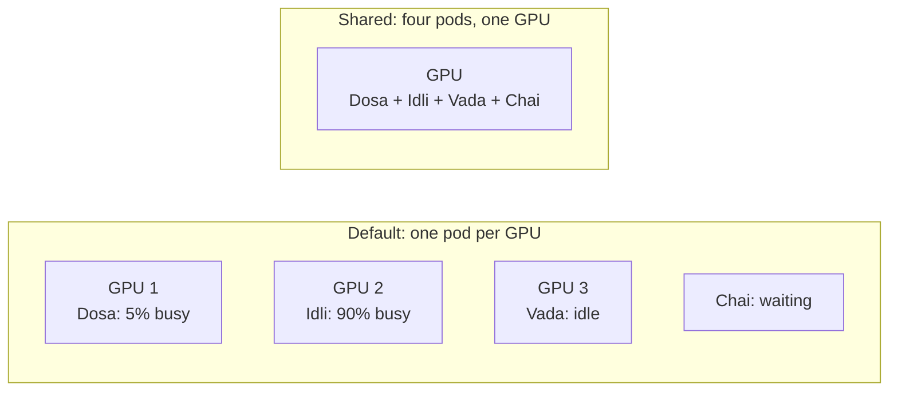
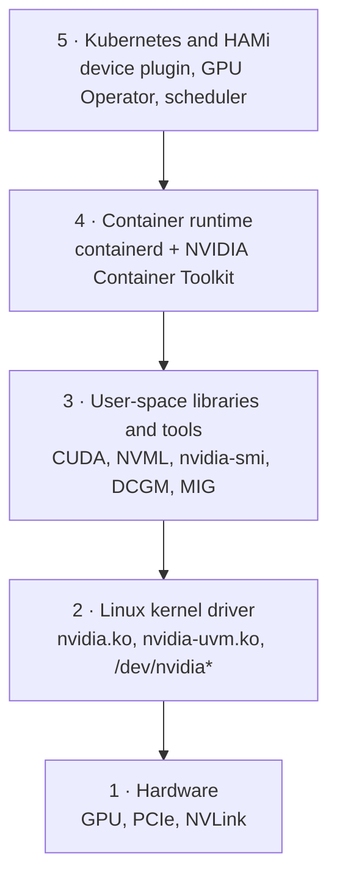
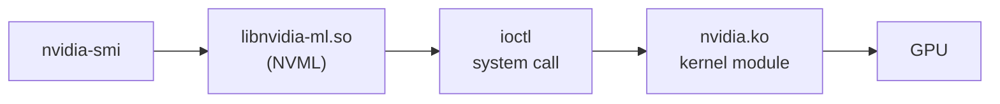
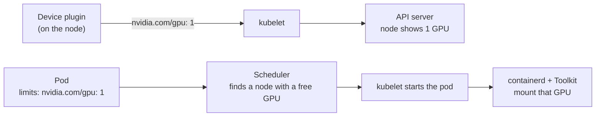
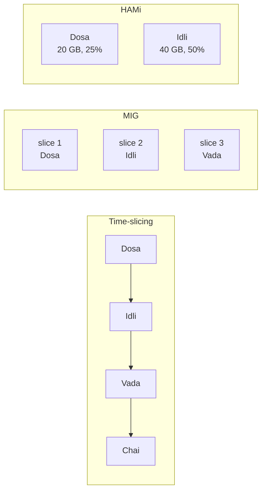
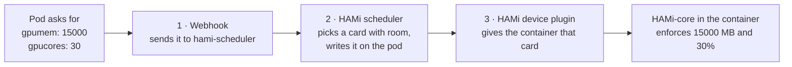

# Concepts: from a GPU chip to a shared GPU in Kubernetes

Before the labs, the main ideas you'll see in them. Each section is one picture and a few lines.
Adapted from the HAMi workshop's concept pages: [GPU software stack](https://workshop.project-hami.io/concepts/gpu-stack/),
[GPU drivers](https://workshop.project-hami.io/concepts/gpu-driver/) and
[HAMi architecture](https://workshop.project-hami.io/concepts/hami-architecture/).

| # | Concept | You'll see it in |
|---|---|---|
| 1 | The GPU software stack: 5 layers | every lab |
| 2 | The driver, and how `nvidia-smi` reaches the GPU | the real-GPU lab, step 2 |
| 3 | How Kubernetes hands out a GPU | both labs, "Kubernetes can't see the GPU" |
| 4 | Four ways to share a GPU | the real-GPU lab |
| 5 | How HAMi works | the laptop lab |

## Why share a GPU?

A GPU is the most expensive part of a cluster. Kubernetes gives each pod a **whole** GPU by default, even if the pod needs 2 GB of
an 80 GB card or is idle most of the day.



!!! takeaway "The point"
    Sharing raises utilisation and lowers cost. The hard part is **fairness**: speed, memory and failures of one team must not hurt another.

## 1. The GPU software stack

Using a GPU from a pod goes through **5 layers**. Each layer needs the one below it.



| Layer | What it does | In our labs |
|---|---|---|
| 1 Hardware | the chip that does the maths | H200 (real), A100 (fake on the laptop) |
| 2 Kernel driver | lets Linux talk to the GPU; creates `/dev/nvidia*` | pre-installed on Jarvislabs |
| 3 Libraries | **CUDA** runs programs, **NVML** reports status, `nvidia-smi` and **DCGM** read it | inside the vLLM image |
| 4 Container runtime | the **NVIDIA Container Toolkit** mounts the GPU and driver libraries into a container | installed on each VM |
| 5 Kubernetes | the **device plugin** tells Kubernetes the node has GPUs; the scheduler picks a node | GPU Operator, then HAMi |

!!! takeaway "When something breaks"
    Find the layer. No `nvidia-smi` on the machine: layer 2. Works on the machine but not in a container: layer 4.
    Works in a container but the pod is `Pending`: layer 5.

## 2. The driver and nvidia-smi

`nvidia-smi` is the first command anyone runs. It goes down three layers:



Every tool that reads a GPU uses the same path: `nvidia-smi`, the **DCGM exporter** (metrics), the **device plugin** (Kubernetes) and
HAMi all go through **NVML → driver → GPU**.

```bash
# is the kernel driver loaded? (more basic than nvidia-smi)
lsmod | grep nvidia
# can user space talk to it?
nvidia-smi -L
```

!!! takeaway "lsmod first"
    `lsmod` shows nothing: the driver isn't loaded, and `nvidia-smi` will fail. `lsmod` shows `nvidia` but `nvidia-smi` errors: the
    problem is the libraries or permissions.

## 3. How Kubernetes hands out a GPU

Kubernetes doesn't know what a GPU is. A **device plugin** on each node tells the kubelet "this node has N of `nvidia.com/gpu`".
From then on a GPU is just a number the scheduler counts, like CPU.



```yaml
# a pod asks for a GPU like this
resources:
  limits:
    nvidia.com/gpu: 1     # a whole number: 1 GPU
```

!!! takeaway "The three gotchas"
    No device plugin: the pod stays `Pending` with `Insufficient nvidia.com/gpu`. GPUs are **whole numbers**, first come first served.
    The scheduler only **counts**: it doesn't know how busy a GPU is or how much memory is free.

## 4. Four ways to share a GPU

| | Time-slicing | NVIDIA MPS | MIG | HAMi |
|---|---|---|---|---|
| How | pods take **turns** | pods run **at the same time**, each capped | the GPU is **cut** into hardware slices | each pod asks for **MB** and **%** |
| Memory limit | none | soft | hard (hardware) | enforced |
| Speed with neighbours | drops | steady | steady | capped |
| GPUs | any NVIDIA | any NVIDIA | A100, H100, H200, B200 | any NVIDIA (and other vendors) |
| On GKE | `gpu-sharing-strategy=time-sharing` | `gpu-sharing-strategy=mps` | `gpu-partition-size=1g.5gb` | install HAMi yourself |



!!! takeaway "One line each"
    **Time-slicing:** cheap and easy, no protection. **MPS:** steady speed for one trusted team. **MIG:** a real wall, big GPUs only,
    fixed sizes. **HAMi:** any size, any NVIDIA GPU, limits written in the pod spec.

## 5. How HAMi works

HAMi (a CNCF project) adds three things to Kubernetes:



| Part | Job |
|---|---|
| **Webhook** | changes GPU pods' `schedulerName` to `hami-scheduler` |
| **Scheduler** (extender) | reads each node's card list, checks free MB and % per card, picks one (binpack or spread) |
| **Device plugin** | replaces NVIDIA's; advertises `nvidia.com/gpumem` and `nvidia.com/gpucores`, mounts the chosen card |
| **HAMi-core** | a library inside the container that enforces the memory and compute limits |

After installing it, the cluster has five layers of software:

| Layer | Parts | If it's broken |
|---|---|---|
| Kubernetes | API server, scheduler, etcd, Cilium | nothing runs |
| GPU runtime | driver, Container Toolkit, GPU Operator, DCGM | no GPU in containers |
| GPU scheduling | HAMi scheduler and device plugin | pods `Pending`, or whole GPUs only |
| Monitoring | Prometheus | no GPU charts |
| Dashboard | HAMi WebUI | nothing to look at |

!!! takeaway "On the laptop vs on a real GPU"
    On your laptop, the **webhook and scheduler are real** and the cards are fake, so you see every scheduling decision. Only a real
    GPU shows **HAMi-core** enforcing the limits. That's the instructor's part.

## Now the labs

1. **[Lab 1: real GPUs, live](jarvislabs-demo.md)** (instructor): build a Kubernetes cluster on 3 H200s, then time-slicing, MPS, MIG and HAMi, each broken on
   purpose, with the GKE way of doing each one.
2. **[Lab 2: HAMi on your laptop](hami-laptop.md)** (you): kind, two fake A100s and the real HAMi scheduler.
