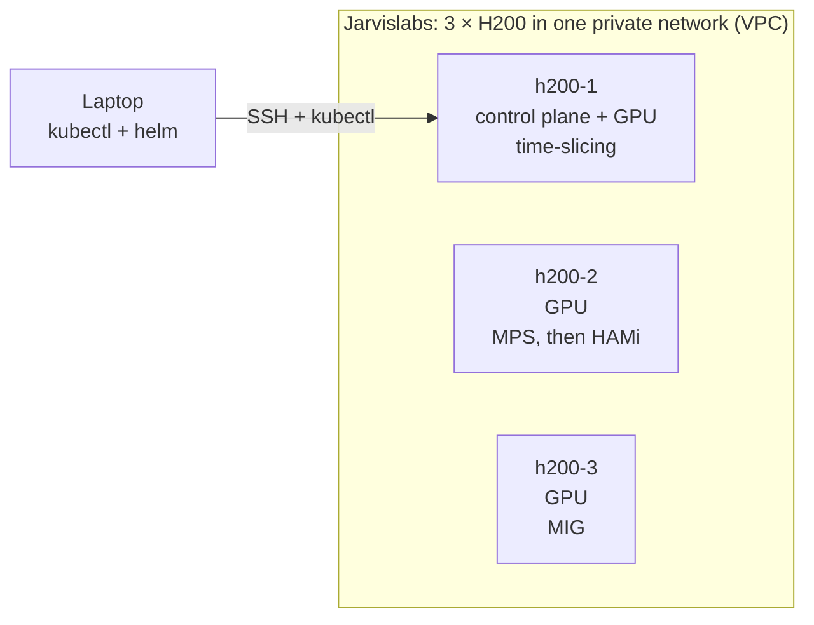

# One GPU, Four Teams: hands-on GPU sharing on Kubernetes

GPUs are the most expensive machines in a cluster, and giving every workload a whole one isn't always necessary.
We build a Kubernetes cluster from **3 Jarvislabs H200 GPU VMs** with **kubeadm**, then hit the real problems one by one:
how Kubernetes exposes and hands out a GPU, **time-slicing**, **NVIDIA MPS**, **multi-instance GPU (MIG)** and **HAMi**,
a noisy neighbour on purpose, the gotchas that surprise teams, and **Gemma served with vLLM** on a shared GPU.

Every command is shown in full: nothing is hidden in a script. The cluster steps follow the official guide,
[Creating a cluster with kubeadm](https://kubernetes.io/docs/setup/production-environment/tools/kubeadm/create-cluster-kubeadm/).
The `# ...` line above each command says what it does. **On GKE** boxes show how Google Kubernetes Engine does the same thing.



| # | Problem we hit | Fix |
|---|---|---|
| 1 | Does this app need a GPU? | measure it: CPU vs GPU |
| 2 | Kubernetes can't see the GPU | the **device plugin** (NVIDIA GPU Operator) |
| 3 | One idle pod takes a whole GPU, others wait | **time-slicing** |
| 4 | Time-slicing: noisy neighbour, no memory limits, one shared GPU per pod | **MPS**: caps per pod |
| 5 | MPS limits are soft | **MIG**: hardware slices |
| 6 | Model servers grab 90% of the GPU's memory | a memory budget per server |
| 7 | MIG is rigid; budgets rely on every team | **HAMi**: MB and % per pod, enforced, any NVIDIA GPU |

**The four teams:** :material-food: **Dosa** (chat assistant) · :material-rice: **Idli** (greedy batch job) ·
:material-cookie: **Vada** (notebook) · :material-tea: **Chai** (evaluations). Each team's work is a pod named after it.

**You need:** 3 × H200 **VMs** on Jarvislabs in the **same private network**, with your SSH key · a laptop with `kubectl`,
`helm`, `jq` · a **Hugging Face** token with Gemma access · this repo (for its small Python test programs).

**Time:** the cluster is built before the session (steps 2 and 3); the GPU parts are ~35 minutes live.

## Prepare (the day before)

!!! step "Get the repo and the laptop tools"
    ```bash
    # the workshop repo: we only need its small Python test programs (workloads/)
    git clone https://github.com/Sagar2366/gke-gpu-sharing-workshop.git && cd gke-gpu-sharing-workshop
    # kubectl, helm and jq (macOS)
    brew install kubectl helm jq
    ```

!!! step "Write down your 3 VMs"
    Put **your** IPs in this block before pasting it. Public IPs are for SSH from the laptop. Private IPs (same VPC) are what the
    VMs use to talk to each other: see the Jarvislabs console, or `ssh root@<public-ip> hostname -I`.

    ```bash
    # save the settings in a file you can load in any terminal
    cat > ~/gpu-demo.env <<'EOF'
    export H1=203.0.113.21 H2=203.0.113.22 H3=203.0.113.23   # public IPs of h200-1, h200-2, h200-3
    export P1=10.0.0.21    P2=10.0.0.22    P3=10.0.0.23      # private IPs of the same VMs
    export KUBECONFIG=$HOME/.kube/gpu-demo                    # this cluster's kubectl config
    export IMAGE=vllm/vllm-openai:latest                      # one image for every demo pod (PyTorch + CUDA + vLLM)
    export MODEL=google/gemma-3-1b-it
    EOF
    # load them (do this in every new terminal)
    source ~/gpu-demo.env
    # let "ssh root@..." use your Jarvislabs key
    ssh-add ~/.ssh/id_ed25519
    ```

!!! step "Check the VMs"
    ```bash
    # each VM answers over SSH and has an H200 with a working driver
    for ip in $H1 $H2 $H3; do ssh root@$ip "hostname; nvidia-smi -L"; done
    # h200-2 and h200-3 reach h200-1 on its private IP
    ssh root@$H2 "nc -zv -w3 $P1 22"; ssh root@$H3 "nc -zv -w3 $P1 22"
    ```

    !!! see "You should see"
        `GPU 0: NVIDIA H200 (UUID: GPU-…)` three times, and `succeeded` twice.

    ??? failure "`nvidia-smi: command not found`"
        On that VM: `apt-get update && apt-get install -y ubuntu-drivers-common && ubuntu-drivers install --gpgpu && reboot`.

Now prepare **each VM** ([Installing kubeadm](https://kubernetes.io/docs/setup/production-environment/tools/kubeadm/install-kubeadm/)).
Do the next five steps on **h200-1**, then repeat them on **h200-2** and **h200-3**.

!!! step "On the VM: kernel settings Kubernetes needs"
    ```bash
    # log in to the VM (the next five steps run there)
    ssh root@$H1
    # the kubelet needs swap off, now and after a reboot
    swapoff -a && sed -i '/\sswap\s/ s/^/#/' /etc/fstab
    # kernel modules for container networking
    printf "overlay\nbr_netfilter\n" > /etc/modules-load.d/k8s.conf && modprobe overlay && modprobe br_netfilter
    # let the VM forward pod traffic
    printf "net.bridge.bridge-nf-call-iptables=1\nnet.bridge.bridge-nf-call-ip6tables=1\nnet.ipv4.ip_forward=1\n" > /etc/sysctl.d/99-k8s.conf && sysctl --system >/dev/null
    ```

!!! step "On the VM: NVIDIA Container Toolkit"
    ```bash
    # NVIDIA's package repository
    curl -fsSL https://nvidia.github.io/libnvidia-container/gpgkey | gpg --dearmor --yes -o /usr/share/keyrings/nvidia-container-toolkit-keyring.gpg
    curl -fsSL https://nvidia.github.io/libnvidia-container/stable/deb/nvidia-container-toolkit.list | sed 's#deb https://#deb [signed-by=/usr/share/keyrings/nvidia-container-toolkit-keyring.gpg] https://#' > /etc/apt/sources.list.d/nvidia-container-toolkit.list
    # the toolkit: lets containers use the GPU
    apt-get update -q && apt-get install -y -q nvidia-container-toolkit
    ```

!!! step "On the VM: containerd, with NVIDIA as the default runtime"
    ```bash
    # Jarvislabs images may run Docker: stop it so it doesn't fight containerd
    systemctl disable --now docker docker.socket 2>/dev/null
    # the container runtime the kubelet talks to
    apt-get install -y -q containerd
    # its default config, with systemd cgroups (what the kubelet expects)
    mkdir -p /etc/containerd && containerd config default > /etc/containerd/config.toml && sed -i 's/SystemdCgroup = false/SystemdCgroup = true/' /etc/containerd/config.toml
    # start every container through the NVIDIA runtime, then restart containerd
    nvidia-ctk runtime configure --runtime=containerd --set-as-default && systemctl restart containerd && systemctl enable containerd
    ```

!!! step "On the VM: kubeadm, kubelet and kubectl"
    ```bash
    # the Kubernetes package repository (v1.36)
    mkdir -p /etc/apt/keyrings && curl -fsSL https://pkgs.k8s.io/core:/stable:/v1.36/deb/Release.key | gpg --dearmor --yes -o /etc/apt/keyrings/kubernetes-apt-keyring.gpg
    echo "deb [signed-by=/etc/apt/keyrings/kubernetes-apt-keyring.gpg] https://pkgs.k8s.io/core:/stable:/v1.36/deb/ /" > /etc/apt/sources.list.d/kubernetes.list
    # install the three tools and stop apt from upgrading them
    apt-get update -q && apt-get install -y -q kubelet kubeadm kubectl && apt-mark hold kubelet kubeadm kubectl
    ```

!!! step "On the VM: private IP, and download images early"
    ```bash
    # THIS VM's private IP (h200-1 here; use 10.0.0.22 on h200-2, 10.0.0.23 on h200-3)
    NODE_IP=10.0.0.21
    # the kubelet registers the node with its private IP, so nodes talk over the VPC
    echo "KUBELET_EXTRA_ARGS=--node-ip=$NODE_IP" > /etc/default/kubelet && systemctl enable --now kubelet
    # Kubernetes' own images (API server, etcd, CoreDNS ...), so kubeadm init is quick
    kubeadm config images pull
    # the ~10 GB demo image, in the background (it keeps going after you log out)
    nohup ctr -n k8s.io images pull docker.io/vllm/vllm-openai:latest >/var/log/image-pull.log 2>&1 &
    # back to the laptop
    exit
    ```

    !!! see "You should see"
        `[config/images] Pulled registry.k8s.io/kube-apiserver:v1.36.x`, `etcd`, `coredns` …

    The kubelet now restarts every few seconds. That's normal: it waits for `kubeadm init` or `kubeadm join`.

    **Repeat the last five steps** on `ssh root@$H2` and `ssh root@$H3`.

!!! step "Next morning: is the big image downloaded?"
    ```bash
    # each VM should list vllm/vllm-openai
    for ip in $H1 $H2 $H3; do ssh root@$ip "crictl --runtime-endpoint unix:///run/containerd/containerd.sock images | grep vllm"; done
    ```

## Build the cluster

!!! step "1. Create the control plane on h200-1"
    ```bash
    # load the settings (in every new terminal)
    cd gke-gpu-sharing-workshop && source ~/gpu-demo.env
    # kubeadm init: start the API server, scheduler, controller manager and etcd on h200-1 (~1 min)
    ssh root@$H1 kubeadm init --node-name h200-1 --apiserver-advertise-address $P1 --apiserver-cert-extra-sans $H1,127.0.0.1 --pod-network-cidr 10.244.0.0/16
    ```

    !!! see "You should see"
        `Your Kubernetes control-plane has initialized successfully!`, then `mkdir -p $HOME/.kube …` and a `kubeadm join …` line.

    ??? question "What do the flags mean?"
        `--apiserver-advertise-address`: the other VMs reach the API server on the **private** IP. `--apiserver-cert-extra-sans`:
        its certificate also accepts the **public** IP, so the laptop can connect. `--pod-network-cidr`: the IP range for pods.
        Each node gets a `/24` slice of it. It must not overlap the VPC's own range.

!!! step "2. kubectl on your laptop"
    kubeadm prints `cp /etc/kubernetes/admin.conf $HOME/.kube/config` for use on the VM. We do the same, but copy it to the laptop.

    ```bash
    # copy the admin kubeconfig to the laptop, pointing it at h200-1's public IP
    mkdir -p ~/.kube && ssh root@$H1 cat /etc/kubernetes/admin.conf | sed "s#server: https://.*:6443#server: https://$H1:6443#" > $KUBECONFIG
    # only you may read it (it's the cluster admin key)
    chmod 600 $KUBECONFIG
    # the machines in the cluster
    kubectl get nodes
    # the control plane's own pods
    kubectl get pods -n kube-system
    ```

    ??? failure "kubectl times out"
        Port 6443 on the public IP isn't open to your laptop. Use an SSH tunnel instead:
        `ssh -fN -L 6443:$P1:6443 root@$H1`, then `sed -i '' "s#https://$H1:6443#https://127.0.0.1:6443#" $KUBECONFIG`.

!!! problem "The node is `NotReady`"
    `h200-1   NotReady   control-plane`, and the two `coredns` pods are `Pending`. kubeadm doesn't include a **pod network**,
    so pods can't get IP addresses yet.

!!! solution "3. Fix: install Cilium as the pod network"
    ```bash
    # Cilium's Helm chart
    helm repo add cilium https://helm.cilium.io/ && helm repo update cilium
    # Cilium: VXLAN tunnel between the VMs' private IPs; pod IPs from each node's 10.244.x.0/24 slice
    helm install cilium cilium/cilium -n kube-system --set routingMode=tunnel --set tunnelProtocol=vxlan --set ipam.mode=kubernetes
    # wait for the Cilium agent and operator (~1-2 min)
    kubectl -n kube-system rollout status ds/cilium && kubectl -n kube-system rollout status deploy/cilium-operator
    # Ready now, and coredns Running
    kubectl get nodes; kubectl get pods -n kube-system
    ```

    !!! see "You should see"
        `daemon set "cilium" successfully rolled out`, then `h200-1   Ready   control-plane`.

    ??? note "Compared with the VirtualBox + Tailscale setup"
        No `MTU=1280` (that was for Tailscale's smaller packets) and no Tailscale IPs: everything uses the VPC's private IPs.
        `ipam.mode=kubernetes` is new: Cilium's default pod range is `10.0.0.0/8`, which can clash with a `10.x` VPC.

!!! step "4. Let h200-1 run workloads, and load the test programs"
    ```bash
    # control planes don't run normal pods by default; h200-1 has a GPU, so remove that taint
    kubectl taint nodes h200-1 node-role.kubernetes.io/control-plane:NoSchedule-
    # the small Python programs the demo pods run, mounted into pods at /scripts
    kubectl create configmap gpu-scripts --from-file=workloads/burn.py --from-file=workloads/memhog.py --from-file=workloads/probe.py
    # your Hugging Face token (Gemma needs it), stored in the cluster as a secret
    read -s -p "Hugging Face token: " HF_TOKEN; echo; kubectl create secret generic hf-token --from-literal=token="$HF_TOKEN"
    ```

!!! note "On GKE"
    `gcloud container clusters create` does all of this section for you: control plane, pod network and nodes.

## Problem 1: does it need a GPU?

!!! step "Run the work on the CPU"
    ```bash
    # a pod doing big matrix multiplications on the CPU only (it asks for no GPU)
    kubectl apply -f - <<EOF
    apiVersion: v1
    kind: Pod
    metadata: {name: burn-cpu}
    spec:
      restartPolicy: Never
      nodeSelector: {kubernetes.io/hostname: h200-1}
      containers:
      - name: main
        image: $IMAGE
        command: ["python3", "/scripts/burn.py"]
        env: [{name: DEVICE, value: cpu}]
        volumeMounts: [{name: scripts, mountPath: /scripts}]
      volumes: [{name: scripts, configMap: {name: gpu-scripts}}]
    EOF
    # its speed, printed every 5 s (Ctrl+C to stop watching)
    kubectl logs -f burn-cpu
    ```

    !!! see "You should see"
        `... on CPU (N cores)` and **a few TFLOPS**. Remember the number.

!!! step "Ask for a GPU"
    ```bash
    # the same work, but this pod asks for one GPU: limits: nvidia.com/gpu: 1
    kubectl apply -f - <<EOF
    apiVersion: v1
    kind: Pod
    metadata: {name: burn-gpu}
    spec:
      restartPolicy: Never
      nodeSelector: {kubernetes.io/hostname: h200-1}
      containers:
      - name: main
        image: $IMAGE
        command: ["python3", "/scripts/burn.py"]
        resources: {limits: {nvidia.com/gpu: 1}}
        volumeMounts: [{name: scripts, mountPath: /scripts}]
      volumes: [{name: scripts, configMap: {name: gpu-scripts}}]
    EOF
    # is it running? and if not, why?
    kubectl get pod burn-gpu; kubectl describe pod burn-gpu | tail -2
    ```

    !!! see "You should see"
        `Pending` and `0/1 nodes are available: 1 Insufficient nvidia.com/gpu`.

## Problem 2: Kubernetes can't see the GPU

!!! problem "The machine has a GPU, but Kubernetes doesn't know"
    ```bash
    # the VM itself sees its H200...
    ssh root@$H1 nvidia-smi -L
    # ...but the node advertises no nvidia.com/gpu
    kubectl describe node h200-1 | grep -A7 Allocatable
    ```

!!! step "The sharing settings the device plugin will use"
    One config per strategy. Each node later picks one with a **label**; `none` means a whole GPU per pod.

    ```bash
    # the namespace for NVIDIA's software
    kubectl create namespace gpu-operator
    # device plugin configs: none (whole GPU), ts4 (time-slicing x4), mps4 (MPS x4), mig (MIG slices)
    kubectl apply -f - <<'EOF'
    apiVersion: v1
    kind: ConfigMap
    metadata: {name: device-plugin-config, namespace: gpu-operator}
    data:
      none: |-
        version: v1
      ts4: |-
        version: v1
        sharing:
          timeSlicing:
            failRequestsGreaterThanOne: true
            resources: [{name: nvidia.com/gpu, replicas: 4}]
      mps4: |-
        version: v1
        sharing:
          mps:
            resources: [{name: nvidia.com/gpu, replicas: 4}]
      mig: |-
        version: v1
        flags: {migStrategy: single}
    EOF
    ```

!!! solution "Fix: a device plugin (NVIDIA GPU Operator)"
    ```bash
    # NVIDIA's Helm chart
    helm repo add nvidia https://helm.ngc.nvidia.com/nvidia && helm repo update nvidia
    # GPU Operator: device plugin + GPU labels + DCGM metrics + MIG manager. The driver and toolkit are already on the VMs (~3 min)
    helm install gpu-operator nvidia/gpu-operator -n gpu-operator --set driver.enabled=false --set toolkit.enabled=false --set devicePlugin.config.name=device-plugin-config --set devicePlugin.config.default=none --set mig.strategy=single --wait --timeout 15m
    # the node now advertises 1 GPU
    kubectl get node h200-1 -o jsonpath='{.status.allocatable.nvidia\.com/gpu}{"\n"}'
    # and the pending pod starts on its own (Ctrl+C when Running)
    kubectl get pod burn-gpu -w
    ```

!!! step "CPU vs GPU, and how the GPU got into the pod"
    ```bash
    # the same work on the GPU
    kubectl logs burn-gpu | tail -2
    # the GPU the device plugin assigned to this pod
    kubectl exec burn-gpu -- nvidia-smi -L
    # tidy up
    kubectl delete pod burn-cpu burn-gpu
    ```

    !!! see "You should see"
        **Hundreds** of TFLOPS vs a few on the CPU. That's why we pay for GPUs.

!!! step "Start monitoring now (we use it later)"
    ```bash
    # Prometheus + Grafana
    helm repo add prometheus-community https://prometheus-community.github.io/helm-charts && helm repo update prometheus-community
    # install it; Prometheus will collect every ServiceMonitor in the cluster (starts in the background)
    helm install monitoring prometheus-community/kube-prometheus-stack -n monitoring --create-namespace --set alertmanager.enabled=false --set prometheus.prometheusSpec.serviceMonitorSelectorNilUsesHelmValues=false
    # tell the GPU Operator to publish its GPU metrics (DCGM) to Prometheus
    helm upgrade gpu-operator nvidia/gpu-operator -n gpu-operator --reuse-values --set dcgmExporter.serviceMonitor.enabled=true
    ```

!!! note "On GKE"
    GKE installs the NVIDIA driver and device plugin for you when a node pool has `--accelerator=type=nvidia-l4,count=1,gpu-driver-version=latest`.

!!! takeaway "How Kubernetes exposes a GPU"
    The **driver** is on the machine. The **device plugin** advertises `nvidia.com/gpu: N` on the node. A pod asks for a **whole number**;
    the scheduler just **counts**. The **container runtime** plugs the chosen GPU into the container.

## Problem 3: one pod, one whole GPU

!!! step "Add the other two GPU machines (kubeadm join)"
    ```bash
    # a fresh join command from the control plane: its private address, a token and the CA certificate hash
    JOIN=$(ssh root@$H1 kubeadm token create --print-join-command); echo $JOIN
    # h200-2 and h200-3 join over the private network (~1 min each)
    ssh root@$H2 "$JOIN --node-name h200-2"
    ssh root@$H3 "$JOIN --node-name h200-3"
    # Cilium and the GPU Operator start on the new nodes by themselves; wait for Cilium
    kubectl -n kube-system rollout status ds/cilium
    # all 3 Ready, with their private IPs
    kubectl get nodes -o wide
    # each one advertises 1 GPU (run again after a minute if a node shows <none>)
    kubectl get nodes -o custom-columns='NODE:.metadata.name,GPU:.status.allocatable.nvidia\.com/gpu'
    ```

    !!! see "You should see"
        Three `Ready` nodes with `INTERNAL-IP` = the private IPs, and `1` GPU on each.

    ??? failure "A node stays `NotReady` or the join hangs"
        `ssh root@$H2 journalctl -u kubelet -n 30`. The VPC must let the VMs reach each other on TCP 6443, 10250, 4240 and
        UDP 8472 (Cilium's tunnel). To retry: `ssh root@$H2 kubeadm reset -f`, then join again.

!!! step "Four teams, three GPUs"
    ```bash
    # each team starts a pod that holds a GPU and does nothing (like an open notebook); no node chosen
    for t in dosa idli vada chai; do
    kubectl apply -f - <<EOF
    apiVersion: v1
    kind: Pod
    metadata: {name: hold-$t, labels: {app: hold}}
    spec:
      containers:
      - name: main
        image: $IMAGE
        command: ["sleep", "infinity"]
        resources: {limits: {nvidia.com/gpu: 1}}
    EOF
    done
    # where did they land?
    kubectl get pods -o wide
    ```

    !!! see "You should see"
        Three `Running`, **one per node**, and one `Pending` (`Insufficient nvidia.com/gpu`).

!!! step "How busy are those GPUs?"
    ```bash
    # utilisation of the GPU that Dosa's pod is holding
    kubectl exec hold-dosa -- nvidia-smi --query-gpu=utilization.gpu,memory.used --format=csv
    # clean up
    kubectl delete pod -l app=hold
    ```

    !!! see "You should see"
        `0 %` and almost no memory used.

!!! problem "One idle pod holds an entire H200"
    Kubernetes hands out GPUs **whole**: whole numbers, first come first served, knowing nothing about how busy a GPU is.

## Strategy 1: time-slicing

!!! step "Give each machine a sharing strategy"
    ```bash
    # h200-1: time-slicing, 4 pods take turns on the GPU
    kubectl label node h200-1 nvidia.com/device-plugin.config=ts4 --overwrite
    # h200-2: NVIDIA MPS, 4 pods run together, each capped (next section)
    kubectl label node h200-2 nvidia.com/device-plugin.config=mps4 --overwrite
    # h200-3: MIG, cut the H200 into 7 slices of 18 GB (the MIG manager does it; a few minutes)
    kubectl label node h200-3 nvidia.com/mig.config=all-1g.18gb nvidia.com/device-plugin.config=mig --overwrite
    # GPUs each node advertises now (run again until you see 4, 4, 7)
    kubectl get nodes -o custom-columns='NODE:.metadata.name,GPU:.status.allocatable.nvidia\.com/gpu'
    ```

    !!! see "You should see"
        `h200-1 4`, `h200-2 4`, `h200-3 7`. One H200 now advertises 4 "GPUs". It's only a label.

!!! note "On GKE"
    A node pool with `--accelerator=type=nvidia-l4,count=1,gpu-sharing-strategy=time-sharing,max-shared-clients-per-gpu=4`.

!!! step "Dosa alone: the baseline"
    ```bash
    # Dosa's GPU-hungry job on the time-slicing machine
    for t in dosa; do
    kubectl apply -f - <<EOF
    apiVersion: v1
    kind: Pod
    metadata: {name: burn-$t, labels: {app: burn}}
    spec:
      restartPolicy: Never
      nodeSelector: {kubernetes.io/hostname: h200-1}
      containers:
      - name: main
        image: $IMAGE
        command: ["python3", "/scripts/burn.py"]
        resources: {limits: {nvidia.com/gpu: 1}}
        volumeMounts: [{name: scripts, mountPath: /scripts}]
      volumes: [{name: scripts, configMap: {name: gpu-scripts}}]
    EOF
    done
    # Dosa's speed (Ctrl+C to stop watching)
    kubectl logs -f burn-dosa
    ```

    !!! see "You should see"
        A steady number, e.g. `620 TFLOPS`. Write it down.

!!! step "Noisy neighbours"
    ```bash
    # the other three teams start the same job on the same GPU (same YAML, three names)
    for t in idli vada chai; do
    kubectl apply -f - <<EOF
    apiVersion: v1
    kind: Pod
    metadata: {name: burn-$t, labels: {app: burn}}
    spec:
      restartPolicy: Never
      nodeSelector: {kubernetes.io/hostname: h200-1}
      containers:
      - name: main
        image: $IMAGE
        command: ["python3", "/scripts/burn.py"]
        resources: {limits: {nvidia.com/gpu: 1}}
        volumeMounts: [{name: scripts, mountPath: /scripts}]
      volumes: [{name: scripts, configMap: {name: gpu-scripts}}]
    EOF
    done
    # watch Dosa again
    kubectl logs -f burn-dosa
    # proof it's one GPU: all four show the same UUID
    for t in dosa idli vada chai; do kubectl exec burn-$t -- nvidia-smi -L; done
    ```

    !!! see "You should see"
        Dosa drops to about **a quarter**, with the same `GPU-…` UUID in all four pods.

!!! problem "Noisy neighbour"
    Nobody touched Dosa's pod, yet it's 4× slower. With time-slicing **your speed depends on your neighbours**.

!!! step "Watch it in monitoring"
    ```bash
    # Grafana's admin password
    kubectl -n monitoring get secret monitoring-grafana -o jsonpath='{.data.admin-password}' | base64 -d; echo
    # open Grafana on the laptop: http://localhost:3000 (user admin)
    kubectl -n monitoring port-forward svc/monitoring-grafana 3000:80 >/dev/null 2>&1 &
    ```

    In Grafana: **Dashboards → New → Import**, type **12239** (NVIDIA DCGM Exporter), pick the **Prometheus** data source, **Import**.

    !!! see "You should see"
        h200-1 at ~100% utilisation. GPU metrics are **per GPU**: they can't tell you **which team** is causing it.

!!! step "No memory limits"
    ```bash
    # stop the jobs
    kubectl delete pod -l app=burn
    # Idli grabs 130 GiB of the H200's ~140, then (45 s later) Chai asks for a modest 20 GiB
    for tg in idli:130 chai:20; do t=${tg%:*}; g=${tg#*:}
    kubectl apply -f - <<EOF
    apiVersion: v1
    kind: Pod
    metadata: {name: memhog-$t, labels: {app: memhog}}
    spec:
      restartPolicy: Never
      nodeSelector: {kubernetes.io/hostname: h200-1}
      containers:
      - name: main
        image: $IMAGE
        command: ["python3", "/scripts/memhog.py"]
        env: [{name: GIB, value: "$g"}]
        resources: {limits: {nvidia.com/gpu: 1}}
        volumeMounts: [{name: scripts, mountPath: /scripts}]
      volumes: [{name: scripts, configMap: {name: gpu-scripts}}]
    EOF
    sleep 45; done
    # what happened to Chai?
    kubectl logs memhog-chai | tail -1
    ```

    !!! see "You should see"
        Chai: `OUT OF MEMORY after 9 GiB`. **The polite pod crashes, not the greedy one.**

!!! step "Gotcha: only one shared GPU per pod"
    ```bash
    # one pod asking for 2 time-sliced "GPUs"
    kubectl apply -f - <<EOF
    apiVersion: v1
    kind: Pod
    metadata: {name: greedy}
    spec:
      restartPolicy: Never
      nodeSelector: {kubernetes.io/hostname: h200-1}
      containers:
      - name: main
        image: $IMAGE
        command: ["sleep", "60"]
        resources: {limits: {nvidia.com/gpu: 2}}
    EOF
    # why did it fail?
    sleep 10; kubectl get pod greedy -o jsonpath='{.status.reason}{"\n"}'
    # clean up
    kubectl delete pod --all
    ```

    !!! see "You should see"
        `UnexpectedAdmissionError`. A time-slice is a turn in the queue, not a piece of the chip.

!!! takeaway "Time-slicing"
    **Isolates:** each process's memory addresses and crashes. **Doesn't isolate:** speed, memory, metrics. One shared GPU per pod.
    **Good for:** bursty, trusted work like notebooks and dev/test.

## Strategy 2: NVIDIA MPS

!!! note "On GKE"
    A node pool with `gpu-sharing-strategy=mps,max-shared-clients-per-gpu=4`. MPS pods need `hostIPC: true` there too.

!!! step "What an MPS pod gets"
    ```bash
    # a pod that prints what the GPU looks like from inside, on the MPS machine. MPS pods need hostIPC: true
    kubectl apply -f - <<EOF
    apiVersion: v1
    kind: Pod
    metadata: {name: probe}
    spec:
      restartPolicy: Never
      hostIPC: true
      nodeSelector: {kubernetes.io/hostname: h200-2}
      containers:
      - name: main
        image: $IMAGE
        command: ["bash", "-c", "nvidia-smi -L; python3 /scripts/probe.py"]
        resources: {limits: {nvidia.com/gpu: 1}}
        volumeMounts: [{name: scripts, mountPath: /scripts}]
      volumes: [{name: scripts, configMap: {name: gpu-scripts}}]
    EOF
    # read it, then delete it
    sleep 30; kubectl logs probe; kubectl delete pod probe
    ```

    !!! see "You should see"
        About **a quarter of the GPU**: fewer SMs, `CUDA_MPS_*` limits, and a memory cap around 35 GiB.

!!! step "The noisy neighbour test, again"
    ```bash
    # four teams' jobs on the MPS machine (Dosa first, its speed after 40 s, then the other three)
    for t in dosa idli vada chai; do
    kubectl apply -f - <<EOF
    apiVersion: v1
    kind: Pod
    metadata: {name: burn-$t, labels: {app: burn}}
    spec:
      restartPolicy: Never
      hostIPC: true
      nodeSelector: {kubernetes.io/hostname: h200-2}
      containers:
      - name: main
        image: $IMAGE
        command: ["python3", "/scripts/burn.py"]
        resources: {limits: {nvidia.com/gpu: 1}}
        volumeMounts: [{name: scripts, mountPath: /scripts}]
      volumes: [{name: scripts, configMap: {name: gpu-scripts}}]
    EOF
    [ $t = dosa ] && { sleep 40; kubectl logs burn-dosa | tail -1; }; done
    # Dosa's speed with three neighbours
    sleep 40; kubectl logs burn-dosa | tail -1
    ```

    !!! see "You should see"
        Dosa is capped lower than time-slicing alone, but **barely changes** when the others start.

!!! step "Memory is capped too"
    ```bash
    # stop the jobs
    kubectl delete pod -l app=burn
    # Idli tries to grab 50 GiB on the MPS machine
    kubectl apply -f - <<EOF
    apiVersion: v1
    kind: Pod
    metadata: {name: memhog-idli}
    spec:
      restartPolicy: Never
      hostIPC: true
      nodeSelector: {kubernetes.io/hostname: h200-2}
      containers:
      - name: main
        image: $IMAGE
        command: ["python3", "/scripts/memhog.py"]
        env: [{name: GIB, value: "50"}]
        resources: {limits: {nvidia.com/gpu: 1}}
        volumeMounts: [{name: scripts, mountPath: /scripts}]
      volumes: [{name: scripts, configMap: {name: gpu-scripts}}]
    EOF
    # Idli stops at its own ~35 GiB cap
    sleep 30; kubectl logs memhog-idli | tail -1; kubectl delete pod --all
    ```

!!! problem "MPS limits are soft"
    The caps are environment variables inside the pod (`CUDA_MPS_*`), pods need `hostIPC: true`, and one crashing client can
    affect the others. Fine for **one trusted team**, not a wall.

## Strategy 3: multi-instance GPU (MIG)

!!! note "On GKE"
    A node pool with `--accelerator=type=nvidia-tesla-a100,count=1,gpu-partition-size=1g.5gb`. GKE creates the slices for you.

!!! step "Seven GPUs from one"
    ```bash
    # h200-3 now advertises 7 slices
    kubectl get node h200-3 -o jsonpath='{.status.allocatable.nvidia\.com/gpu}{"\n"}'
    # what a slice looks like from inside
    kubectl apply -f - <<EOF
    apiVersion: v1
    kind: Pod
    metadata: {name: probe}
    spec:
      restartPolicy: Never
      nodeSelector: {kubernetes.io/hostname: h200-3}
      containers:
      - name: main
        image: $IMAGE
        command: ["bash", "-c", "nvidia-smi -L; python3 /scripts/probe.py"]
        resources: {limits: {nvidia.com/gpu: 1}}
        volumeMounts: [{name: scripts, mountPath: /scripts}]
      volumes: [{name: scripts, configMap: {name: gpu-scripts}}]
    EOF
    sleep 30; kubectl logs probe; kubectl delete pod probe
    ```

    !!! see "You should see"
        `MIG 1g.18gb Device 0` and **~17 GiB total**: the pod can't even see the rest of the GPU.

    ??? failure "Still `1`, not `7`"
        `kubectl -n gpu-operator logs -l app=nvidia-mig-manager --tail=30`. If MIG mode can't be enabled inside the VM, show this part as slides.

!!! step "Noisy neighbours can't reach you"
    ```bash
    # four jobs, one per slice (a smaller matrix, MATRIX=4096, to fit a slice)
    for t in dosa idli vada chai; do
    kubectl apply -f - <<EOF
    apiVersion: v1
    kind: Pod
    metadata: {name: burn-$t, labels: {app: burn}}
    spec:
      restartPolicy: Never
      nodeSelector: {kubernetes.io/hostname: h200-3}
      containers:
      - name: main
        image: $IMAGE
        command: ["python3", "/scripts/burn.py"]
        env: [{name: MATRIX, value: "4096"}]
        resources: {limits: {nvidia.com/gpu: 1}}
        volumeMounts: [{name: scripts, mountPath: /scripts}]
      volumes: [{name: scripts, configMap: {name: gpu-scripts}}]
    EOF
    done
    # their speeds
    sleep 40; for t in dosa idli vada chai; do kubectl logs burn-$t | tail -1; done
    ```

    !!! see "You should see"
        Four **equal, steady** numbers. Each slice has its own cores, memory and bandwidth.

!!! step "A hard memory wall"
    ```bash
    # stop the jobs
    kubectl delete pod -l app=burn
    # Idli tries 24 GiB on its 18 GB slice
    kubectl apply -f - <<EOF
    apiVersion: v1
    kind: Pod
    metadata: {name: memhog-idli}
    spec:
      restartPolicy: Never
      nodeSelector: {kubernetes.io/hostname: h200-3}
      containers:
      - name: main
        image: $IMAGE
        command: ["python3", "/scripts/memhog.py"]
        env: [{name: GIB, value: "24"}]
        resources: {limits: {nvidia.com/gpu: 1}}
        volumeMounts: [{name: scripts, mountPath: /scripts}]
      volumes: [{name: scripts, configMap: {name: gpu-scripts}}]
    EOF
    # it stops at its slice, and no setting can raise that
    sleep 30; kubectl logs memhog-idli | tail -1; kubectl delete pod --all
    ```

!!! takeaway "MIG"
    **Isolates:** compute, memory, bandwidth and faults, in hardware. **Costs:** big GPUs only (A100, H100, H200…), slice sizes fixed
    up front, one slice per pod.

## Serve Gemma with vLLM on a shared GPU

!!! step "A model server, the default way"
    ```bash
    # Gemma servers for Dosa and Vada on the time-slicing machine, with vLLM's default memory setting (0.9 = 90% of the GPU)
    for t in dosa vada; do
    kubectl apply -f - <<EOF
    apiVersion: apps/v1
    kind: Deployment
    metadata: {name: gemma-$t}
    spec:
      replicas: 1
      strategy: {type: Recreate}
      selector: {matchLabels: {app: gemma-$t}}
      template:
        metadata: {labels: {app: gemma-$t}}
        spec:
          nodeSelector: {kubernetes.io/hostname: h200-1}
          containers:
          - name: vllm
            image: $IMAGE
            command: ["python3", "-m", "vllm.entrypoints.openai.api_server"]
            args: ["--model=$MODEL", "--gpu-memory-utilization=0.9", "--max-model-len=4096", "--enforce-eager", "--port=8000"]
            env:
            - {name: HF_HOME, value: /models}
            - {name: HF_TOKEN, valueFrom: {secretKeyRef: {name: hf-token, key: token}}}
            ports: [{containerPort: 8000}]
            readinessProbe: {httpGet: {path: /health, port: 8000}, periodSeconds: 5, failureThreshold: 120}
            resources: {limits: {nvidia.com/gpu: 1, memory: 16Gi}}
            volumeMounts: [{name: models, mountPath: /models}]
          volumes: [{name: models, hostPath: {path: /var/lib/hf-models, type: DirectoryOrCreate}}]
    ---
    apiVersion: v1
    kind: Service
    metadata: {name: gemma-$t}
    spec:
      selector: {app: gemma-$t}
      ports: [{port: 8000}]
    EOF
    [ $t = dosa ] && kubectl rollout status deploy/gemma-dosa --timeout=10m; done
    # how much GPU memory did Dosa's 2 GB model take?
    kubectl exec deploy/gemma-dosa -- nvidia-smi --query-gpu=memory.used --format=csv
    ```

    !!! see "You should see"
        About **125 GB** used. vLLM reserves **90% of the GPU** up front, on purpose, to answer fast.

!!! step "What happened to Vada?"
    ```bash
    # Vada's server, same defaults, same GPU
    kubectl get pods -l app=gemma-vada
    # read why it crashed
    kubectl logs deploy/gemma-vada | grep -i -m1 memory
    ```

    !!! see "You should see"
        `Free memory on device ... is less than desired GPU memory utilization (0.9 ...)`, and `CrashLoopBackOff`.

!!! problem "Model servers preallocate memory"
    Kubernetes put Vada's pod there because a time-slice was free. Nothing checked memory.

!!! solution "Fix: give every server a memory budget"
    ```bash
    # change one flag on Dosa's server: 20% of the GPU (~28 GB); this frees what it was holding
    kubectl patch deploy gemma-dosa --type json -p '[{"op":"replace","path":"/spec/template/spec/containers/0/args/1","value":"--gpu-memory-utilization=0.2"}]'
    kubectl rollout status deploy/gemma-dosa --timeout=10m
    # the same for Vada
    kubectl patch deploy gemma-vada --type json -p '[{"op":"replace","path":"/spec/template/spec/containers/0/args/1","value":"--gpu-memory-utilization=0.2"}]'
    kubectl rollout status deploy/gemma-vada --timeout=10m
    ```

    That works only if **every** team remembers the flag. HAMi (next) puts the limit in the pod spec instead.

!!! step "Talk to it, then add a noisy neighbour"
    ```bash
    # connect the laptop to Dosa's server
    kubectl port-forward svc/gemma-dosa 8000:8000 >/dev/null 2>&1 &
    # ask Gemma something
    curl -s localhost:8000/v1/chat/completions -H 'Content-Type: application/json' -d '{"model":"'$MODEL'","max_tokens":80,"messages":[{"role":"user","content":"Three tips for Silk Board traffic?"}]}' | jq -r '.choices[0].message.content'
    # response time on a quiet GPU: 5 requests
    for i in 1 2 3 4 5; do curl -s -o /dev/null -w "%{time_total}s\n" localhost:8000/v1/chat/completions -H 'Content-Type: application/json' -d '{"model":"'$MODEL'","max_tokens":64,"messages":[{"role":"user","content":"Say hi"}]}'; done
    ```

    ```bash
    # Idli starts a batch job on the same time-sliced GPU
    kubectl apply -f - <<EOF
    apiVersion: v1
    kind: Pod
    metadata: {name: burn-idli}
    spec:
      restartPolicy: Never
      nodeSelector: {kubernetes.io/hostname: h200-1}
      containers:
      - name: main
        image: $IMAGE
        command: ["python3", "/scripts/burn.py"]
        resources: {limits: {nvidia.com/gpu: 1}}
        volumeMounts: [{name: scripts, mountPath: /scripts}]
      volumes: [{name: scripts, configMap: {name: gpu-scripts}}]
    EOF
    # time Dosa's answers again
    sleep 30; for i in 1 2 3 4 5; do curl -s -o /dev/null -w "%{time_total}s\n" localhost:8000/v1/chat/completions -H 'Content-Type: application/json' -d '{"model":"'$MODEL'","max_tokens":64,"messages":[{"role":"user","content":"Say hi"}]}'; done
    ```

    !!! see "You should see"
        Answers get **slower** with the batch job on the same time-sliced GPU. For a chat service with speed promises: MIG, or HAMi with `gpucores`.

!!! step "Clean up"
    ```bash
    # stop the port-forwards and remove everything we started
    kill %1 %2 2>/dev/null; kubectl delete deploy gemma-dosa gemma-vada; kubectl delete svc gemma-dosa gemma-vada; kubectl delete pod --all
    ```

## Strategy 4: HAMi

!!! problem "MIG is rigid, and budgets rely on every team"
    Slice sizes are fixed up front (7 × 18 GB here), and only big GPUs (A100, H100, H200…) can do it. An L4 or T4 can't.
    And a `--gpu-memory-utilization` budget only works if every team remembers to set it.


[HAMi](https://project-hami.io) (CNCF) lets each pod ask for **memory in MB** (`nvidia.com/gpumem`) and **compute in %**
(`nvidia.com/gpucores`) on **any** NVIDIA GPU, and enforces both inside the container. It's what you ran on your laptop with
fake GPUs. Here it's real, on h200-2.

!!! step "Switch h200-2 from MPS to HAMi"
    ```bash
    # back to the plain config, then turn NVIDIA's device plugin OFF on h200-2 (HAMi brings its own)
    kubectl label node h200-2 nvidia.com/device-plugin.config=none --overwrite
    kubectl label node h200-2 nvidia.com/gpu.deploy.device-plugin=false --overwrite
    # HAMi's Helm chart
    helm repo add hami-charts https://project-hami.github.io/HAMi/ && helm repo update hami-charts
    # install HAMi; its scheduler image must match the cluster's Kubernetes version (~2 min)
    helm install hami hami-charts/hami -n kube-system --version 2.10.0 --set scheduler.kubeScheduler.image.registry=registry.k8s.io --set scheduler.kubeScheduler.image.repository=kube-scheduler --set scheduler.kubeScheduler.image.tag=$(kubectl version -o json | jq -r .serverVersion.gitVersion) --wait --timeout 10m
    # HAMi manages nodes labelled gpu=on
    kubectl label node h200-2 gpu=on
    # h200-2 now offers MB and % (run again after a minute if empty)
    kubectl get node h200-2 -o json | jq '.status.allocatable | with_entries(select(.key | startswith("nvidia.com")))'
    ```

    !!! see "You should see"
        `nvidia.com/gpu: "10"` (10 slots), `nvidia.com/gpumem` ≈ 143000 (MB) and `nvidia.com/gpucores: "100"`.

!!! step "A memory limit that holds"
    ```bash
    # Idli asks for 40 GiB, but its pod is limited to 20000 MB and 25% of the cores
    kubectl apply -f - <<EOF
    apiVersion: v1
    kind: Pod
    metadata: {name: memhog-idli}
    spec:
      restartPolicy: Never
      nodeSelector: {kubernetes.io/hostname: h200-2}
      containers:
      - name: main
        image: $IMAGE
        command: ["python3", "/scripts/memhog.py"]
        env: [{name: GIB, value: "40"}]
        resources: {limits: {nvidia.com/gpu: 1, nvidia.com/gpumem: 20000, nvidia.com/gpucores: 25}}
        volumeMounts: [{name: scripts, mountPath: /scripts}]
      volumes: [{name: scripts, configMap: {name: gpu-scripts}}]
    EOF
    # inside the pod, the "GPU" has only 20 GB
    sleep 30; kubectl exec memhog-idli -- nvidia-smi --query-gpu=memory.total --format=csv
    # and Idli stops at it, enforced by HAMi-core
    kubectl logs memhog-idli | tail -1
    ```

    !!! see "You should see"
        `memory.total` ≈ **20000 MiB**, and `OUT OF MEMORY after ~19 GiB`. Same as the laptop, but now the limit is real.

!!! step "A compute limit that holds"
    ```bash
    # Dosa's job with 25% of the cores
    kubectl apply -f - <<EOF
    apiVersion: v1
    kind: Pod
    metadata: {name: burn-dosa}
    spec:
      restartPolicy: Never
      nodeSelector: {kubernetes.io/hostname: h200-2}
      containers:
      - name: main
        image: $IMAGE
        command: ["python3", "/scripts/burn.py"]
        resources: {limits: {nvidia.com/gpu: 1, nvidia.com/gpumem: 20000, nvidia.com/gpucores: 25}}
        volumeMounts: [{name: scripts, mountPath: /scripts}]
      volumes: [{name: scripts, configMap: {name: gpu-scripts}}]
    EOF
    # about a quarter of the whole-GPU speed from Problem 2
    sleep 40; kubectl logs burn-dosa | tail -1
    # which card and how much HAMi booked for each pod
    for p in memhog-idli burn-dosa; do echo -n "$p  "; kubectl get pod $p -o jsonpath='{.metadata.annotations.hami\.io/vgpu-devices-allocated}{"\n"}'; done
    kubectl delete pod --all
    ```

!!! step "Gemma on HAMi: the limit lives in the pod spec"
    ```bash
    # Vada's Gemma server on the HAMi machine: a 20000 MB slice, and vLLM's default 0.9 left as it is
    kubectl apply -f - <<EOF
    apiVersion: apps/v1
    kind: Deployment
    metadata: {name: gemma-vada}
    spec:
      replicas: 1
      strategy: {type: Recreate}
      selector: {matchLabels: {app: gemma-vada}}
      template:
        metadata: {labels: {app: gemma-vada}}
        spec:
          nodeSelector: {kubernetes.io/hostname: h200-2}
          containers:
          - name: vllm
            image: $IMAGE
            command: ["python3", "-m", "vllm.entrypoints.openai.api_server"]
            args: ["--model=$MODEL", "--gpu-memory-utilization=0.9", "--max-model-len=4096", "--enforce-eager", "--port=8000"]
            env:
            - {name: HF_HOME, value: /models}
            - {name: HF_TOKEN, valueFrom: {secretKeyRef: {name: hf-token, key: token}}}
            readinessProbe: {httpGet: {path: /health, port: 8000}, periodSeconds: 5, failureThreshold: 120}
            resources: {limits: {nvidia.com/gpu: 1, nvidia.com/gpumem: 20000, memory: 16Gi}}
            volumeMounts: [{name: models, mountPath: /models}]
          volumes: [{name: models, hostPath: {path: /var/lib/hf-models, type: DirectoryOrCreate}}]
    EOF
    kubectl rollout status deploy/gemma-vada --timeout=10m
    # vLLM sees a 20 GB GPU and takes 90% of THAT, not of the whole H200
    kubectl exec deploy/gemma-vada -- nvidia-smi --query-gpu=memory.used,memory.total --format=csv
    # clean up
    kubectl delete deploy gemma-vada
    ```

    !!! see "You should see"
        `memory.total` ≈ 20000 MiB and ~18000 MiB used. The vLLM gotcha is gone without touching vLLM's flags.

!!! takeaway "HAMi"
    **Isolates:** memory (hard) and compute (a quota), per pod, set in the pod spec. **Works on:** any NVIDIA GPU, not only MIG ones,
    with any slice size. **Costs:** an extra scheduler and webhook, and a library injected into each container. Once HAMi is installed,
    its webhook handles **every** GPU pod; give pods on non-HAMi nodes the label `hami.io/webhook: ignore`.

## Choose a strategy

| | Time-slicing | MPS | MIG | HAMi |
|---|---|---|---|---|
| Speed with neighbours | drops | steady (capped) | steady | capped by `gpucores` |
| Memory limit | **none** | yes, soft | yes, hardware | yes, enforced per pod |
| GPUs | any NVIDIA | any NVIDIA | A100 / H100 / H200 / B200 | any NVIDIA (and other vendors) |
| Slice size | equal turns | equal shares | fixed profiles | any MB / % per pod |
| Shared GPUs per pod | **1** | 1 | **1** slice | 1 or more |
| Needs | nothing | `hostIPC: true` | slice size fixed up front | HAMi scheduler + webhook |
| On GKE | built in | built in | built in | install it yourself |

- **Bursty, trusted, dev/test** → **time-slicing**, and cap memory in each app
- **Many steady jobs from one team** → **MPS**
- **Untrusted tenants or latency promises** → **MIG**
- **Different-sized jobs, any GPU, limits in the pod spec** → **HAMi**
- **Big training jobs** → a **whole GPU**
- **Model servers on any shared GPU** → always set a memory budget (`--gpu-memory-utilization`, or HAMi `gpumem`)

## Clean up

These steps follow the guide's [tear-down section](https://kubernetes.io/docs/setup/production-environment/tools/kubeadm/create-cluster-kubeadm/#tear-down).

!!! step "Tear everything down"
    ```bash
    # move pods off the workers, then remove them from the cluster
    for n in h200-3 h200-2; do kubectl drain $n --delete-emptydir-data --force --ignore-daemonsets; kubectl delete node $n; done
    # kubeadm reset: undo join/init on every VM, then remove its CNI config and network rules
    for ip in $H3 $H2 $H1; do ssh root@$ip "kubeadm reset -f; rm -rf /etc/cni/net.d; iptables -F && iptables -t nat -F && iptables -t mangle -F && iptables -X"; done
    # forget the cluster on the laptop
    rm -f $KUBECONFIG
    ```

    Then **delete the 3 VMs** in the Jarvislabs console, and revoke the **Hugging Face token**.

!!! success "Done"
    From three bare GPU machines to a shared GPU cluster: how Kubernetes exposes and hands out GPUs, all four sharing strategies,
    each one broken on purpose, and a real model on a shared GPU.
