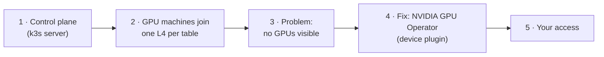

!!! abstract "What you'll see"
    The instructor turns plain GPU machines into a Kubernetes cluster, one command at a time. You'll see the first problem
    (**Kubernetes can't see the GPU**) and how it's fixed. Meanwhile you open Cloud Shell and get the same repo.



!!! step "You · Open Cloud Shell and get the repo"
    Open **[shell.cloud.google.com](https://shell.cloud.google.com)**, sign in, then:

    ```bash
    git clone https://github.com/Sagar2366/gke-gpu-sharing-workshop.git
    cd gke-gpu-sharing-workshop
    ```

    !!! see "You should see"
        Your prompt ends in `~/gke-gpu-sharing-workshop$`. You now have every script the instructor is running.

    ??? tip "Paste not working?"
        Try ++ctrl+shift+v++ (Windows/Linux), ++cmd+v++ (Mac), or right-click → **Paste**.

!!! screen "On the big screen · 1. Start the control plane"
    ```bash
    ./scripts/jarvislabs/01-server.sh
    export KUBECONFIG=$PWD/scripts/jarvislabs/out/admin.kubeconfig
    kubectl get nodes
    ```

    One node, `Ready`. That's the **control plane**: the part that stores what you asked for and decides where things run.
    **k3s** is a small, certified Kubernetes that installs in about a minute.

!!! screen "On the big screen · 2. GPU machines join the cluster"
    ```bash
    ./scripts/jarvislabs/02-gpu-nodes.sh
    kubectl get nodes
    ```

    Every table's L4 machine is now a **node**. Find yours: it's labelled with your table id later.

!!! problem "Problem · Kubernetes can't see the GPU"
    ```bash
    ssh root@<t01-ip> nvidia-smi -L                              # the machine sees its GPU...
    kubectl describe node <t01-node> | grep nvidia.com/gpu       # ...Kubernetes doesn't: nothing printed
    ```

    The GPU, driver and container runtime are all there, but Kubernetes only schedules what a node **advertises**.
    Nobody has told it "this node has a GPU", so a pod asking for one would wait forever.

!!! solution "Fix · Install the NVIDIA GPU Operator (the device plugin)"
    ```bash
    ./scripts/jarvislabs/03-gpu-operator.sh
    kubectl get nodes -o custom-columns='NODE:.metadata.name,TABLE:.metadata.labels.workshop\.devfest/table,GPU:.status.allocatable.nvidia\.com/gpu'
    ```

    The **device plugin** runs on every GPU node and announces `nvidia.com/gpu: 1`. Now pods can ask for a GPU.
    The operator also brings **DCGM** (GPU metrics) and the **MIG manager**. On GKE, Google runs all of this for you.

!!! screen "On the big screen · 3. Monitoring and your access"
    ```bash
    ./scripts/jarvislabs/03b-monitoring.sh      # Prometheus + Grafana with NVIDIA's GPU dashboard
    ./scripts/jarvislabs/06-onboard.sh && ./scripts/jarvislabs/07-serve-kubeconfigs.sh
    ```

    Each of you now has a **namespace** (your private area, like `t07-dosa`) and an access file. Wait for **"go"** from the instructor.

??? question "Curious? Read the scripts while you wait"
    `less scripts/jarvislabs/03-gpu-operator.sh` (press **q** to quit). The sharing settings you'll use later are in
    `scripts/jarvislabs/device-plugin-config.yaml`.
