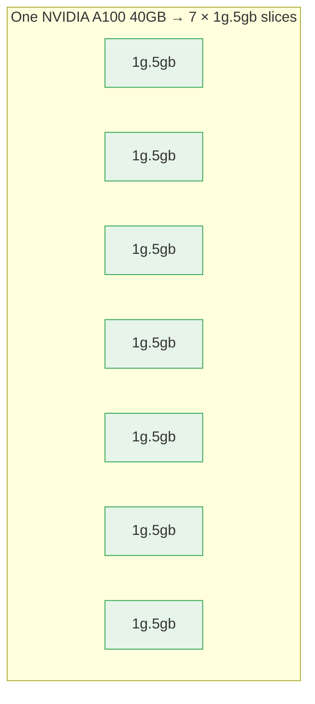

# Step 7 · Multi-instance GPU (MIG)

<div class="lesson-head" markdown>
<span class="pill">Module 2 · Step 7 of 7</span>
<span class="pill time">:material-timer-outline: 10 min</span>
<span class="pill who">:material-account: everyone on their own</span>
[Skip to Step 8 :material-arrow-right:](06-gemma-vllm.md){ .skip }
</div>

!!! abstract "What you'll do"
    This GPU is physically cut into **seven small GPUs**, each with its own cores and memory.
    You'll get one slice and check whether anyone else can affect it.



`1g.5gb` = **1/7 of the cores + 5 GB**. MIG needs a big GPU (A100, H100, H200…).

??? planb "On the Plan B (Jarvislabs) cluster?"
    MIG runs on a **${MIG_PARTITION}** slice of a bigger GPU (for example an H200: `1g.18gb`, 7 slices), set up by NVIDIA's **MIG manager**.
    The commands use `${MIG_PARTITION}`, so they work unchanged. Expect **bigger numbers**: more memory per slice, and memhog tries
    `${MIG_MEMHOG_GIB}` GiB. If the organisers only have one MIG GPU, they may run this lab as a demo on the big screen.

!!! step "Count the slices on one A100"
    ```bash
    MIG_NODE=$(kubectl get nodes -l cloud.google.com/gke-gpu-partition-size=${MIG_PARTITION} -o name | head -1)
    kubectl get $MIG_NODE -o jsonpath='{.status.allocatable.nvidia\.com/gpu}{"\n"}'
    ```

    !!! see "You should see"
        ```text
        7
        ```

    !!! why "Why this matters"
        One physical A100 shows up as **seven** separate GPUs to Kubernetes.

!!! step "Get a slice and look at it"
    {{PROBE_MIG}}

    ```bash
    sleep 25; kubectl logs probe-mig
    ```

    !!! see "You should see"
        ```text
        GPU 0: NVIDIA A100-SXM4-40GB (UUID: GPU-45eafa61-....)
          MIG 1g.5gb      Device  0: (UUID: MIG-7d1c....)
        device                  : NVIDIA A100-SXM4-40GB MIG 1g.5gb
        SMs visible             : 14
        GPU memory free / total : 4.6 GiB / 4.8 GiB
        ```

    !!! why "Compare with MPS"
        Both show a slice of the chip, but here the **total** memory is only ~4.8 GiB. The pod **can't even see** the rest of the GPU.
        No special settings, no `hostIPC`.

    !!! tip "Find your hardware neighbours"
        Compare the first-line `GPU-…` UUID with people around you. **Same UUID = same physical A100**, in different slices.

!!! step "Clean up the probe"
    ```bash
    kubectl delete pod probe-mig
    ```

!!! step "Run the noisy workload on your slice"
    {{BURN_MIG}}

    ```bash
    kubectl logs -f burn-mig
    ```

    !!! see "You should see"
        TFLOPS lines that stay **flat**, even though everyone in the room is doing the same thing and your A100 almost certainly has
        six busy neighbours. Compare numbers with someone on a different A100 and you'll get about the same.

    !!! why "Why this matters"
        Hardware isolation: each slice has its **own** cores, memory and bandwidth. Noisy neighbours can't reach you.

!!! step "Hit the memory wall"
    Press ++ctrl+c++, then:

    ```bash
    kubectl delete pod burn-mig
    ```

    {{MEMHOG_MIG}}

    ```bash
    sleep 25; kubectl logs memhog-mig
    ```

    !!! see "You should see"
        `OUT OF MEMORY` after about **4 GiB**, the size of **your own** slice.

    !!! why "Why this matters"
        Unlike MPS, there's **no environment variable** to raise this. The limit is built into the hardware.

!!! step "Clean up"
    ```bash
    kubectl delete pod --all
    ```

!!! step extra "Try to take two slices"
    ```bash
    kubectl apply -f - <<EOF
    apiVersion: v1
    kind: Pod
    metadata:
      name: two-slices
    spec:
      restartPolicy: Never
      nodeSelector:
        cloud.google.com/gke-gpu-partition-size: ${MIG_PARTITION}
      containers:
      - name: c
        image: ${IMAGE}
        command: ["sleep", "30"]
        resources:
          limits: {nvidia.com/gpu: 2}
    EOF
    sleep 15; kubectl get pod two-slices -o jsonpath='{.status.reason}{"  "}{.status.message}{"\n"}'
    kubectl delete pod two-slices
    ```

    Rejected: **one slice per pod**. Two `1g.5gb` slices don't add up to a `2g.10gb`. Bigger slices need a node pool created with a bigger partition size:

    | GPU | Partition sizes (slices per GPU) |
    |---|---|
    | A100 40GB | `1g.5gb` (7) · `2g.10gb` (3) · `3g.20gb` (2) · `7g.40gb` (1) |
    | A100 80GB | `1g.10gb` (7) · `2g.20gb` (3) · `3g.40gb` (2) · `7g.80gb` (1) |
    | H100 80GB | `1g.10gb` (7) · `1g.20gb` (4) · `2g.20gb` (3) · `3g.40gb` (2) · `7g.80gb` (1) |
    | H200 141GB | `1g.18gb` (7) · `1g.35gb` (4) · `2g.35gb` (3) · `3g.71gb` (2) · `4g.71gb` (1) · `7g.141gb` (1) |

!!! tip "You can combine strategies"
    MIG **plus** time-sharing: `gpu-partition-size=1g.5gb,gpu-sharing-strategy=time-sharing,max-shared-clients-per-gpu=3` gives
    7 × 3 = **21** chairs on one A100. Slices are walled off from each other; pods inside a slice share it softly.

## Test your knowledge

<div class="flipcards">
  <div class="flip">
    <div class="front"><p>How many <code>1g.5gb</code> slices does one A100 40GB give?</p></div>
    <div class="back"><p><b>7</b></p></div>
  </div>
  <div class="flip">
    <div class="front"><p>Can a pod raise its MIG memory limit with an environment variable?</p></div>
    <div class="back"><p><b>No.</b> It's set in hardware.</p></div>
  </div>
  <div class="flip">
    <div class="front"><p>Does an L4 support MIG?</p></div>
    <div class="back"><p><b>No.</b> MIG needs A100, H100, H200, B200 and similar.</p></div>
  </div>
</div>

!!! takeaway "Key takeaway: MIG"
    - **Protects:** cores, memory, cache and bandwidth, in hardware. Predictable, and one slice's crash doesn't affect another.
    - **Costs:** only on the most expensive GPUs; fixed slice sizes per node pool; one slice per pod; no `duty_cycle` metric; unused slices are wasted.
    - **Great for:** sharing between teams that don't trust each other, and workloads with speed guarantees.

!!! checkpoint "Checkpoint"
    You saw `MIG 1g.5gb`, a flat TFLOPS line next to busy neighbours, and a hard memory wall.
    **Next: [Step 8 · Serving Gemma](06-gemma-vllm.md).**
