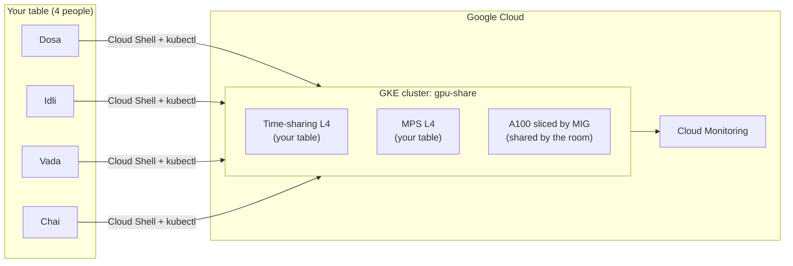
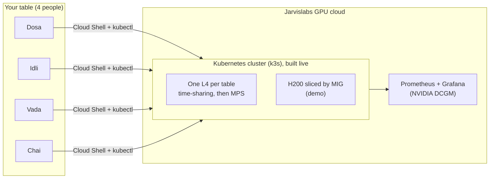

GPUs are the most expensive machines in a cluster, and Kubernetes hands them out **whole**. Today your table of four
shares **one real NVIDIA GPU** three different ways, and finds out what each way protects.

<!-- only:gke -->

<!-- /only -->
<!-- only:jarvislabs -->

<!-- /only -->

### The story

It's Monday at a Bengaluru startup. Finance approved **one** L4 GPU for four teams. Each person at your table plays one:

| Team | Runs | Cares about |
|---|---|---|
| :material-food: **Dosa** | A Gemma chat assistant | Fast answers. Customers are waiting. |
| :material-rice: **Idli** | A nightly batch job | Throughput. It takes everything it can get. |
| :material-cookie: **Vada** | A data-science notebook | Idle most of the time, then suddenly busy |
| :material-tea: **Chai** | Evaluation jobs | Steady, medium load |

By the end you'll know which strategy keeps all four happy, and which one lets Idli quietly ruin Dosa's day.

### What you'll do

- Put four programs on **one GPU** and watch them slow each other down
- Give each team a fixed share with **MPS**, then real hardware slices with **MIG**
- Serve **Gemma** with **vLLM** on a shared GPU, and fix the classic memory crash

### What you'll need

- A laptop with a browser, and the **Google account** you registered with
- Nothing to install: everything runs in **Cloud Shell**, a terminal in your browser
- **No Kubernetes, GPU or Google Cloud experience.** Every command is given, and every task shows what you should see.
  If you have 10 minutes beforehand, do the **[GPU sharing foundations](foundations.md)** codelab first.
- You **don't** need your own cloud project, credits or GPUs on the day: the organisers run a shared cluster for you.

!!! info "How it works"
    Small **tasks**: copy a command, check **You should see**, click **Mark as done**. **Extra** tasks are optional.

**Estimated time:** 90 minutes, at the workshop (3:00–4:30 PM).
<!-- only:gke -->
**Tested with:** GKE Standard (regular channel), NVIDIA L4 and A100 40GB, vLLM, Gemma 3 1B.
<!-- /only -->
<!-- only:jarvislabs -->
**Runs on:** Jarvislabs GPU VMs (NVIDIA L4, H200 for MIG), k3s, NVIDIA GPU Operator, vLLM, Gemma 3 1B. The cluster is labelled
like GKE, so the same commands also work on Google Kubernetes Engine.
<!-- /only -->
