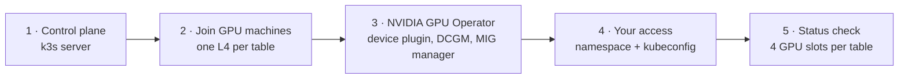

<!-- only:jarvislabs -->
## Watch the cluster being built

!!! abstract "What you'll do"
    Watch the big screen while the instructor builds today's GPU cluster **live**, from bare machines to a working Kubernetes cluster
    in about 10 minutes. While it builds, you'll open Cloud Shell and download the same scripts, so you can read along and run them yourself later.


<!-- /only -->
<!-- only:gke -->
## Open Cloud Shell and get the repo

!!! abstract "What you'll do"
    Open a terminal in your browser and download the workshop files.
<!-- /only -->

!!! step "Open Cloud Shell"
    Go to **[shell.cloud.google.com](https://shell.cloud.google.com)** and sign in with your Google account. Accept the terms if asked.

    !!! see "You should see"
        A terminal with a prompt like `you@cloudshell:~$`.

    !!! tip "Paste not working?"
        Try ++ctrl+shift+v++ (Windows/Linux), ++cmd+v++ (Mac), or right-click → **Paste**.

!!! step "Get the workshop repo"
    ```bash
    git clone https://github.com/YOUR-ORG/gke-gpu-sharing-workshop.git
    cd gke-gpu-sharing-workshop
    ```

    !!! see "You should see"
        A few lines ending in `done.`, and your prompt ends in `~/gke-gpu-sharing-workshop$`.

    !!! why "Why this matters"
        Everyone now has the **same repo** the instructor uses: same scripts, same settings.

<!-- only:jarvislabs -->
!!! step "Follow along in the scripts"
    Open the script the instructor is running. For example, stage 3:

    ```bash
    less scripts/jarvislabs/03-platform.sh       # press q to quit
    ```

    | Stage on screen | Script | What it does |
    |---|---|---|
    | 1 · Control plane | `01-server.sh` | Installs **k3s**, a small certified Kubernetes, on a CPU machine |
    | 2 · Join GPU machines | `02-gpu-nodes.sh` | Each table's **L4 GPU machine** joins the cluster as a node |
    | 3 · GPU platform | `03-platform.sh` | Installs NVIDIA's **GPU Operator**, turns on GPU sharing, adds monitoring |
    | 4 · Your access | `06-onboard.sh`, `07-serve-kubeconfigs.sh` | Creates **your namespace** and a personal access file |
    | 5 · Status | `status.sh` | Checks every table GPU shows **4** shareable slots |

    !!! why "Why this matters"
        A managed service like GKE does stages 1–3 for you. Watching them by hand shows you **what a GPU platform actually manages**:
        the driver, the device plugin that "advertises" GPUs, and the sharing configuration.

!!! step "Wait for \"CLUSTER READY\""
    When the big screen shows the green **CLUSTER READY** banner, go on to *Connect and run your first pod* below.

    !!! see "You should see (on the big screen)"
        ```text
          CLUSTER READY in 11 min    Attendees can now run:  source scripts/attendee/setup.sh <table> <team>
        ```

    ??? question "Finished early? Peek at the GPU sharing settings"
        ```bash
        cat scripts/jarvislabs/device-plugin-config.yaml
        ```

        `ts4` is **time-sharing** with 4 slots per GPU, `mps4` is **NVIDIA MPS** with 4 shares, `mig` turns on **MIG slices**.
        You'll use all three today.

### Quick check

<div class="quiz" data-answer="b">
  <p class="q">Which component tells Kubernetes "this node has 4 GPUs" when it physically has one?</p>
  <button data-opt="a">The k3s server</button>
  <button data-opt="b">The NVIDIA device plugin, using its time-sharing config</button>
  <button data-opt="c">Cloud Shell</button>
  <div class="explain">The <b>device plugin</b> runs on every GPU node and advertises <code>nvidia.com/gpu</code>. With a time-sharing config of 4 replicas, one physical GPU shows up as 4.</div>
</div>
<!-- /only -->
