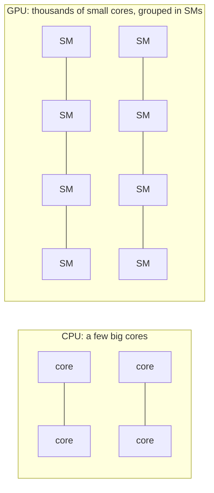

# Accelerated compute

AI is mostly **huge amounts of simple maths**: multiplying big grids of numbers, billions of times.

- **CPU**: a few powerful cores, one task after another. Great for everything else.
- **GPU**: thousands of small cores doing the same maths **at once**. Great for AI.
- **GPU memory** is a fixed size (24 GB on today's L4). Fill it and programs crash with **"CUDA out of memory"**.
- GPUs are **expensive**. One that sits 90% idle is a lot of wasted money, and that's what today is about.

| Word you'll see | Means |
|---|---|
| **SM** | a block of GPU cores (the L4 has 58) |
| **TFLOPS** | trillions of maths operations per second: our speedometer |

### Quick check

  

    

Thousands of small cores doing maths at the same time.

    

<b>GPU</b>

  

  

    

What happens when GPU memory is full?

    

The next program to ask for memory crashes: <b>CUDA out of memory</b>.

  

